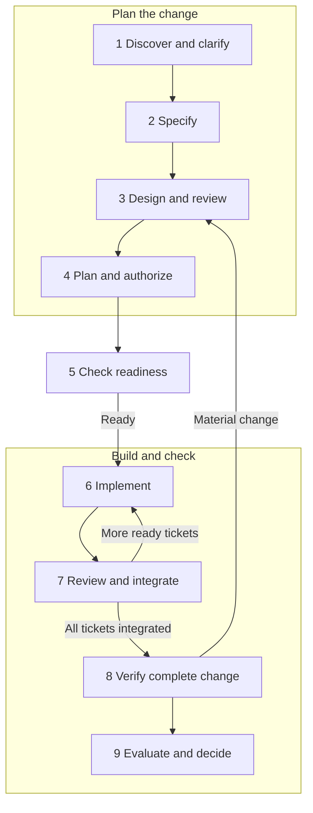

# pi-adapted-mp-skills

Matt Pocock's development workflow adapted for Pi. A planner clarifies and designs changes; a coordinator uses Paseo to launch implementation and independent review sessions.

**0.2.0, unreleased.** This is a selective upgrade to [upstream v1.3.1](https://github.com/mattpocock/skills/tree/v1.3.1), not a wholesale rebase. Source pins remain in each skill. See [migration](docs/MIGRATION-0.2.md), [workflow](docs/WORKFLOW.md) and [changelog](CHANGELOG.md).

## SWE process at a glance

This repository supplies **procedures and focused helpers** for taking a change from an uncertain need to a reviewed, verified result. The numbered stages describe work in a **software project that uses this package**, not steps for validating this repository's PRs. Planning settles what to build and how; execution builds only accepted work and checks the combined result.



Research, grilling, prototypes and optional Wayfinder help resolve Stage 1 questions; a spec, design and implementation tickets make Stages 2–4 inspectable. At Stage 5 the coordinator checks that accepted inputs, models, tracker and test resources are ready. The tracker holds tickets, claims and evidence links. Paseo launches workers in separate Git worktrees; fresh reviewers examine committed candidates, and the coordinator integrates and verifies them **one at a time**. Only verified integration unblocks dependent tickets. The human owns consequential choices and the final delivery decision. If a check fails, return to the **affected stage**; the arrows show the common routes, not an automatic scheduler.

See [stage owners, artifacts and completion checks](docs/WORKFLOW.md#stages-owners-and-completion-conditions) for the exact meaning of each stage. Use the [manual](docs/MANUAL.md) for setup and commands, or the [PR validation guide](docs/PR-VALIDATION.md) to test this package with the separate quotation lab.

## Documentation map

Choose one route. **Using the skills in a software project?** Read [WORKFLOW](docs/WORKFLOW.md) for the lifecycle, [MANUAL](docs/MANUAL.md) for setup, project folders, artifacts, tools and day-to-day operation, and [ARCHITECTURE-GUIDE](docs/ARCHITECTURE-GUIDE.md) for design review and acceptance. Those guides describe normal project work; use your project's own requirements, design and tests.

**Evaluating these proposed package changes?** Follow [PR-VALIDATION](docs/PR-VALIDATION.md) from its first step. That separate guide owns the disposable quotation lab, its planning rehearsal, design exercise, commands, failure drills and evaluation. Record live results in [workflow validation](docs/VALIDATION-REPORT.md) and [architecture validation](docs/ARCHITECTURE-VALIDATION.md); these templates are only for assessing the PRs. The lab [fixture README](examples/validation-lab/README.md) describes its generated application.

| Question | Project route | PR validation route |
| --- | --- | --- |
| What are the lifecycle stages, owners and gates? | [Workflow stage map](docs/WORKFLOW.md#stages-owners-and-completion-conditions) | [Validation steps and checks](docs/PR-VALIDATION.md) |
| What are `docs/agents`, specs, designs, ADRs, maps and `.scratch` efforts? | [Manual folders and artifacts](docs/MANUAL.md#project-folders-and-effort-directories) | [Lab setup](docs/PR-VALIDATION.md#2-create-and-configure-the-lab) |
| How do design review and readiness work? | [Architecture guide](docs/ARCHITECTURE-GUIDE.md#operational-route-and-completion-checks) | [Quotation design exercise](docs/PR-VALIDATION.md#3-review-the-quotation-design) |
| How do I run and inspect the agents? | [Manual setup and use](docs/MANUAL.md#prepare-the-execution-host) | [Lab execution](docs/PR-VALIDATION.md#4-execute-the-ticket-graph) |

The [skills](skills/) and [shared policies](skills/engineering/_shared/) give agents exact procedures. The [migration notes](docs/MIGRATION-0.2.md) and [changelog](CHANGELOG.md) describe package changes. Historical documents are provenance, not current operating instructions.

## Start

Install the complete package from a checked-out version you intend to use:

```bash
pi install /absolute/path/to/pi-adapted-mp-skills
```

After this change is merged, the repository install picks it up:

```bash
pi install git:github.com/netname/pi-adapted-mp-skills
```

There is no claim that 0.2.0 is published to npm. Do not also install duplicate skill copies. The package includes role briefs, scripts and sidecars; copying SKILL.md alone is insufficient.

Run `/skill:setup-matt-pocock-skills` in the target project. It configures the tracker, domain docs, delegation profiles and testing contract. `/skill:ask-matt` routes uncertain work.

| Need | Skill |
| --- | --- |
| Resolve a large set of planning decisions | `wayfinder`; loop ready research, pause for human decisions |
| Clarify a change | `grill-with-docs` |
| Publish requirements | `to-spec` |
| Explain and independently review the design | `design-solution`, `review-design` |
| Approve the dependency graph and requirement coverage | `to-tickets`, then final design/plan readiness check |
| Execute the graph without launching tickets manually | `implement-spec` |
| Implement one ticket | `implement` |
| Independently review a committed candidate | `code-review` |
| Write delivery evidence / improve the workflow | `pr` / `retro` |

The remaining diagnosis, architecture, productivity and guardrail skills remain available under `skills/`. There are 30 skills; the obsolete conflict-resolution skill is retired.

## Roles and prerequisites

Use Paseo profiles to choose actual providers/models on your host. A useful starting point is Claude Code for planning and both review axes, with Pi/DeepSeek for implementation. The reviewer family must differ from **all** implementation families in its candidate. The harness name alone does not establish independence. No model subscriptions or global packages are changed by this package.

Paseo delegation and primary-source access are required only by work that uses them. Planning works without those capabilities. `pi-subagents` and `pi-web-access` are no longer mandatory. The files in `agents/` are portable task briefs passed explicitly by the coordinator; they are not registered Pi subagents or automatically discovered Paseo profiles.

Enable Paseo tools on the host or use its CLI. See [Paseo orchestration](https://paseo.sh/docs/orchestration) and [agent profiles](https://paseo.sh/docs/agent-profiles). This package remains Pi-native: it does not automatically install skills into Claude Code. Supply relevant project instructions and role briefs explicitly to delegated sessions.

## Tests and helpers

The execution helpers support Node.js 20+ and Git. Use Node 24 LTS for the full validation walkthrough and check the installed agent CLIs' requirements. Execution helpers remain dependency-free; package validation uses a pinned development-only YAML parser.

```bash
npm ci
npm test
npm run smoke
node scripts/frontier.mjs /path/to/graph.json
node scripts/review-target.mjs --repo /absolute/worktree --base BASE --head HEAD
```

The frontier helper validates dependencies and prints ready IDs. The review helper rejects staged, unstaged and untracked work, pins commits, and writes a manifest/diff outside the worktree. Neither is a standalone background scheduler. `implement-spec` drives the loop through Paseo, with durable state in the tracker.

`npm run drift` compares against the v1.3.1 baseline, including deliberate adaptations and skills still sourced from the original pin. It is a review aid, not proof that everything was upgraded. After `npm ci`, `npm test` is offline; live Paseo acceptance is documented separately.

MIT. Original methodology © Matt Pocock; attribution and source pins in [NOTICE](NOTICE). Historical v0.1 docs remain for provenance and are explicitly superseded by the current workflow.
