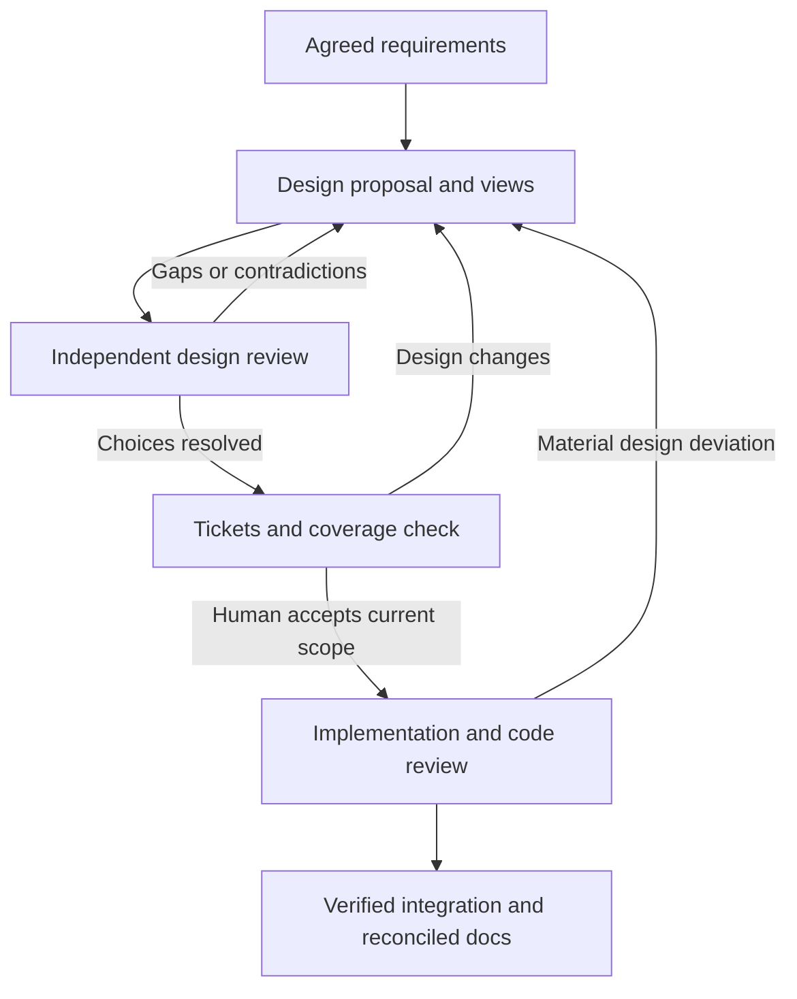

# Understand and approve the design before building it

This guide extends the [setup and SWE manual](MANUAL.md) with design explanation, visualization and independent review. It describes a local extension to Matt Pocock's adapted skills, not a feature attributed to upstream. The architecture branch depends on the workflow work in PR #1; validate these additions separately from live implementation orchestration. The older commit-linked edition remains historical; use the guide from the same package revision you are testing.

Start at the [repository README](../README.md#documentation-map). Within this guide: [purpose and solution overview](#1-the-purpose-and-overall-process) → [owners](#2-who-does-what) → [minimum artifacts and actions](#3-choose-an-appropriate-amount-of-design) → [artifact locations](#4-artifacts-and-their-relationships) → [operational route](#operational-route-and-completion-checks) → [worked example](#6-worked-example-understand-the-quotation-tool).

## 1. The purpose and overall process

A spec tells you what users need and what counts as correct. A design explains how the proposed software will meet those requirements. It should let you answer: What components exist? Who owns each responsibility and each piece of data? What happens during success and failure? Why choose this structure over a simpler alternative? How will we know it works?

The process is: clarify requirements; propose a design; independently explain and challenge it; resolve choices with you; break it into tickets; check the plan's coverage; authorize execution. During implementation, reviews compare code with the accepted decisions. At delivery, the documentation is reconciled with what was actually built.



Design review occurs before significant decomposition, and the final readiness checkpoint occurs after decomposition. This prevents both planning the wrong system and starting with a plan that omits part of the accepted design. Earlier review can be reused when its scope remains valid; the final record must identify the current inputs and any targeted refresh.

### Which solution are we explaining?

There are two related subjects. Keeping them separate makes the goals, owners and file locations easier to understand:

| Subject | Goal | Components | Where its overview belongs |
| --- | --- | --- | --- |
| This skills package | Turn an agreed change into inspectable decisions, scoped parallel work and a verified result without manually launching each ticket | Skills, role briefs, configured agent sessions, tracker conventions, Git worktrees and focused helper scripts | [WORKFLOW.md](WORKFLOW.md#solution-overview), with setup/operation in [MANUAL.md](MANUAL.md) |
| The generated quotation application | Read a local product catalog and return a quote for one product and whole quantity | CLI, catalog reader, pricing function and read-only JSON input | The application's `docs/architecture/overview.md`; the package ships its [starting template](../examples/validation-lab/template/docs/architecture/overview.md) |

The package's goals are to make the proposed behavior understandable before coding, permit parallel implementation when dependencies allow it, obtain independent feedback and retain enough evidence to resume or accept work. A correct application and a correctly followed development workflow are separate validation subjects.

For the application, the operator supplies a catalog path, SKU and quantity. The CLI coordinates the catalog reader and pricing function, then presents either the quote or a user-facing error. The [application overview](../examples/validation-lab/template/docs/architecture/overview.md) explains each component's responsibility, goals and success/failure paths. Its [spec](../examples/validation-lab/template/docs/specs/quote.md) remains authoritative for exact behavior. The proposed `src/` modules are created during implementation; they are deliberately absent from the scaffold.

### What belongs here and what belongs elsewhere?

This guide explains **how to prepare, inspect, review and accept a design**, including a worked walkthrough. It provides enough solution context to orient you. It is not the authoritative architecture document for every application built with these skills.

- Keep this package's component responsibilities and enforcement limits in [WORKFLOW.md](WORKFLOW.md#solution-overview).
- Keep a particular application's goals, actors, component responsibilities and main scenarios in its `docs/architecture/overview.md`.
- Keep the reasoning for one proposed change in `docs/designs/<feature>.md`, linked to the overview and authoritative spec. Significant accepted choices may have ADRs.
- Keep commands, test resources and provider settings in `docs/agents/` contracts, so the design does not maintain another copy of those settings.

The quotation overview is supplied as teaching material, then copied into your new application. In a normal project the planner creates or updates that overview while inspecting/designing the change. At delivery, the coordinator reconciles it with the integrated source and evidence. A proposed overview must not claim that its components already exist.

## 2. Who does what?

An **owner** is the person or session accountable for a decision or handoff. This differs from a component's responsibility: the pricing function owns arithmetic at runtime, while a human owns whether the proposed design is acceptable. Tools execute actions; they do not become the business decision owner.

### Name the human and session owners

For a solo project, you are usually the application owner and validation operator. Write your actual name or role in the project's architecture contract. In a team, identify the person authorized to resolve scope/tradeoffs and the person maintaining the workflow configuration. They may be the same person. Do not leave an unassigned “someone approves this” responsibility.

| Owner / role | What they are accountable for | Actions and limits | Durable handoff |
| --- | --- | --- | --- |
| Human application owner | Goal, scope, consequential tradeoffs and final acceptance | Answers business questions and accepts/rejects the actual proposal; agents cannot invent this decision. Existing explicit authorization is reused when it covers the current scope | Decision reference linked to the exact accepted inputs in the readiness record |
| Human validation operator | Running the experiment and judging observed workflow behavior | Inspects actual models, worktree placement and evidence; records PASS/FAIL/BLOCKED/NOT RUN rather than accepting an agent's assertion | [Workflow](VALIDATION-REPORT.md) and [architecture](ARCHITECTURE-VALIDATION.md) reports |
| Package/project maintainer | Reusable policies and the target project's role/path/tool configuration | Fixes workflow defects in the skills repo and configures application contracts. An application worker does not silently change the skills package to bypass a gate | Package revision under test and application `docs/agents/` configuration |
| Planner / design author | A proposal that explains the agreed behavior, feasible structure and alternatives | Reads source, asks necessary questions, drafts/updates the spec/design/overview and prepares coverage. Records unknowns and proposals; does not mark its own proposal accepted | Spec, design, overview, applicable ADRs and model, with author/source provenance |
| Comprehension reviewer | An independent explanation of what is proposed | Uses a fresh session to reconstruct components/scenarios and trace requirements; reports unclear language or missing information without inheriting the drafting conversation | Its own report, run/model details and reviewed input identities |
| Challenge reviewer | An independent assessment of omissions, alternatives and risks | Uses another fresh session to challenge concrete gaps; distinguishes blockers from preferences. Recommends readiness but cannot approve for the human | Separate report and evidence-based findings |
| Coordinator | Correct execution of the approved scope, including readiness and recovery | Sole tracker/integration writer for the effort; launches workers, checks actual settings, preserves reports, controls repairs and serializes integration. Cannot override unresolved product decisions or turn failed evidence into a pass | Claims/run IDs, candidate SHAs, verification/review evidence and integrated revisions |
| Implementation worker | One assigned ticket in its allocated worktree | Implements within approved constraints, runs applicable checks and commits its candidate. Does not update the shared tracker, integrate other work or launch duplicate reviews | Base/head, actual implementation family, commands/results and remaining issues |
| Code reviewers | Whether the committed candidate meets the spec and documented standards | Separate fresh Spec and Standards sessions inspect exact candidate context; return reports while the coordinator owns their persistence. They do not edit the candidate or run tests | Findings tied to immutable base/head, with dispositions maintained by the coordinator |

The planner and coordinator can use the same harness/model. The role change is explicit: after acceptance, the coordinator follows the approved artifacts and dispatches work instead of quietly making new product decisions. Implementation workers and reviewers are separate fresh sessions with the configured model-family independence.

### Who writes and who accepts?

The planner drafts decision-bearing artifacts. Reviewers own their findings. The coordinator preserves reports and records the human's actual decision; recording that decision is different from making it. The human accepts the proposal/plan and later decides whether the complete delivered result meets the goal.

Two handoffs matter: review the design before substantial decomposition, then check the final tickets and coverage before dispatch. An earlier approval can cover the later handoff if scope and inputs remain applicable; otherwise refresh the affected review and obtain the needed decision. Do not ask the same business question again merely because a different agent started.

### What Paseo, the tracker and profiles own

Paseo launches and exposes agent sessions and workspaces. The tracker stores durable tickets, claims, transitions and evidence references. A profile saves launch settings for a role. The coordinator is the active agent responsible for using all three correctly. A profile named “review” and a ticket labelled “ready” do not themselves establish independent review or design acceptance. See [the package's component map](WORKFLOW.md#components-and-responsibilities).

For the Claude-planning / Pi-implementation example, use two fresh Pi design-review sessions with an available DeepSeek model, or another verified family different from all design authors. Code review can use Claude when all implementation contributors used DeepSeek. If Claude contributes implementation code, it no longer meets that candidate's code-review independence rule. Record effective settings, not just profile names, in `docs/agents/delegation.md` and the run evidence. Exact model versions come from the host's available configuration.

## 3. Choose an appropriate amount of design

“Useful minimum” means the smallest set of **decisions, references, artifacts and actions** that lets another session implement and review the change without guessing. It does not mean creating every possible document, and it is not permission to skip an unresolved requirement or failed review.

### Choose a route

| Situation | Useful minimum | Add only when it explains a real decision |
| --- | --- | --- |
| Small fix inside accepted boundaries | Existing requirement/issue reference, a short design note, reused decisions, specific checks, scoped ticket and applicable review/acceptance evidence | A diagram or new ADR if existing documentation cannot explain the change |
| Greenfield feature/application | Agreed requirements, intended actors/components/interfaces, success/failure paths, alternatives and verification mapping | Shared LikeC4 model when several views benefit from consistent identities |
| Brownfield feature | The above plus evidence-backed current state at a named commit and proposed differences | Transition, compatibility, migration and rollback when the change needs them |
| Cross-cutting boundary/data change | Full change design, explicit ownership/contracts, significant ADRs and verification for the affected boundaries | Deployment/resource model and operational checks when relevant |

Lightweight reduces the amount of prose and optional modeling. This package still expects applicable independent review and actual human acceptance. The configured readiness helper requires both recorded review axes; it does not automatically waive one for a small note. Reuse existing reports/authorization only when they genuinely cover unchanged inputs and scope. Missing evidence remains incomplete.

### Build the minimum in order

These are application-repository paths unless otherwise stated. Existing artifacts may be reused; “create” does not mean duplicate them for each change.

| When | Action and responsible role | Minimum artifact / location | How to know it is enough |
| --- | --- | --- | --- |
| Once per project, before execution | Maintainer/planner runs setup and preserves current conventions | `AGENTS.md` plus `docs/agents/architecture.md`, `delegation.md`, `testing.md` and `issue-tracker.md` | Paths, actual role settings, commands and owners are usable; no blocking placeholders |
| When behavior is clarified | Planner synthesizes agreed requirements, normally with `to-spec` | `docs/specs/<feature>.md` or an authoritative tracker issue | Stable requirement references, examples/exclusions and observable acceptance; no unresolved product choice hidden as an implementation assumption |
| Before design review | Planner creates a scoped proposal with `design-solution` | `docs/designs/<feature>.md`, starting from [the design template](../skills/engineering/_shared/design.template.md) | Explains what changes, responsibilities, a success/failure path, consequences and checks; a short note can link existing overview/ADRs |
| When system context is missing or changes | Planner creates/updates the application overview; records a significant decision if needed | `docs/architecture/overview.md`; optional `docs/adr/<decision>.md`; optional model under `docs/architecture/model/` | The reader can place the change in the system. No new diagram or ADR is needed merely to fill a folder |
| Before major decomposition | Coordinator arranges `review-design`; fresh reviewers explain/challenge the proposal | Reports in the configured evidence store; the lab uses `docs/designs/reviews/` | Both axes actually ran against identified inputs; blockers have dispositions; unresolved choices return to the human |
| After the design is understood | Planner uses `to-tickets`; human confirms scope/breakdown; coordinator checks consistency | Tickets in the configured tracker and requirement → component → ticket → check mapping, normally `docs/designs/<feature>-traceability.md` | Every in-scope requirement has coverage; blockers and resource assumptions make execution feasible |
| Before any affected worker is dispatched | Coordinator records final reviewed inputs and actual acceptance, then checks readiness | `docs/designs/<feature>-readiness.json` when using the supplied helper; include a stable approved-ticket snapshot among its inputs | Files/reports match the accepted target, required reviews are complete, real acceptance is linked and the readiness command passes |

For a lightweight change, the design note can contain the short coverage table and links to existing decisions. One ticket can be sufficient; the traceability table need not become a separate file. The machine record and evidence still identify the applicable files. For remote requirements/tickets, preserve an immutable export or revision reference; do not hash a URL string and imply its changing content was reviewed.

### Example of a lightweight note

For a later request to clarify the quotation CLI's existing error message, `docs/designs/quote-error-message.md` could link R3, explain the wording change, state that CLI ownership and exit/stdout/stderr behavior remain unchanged, identify the affected ticket and CLI assertions, and link existing decisions. That single note can carry the mapping and tradeoff explanation. A new component model or ADR adds little unless the request changes a boundary or contract. This is an example of a future scoped change, not an instruction to alter the supplied lab behavior now.

### What the lab has already created for you

The generator copies the spec, draft overview/design, proposed ADR, optional teaching model and coverage from [the fixture template](../examples/validation-lab/template/). It copies [the supplied tickets](../examples/validation-lab/tickets/) into the ignored local tracker, creates the derived graph, and assembles `docs/designs/quote-plan.md` as a stable ticket-scope snapshot. That plan file exists only after generation; there is no separate hand-maintained template copy to find.

The full route is intentionally supplied for teaching. In real work the planner would prepare these artifacts; in the lab you inspect the supplied proposal instead of inventing another application. You still configure actual profiles, run independent reviews, resolve findings and make a real acceptance decision. The initial `quote-readiness.json` is draft. No generated file is evidence that a live review ran.

Markdown carries explanation and decisions. Mermaid is convenient for a small diagram. LikeC4 is useful when multiple views share component identities. A model is an authored description; syntax validity alone cannot establish that it includes every requirement or matches source code.

For brownfield, inspect code, configuration and tests at a named commit. Mark claims observed, inferred or unknown, and separate current, target and transition. In the greenfield quotation lab there is no existing application source to reverse-engineer before implementation.

## 4. Artifacts and their relationships

### Resolve the three locations first

| Location | Variable / example | What belongs there |
| --- | --- | --- |
| Skills package checkout | `MP_SKILLS`, for example `$HOME/code/pi-skills-design-validation-01` | This guide, skill procedures, briefs, helper scripts and fixture templates |
| Generated application repository | `MP_LAB`, for example `$HOME/code/quote-workflow-lab-01` | The application's spec, overview, design, tests, eventual source and project contracts |
| Canonical tracker/evidence root | In this lab, `$MP_LAB/.scratch/quote-demo` | Authoritative ticket state, claims/events and execution evidence; all worktrees use this same absolute root |

In prose, `docs/architecture/overview.md` below means the file inside **the application**. A Markdown link starting `../examples/validation-lab/template/…` opens the **package template** on GitHub. The generator copies and substitutes paths into the application version. Do not edit the template as a substitute for reviewing a generated application's design.

`MP_SKILLS` and `MP_LAB` are shell variables you set; a fresh shell may not contain them. Agent prompts should receive their expanded absolute values, because a Paseo session does not automatically inherit every variable from your terminal. The coordinator supplies workers with explicit project and tracker paths. The ignored tracker/evidence directory needs separate retention; a source commit does not back it up.


| Artifact | Purpose | Typical location in the application repository |
| --- | --- | --- |
| Spec | Authoritative behavior and exclusions, stable requirement IDs | docs/specs/feature.md or tracker |
| Overview/model | System boundaries and shared views | docs/architecture/ |
| Feature design | Proposed change, scenarios and tradeoffs | docs/designs/feature.md |
| ADR | Significant decision, alternatives and consequences | docs/adr/ |
| Traceability | Requirement → component → ticket → observable check | docs/designs/feature-traceability.md |
| Readiness record | Exact files, completed reviews and human acceptance reference | docs/designs/feature-readiness.json |
| Project contract | Paths, roles, tooling and readiness rules | docs/agents/architecture.md |

The skills repository ships reusable procedures, templates and a teaching fixture. Each application owns its real architecture. Do not put every application's model into this skills package. Do not duplicate the requirements into each diagram or ticket; link IDs to the authoritative spec.

An ADR is a short decision record, not a long design document. For example: integer cents were selected because exact cents are required, floating-point amounts would require additional rounding rules, and fractional quantities are excluded. Supersede an accepted decision when it changes; retain the history explaining why.

### Operational route and completion checks

Use this table as the execution order. The main manual owns host installation, worktree execution and delivery commands; this guide owns the design/review operations between setup and dispatch. Skill files are the agent's procedures. Neither document's prose automatically runs a command.

| Step | Who acts and what to do | Input → output / completion check | Exact instructions |
| --- | --- | --- | --- |
| 1 | Operator installs/verifies CLIs on one execution host and proves authentication | Working host → Pi and Claude actually run there | [Manual §4](MANUAL.md#4-prepare-the-execution-host) |
| 2 | Operator checks out the package branch and runs its offline tests | Package revision → recorded skills SHA and passing package checks | [This guide §5](#5-set-up-the-extension) |
| 3 | Operator generates a new, separate lab and installs its project-local package | Package fixture → application repo and canonical local tracker | [Manual §11](MANUAL.md#11-worked-example-create-the-quotation-lab), repeated bootstrap in [§6 below](#prepare-the-lab-before-review) |
| 4 | Maintainer/operator configures profiles/contracts, then commits the initial baseline | Supplied configuration → actual settings, usable commands and an initial lab SHA | [Manual §6](MANUAL.md#6-configure-paseo-and-profiles), [§7](MANUAL.md#7-configure-each-software-project), and [baseline instructions](MANUAL.md#generate-a-new-directory) |
| 5 | Planner explains/updates the proposal and its overview; operator inspects the views | Agreed requirements → understandable proposed components and choices | [Explain the proposal](#explain-the-proposal) and [visualize](#visualize-and-validate) |
| 6 | Coordinator arranges fresh comprehension/challenge sessions and preserves findings | Frozen proposal → two real reports and dispositions | [Run independent review](#run-independent-review-and-check-the-plan) |
| 7 | Planner/coordinator checks tickets and coverage against the design | Reviewed design → consistent scoped plan; refresh affected review if it changes the proposal | [Same review/plan handoff](#run-independent-review-and-check-the-plan); general ticket process: [to-tickets](../skills/engineering/to-tickets/SKILL.md) |
| 8 | Human accepts the actual current target; coordinator records it and checks readiness | Final input identities/reports → acceptance reference and successful check | [Capture inputs](#capture-exact-inputs), [record acceptance](#record-acceptance-and-check-readiness) |
| 9 | Operator/coordinator commits planning artifacts and records the execution baseline; coordinator dispatches | Current accepted artifacts → worker-ready committed starting point | [Commit and hand off](#commit-and-hand-off-to-execution), then [manual §12](MANUAL.md#12-execute-the-graph-and-observe-it) |
| 10 | Coordinator verifies/reviews integrated code; operator inspects results and failure drills | Committed candidates → application and workflow evidence, final human decision | [Manual §13](MANUAL.md#13-inspect-the-final-result), [§14](MANUAL.md#14-negative-exercises-prove-failures-remain-failures), [§15](MANUAL.md#15-decide-whether-pr-1-is-ready), and [this guide §7](#7-failure-exercises-and-acceptance-evidence) |

Stop at the first incomplete prerequisite and record what is missing. Examples: no working independent profile means review is incomplete; a draft readiness record means workers must wait; a passing package test suite does not mean either live review or implementation was performed. Reuse established decisions rather than restarting the interview at each row.

## 5. Set up the extension

Use a separate checkout so you can compare this dependent PR with PR #1. Keep it and the generated application as sibling repositories under `$HOME/code`, outside existing application repositories:

```bash
export MP_SKILLS="$HOME/code/pi-skills-design-validation-01"
mkdir -p "$HOME/code" &&
git clone --branch improve/architecture-design-review --single-branch \
  https://github.com/netname/pi-adapted-mp-skills.git \
  "$MP_SKILLS" &&
cd "$MP_SKILLS" &&
git rev-parse --show-toplevel &&
git rev-parse HEAD &&
npm ci &&
npm test
```

The explicit absolute destination makes the clone independent of your starting directory. The `&&` chain stops at the first failure, including a failed clone or `cd`; it cannot fall through to npm commands in another project. If the destination exists, inspect it or choose a new numbered name. Verify the printed root, record the new skills-under-test SHA and keep that revision fixed for the run. See the manual for [user-owned CLI installation and PATH](MANUAL.md#4-prepare-the-execution-host), including recovery from npm EACCES errors.

These Bash commands work on Linux or a configured Windows Bash environment such as WSL. See the main manual for host/harness setup. The Node helpers use portable filesystem APIs; Windows behavior has not been exercised by this PR's Linux checks. `MP_SKILLS` identifies the package checkout; it is not your application directory. There are now 30 skills and 23 offline tests. `npm ci` installs the pinned development-only YAML parser; execution helpers and the generated application remain dependency-free.

Install the complete checkout with the manual's Pi installation method. Avoid duplicate old/new skill registrations. Claude Code can read the explicit skill and project files as described in the manual; this does not automatically register Claude slash commands.

At the end of this section only the skills checkout has been prepared. Create/open the application in section 6 before running project setup. Setup then preserves existing conventions and adds the architecture contract alongside delegation/testing. Configure the actual design-review profiles and named human owner. Templates are starting points, not accepted records.

## 6. Worked example: understand the quotation tool

Create the disposable quotation lab using section 11 of the main manual, using the new `MP_SKILLS` path and `$HOME/code/quote-workflow-lab-01` as `MP_LAB`. The generated application is a standalone CLI that reads a local JSON catalog and uses Node's standard library; no external application or runtime service is assumed. Provider authentication and optional diagram downloads belong to validation tooling, not the application runtime. The generator now includes a **draft** design, LikeC4 model, proposed ADR, coverage table and ticket scope snapshot. It deliberately includes neither a completed application nor accepted design evidence.

### Prepare the lab before review

The complete host/provider setup is in [manual §4](MANUAL.md#4-prepare-the-execution-host); profile configuration is in [§6](MANUAL.md#6-configure-paseo-and-profiles). If you have already generated this lab, keep its actual `MP_LAB` path and existing evidence instead of running the generator over it. A package update does not update files already copied into a lab. To validate a changed fixture, generate a fresh numbered lab and record the new package SHA; do not copy new templates over accepted inputs and retain the old approval. For a fresh run, execute:

```bash
export MP_LAB="$HOME/code/quote-workflow-lab-01"
mkdir -p "$HOME/code" &&
node "$MP_SKILLS/examples/validation-lab/create.mjs" "$MP_LAB" &&
cd "$MP_LAB" &&
git init -b main &&
pi install -l "$MP_SKILLS"
```

The destination must be new. The package and lab are separate sibling repositories. Run project setup and populate actual role settings as described in [manual §7](MANUAL.md#7-configure-each-software-project), preserving the supplied spec, tests and canonical tracker root. Record the operator/decision owner, both design-review profiles, code-review profiles and the actual model families. Do not launch implementation yet.

After configuration, commit the initial lab baseline using [manual §11](MANUAL.md#generate-a-new-directory), and copy/fill the [workflow](VALIDATION-REPORT.md) and [architecture](ARCHITECTURE-VALIDATION.md) report templates in the canonical tracker directory. Keep the initial lab SHA separate from the skills-package SHA. The ignored tracker/evidence is not saved by that commit.

The supplied overview describes proposed components. Read it first, then use the spec to check exact behavior. Runtime files such as `src/cli.mjs` are intentionally created later by workers; a missing `src/` before dispatch is expected.

Before launching A/B workers, read these files in the generated application:

1. `docs/specs/quote.md`: R1–R4 define behavior.
2. `docs/architecture/overview.md`: responsibilities and intended state.
3. `docs/designs/quote.md`: alternatives, consequences and scenarios.
4. `docs/adr/001-integer-cents.md`: arithmetic decision.
5. `docs/designs/quote-traceability.md` and `quote-plan.md`: coverage and proposed work.

You should be able to explain why pricing knows nothing about files, why the catalog reader does not print errors, and why C must wait for A/B. For PEN at 1250 cents and quantity 3, the CLI loads products, finds PEN, calls pricing and prints totalCents 3750. For malformed JSON, loading fails and the CLI prints only a concise stderr error with exit 1. The full teaching route is intentionally more elaborate than this tiny program ordinarily needs.

### Visualize and validate

From the generated application's `docs/architecture/model` directory:

```bash
npx --yes --package=likec4@1.60.0 likec4 validate
npx --yes --package=likec4@1.60.0 likec4 start
```

The first command checks model syntax/layout validity and exits. The second starts a local preview; use its printed URL and stop it with Ctrl+C when done. The package version is pinned for the exercise. This may download documentation tooling from npm; it does not add runtime dependencies to the quotation application. In a real project, pin tooling in the project's development dependencies and lockfile for CI reproducibility.

Inspect the component, success and failure views. Rendering makes relationships easier to see; it does not review them. Official references: [LikeC4 tutorial](https://likec4.dev/tutorial/), [CLI](https://likec4.dev/tooling/cli/), [dynamic views](https://likec4.dev/dsl/views/dynamic/).

### Explain the proposal

Open a Claude planning session in Paseo for the lab. Expand the paths from your terminal and paste their actual values into the prompts:

```bash
printf 'Package path: %s\nApplication path: %s\n' "$MP_SKILLS" "$MP_LAB"
```

Replace `PACKAGE_PATH` and `APPLICATION_PATH` below with those absolute values; they are explanatory placeholders, not literal directories. Installing this package in Pi does not register its slash commands in Claude Code, so use the explicit file path.

```text
Read PACKAGE_PATH/skills/engineering/design-solution/SKILL.md and follow it
for APPLICATION_PATH. Resolve relative references from the skill's directory.

Read the application's architecture, delegation and testing contracts and R1–R4.
Explain the supplied quotation proposal and its overview in plain language:
components, responsibilities, data ownership, success/failure paths and tradeoffs.
Preserve the supplied behavior, tests and exclusions. Identify assumptions and
contradictions. Update the proposal if needed, keeping changes visible.
Do not implement the application or record human acceptance.
```

Expected result: you can explain what will be built and why without needing the author's missing context. Ask “Which component rejects an unsafe product?”, “Who presents a missing-SKU error?” and “Which ticket/test covers accented names?” Review changes in Git before approving them. Actual implementation remains absent.

### Run independent review and check the plan

Use the planning/coordinator session to arrange review through the configured profiles:

```text
Read PACKAGE_PATH/skills/engineering/review-design/SKILL.md and follow it
for APPLICATION_PATH, using the actual configured Paseo profiles.

Freeze and identify the proposal inputs. Launch separate fresh comprehension
and challenge sessions with the package brief and explicit project paths.
Inspect their effective models and ensure independence from the design authors.
Preserve their reports under docs/designs/reviews/ and record findings/dispositions.
Do not change the frozen proposal while reviewers inspect it.

Check R1–R4 coverage, the supplied A/B/C tickets, quote-plan.md and verification
mapping. Do not generate duplicate tickets. Refresh affected review if the final
plan changes the design. Present unresolved questions and the final proposal to me.
Do not fabricate acceptance or start implementation workers.
```

Design review checks understanding before decomposition. The teaching fixture already supplies its proposed tickets, so the final plan check inspects those tickets and their scope snapshot rather than running a second breakdown. For a new feature, use `to-tickets` after the proposal review. Either way, record any changed scope in the snapshot and refresh affected review/acceptance; live claim/status changes alone do not alter ticket scope.

Complete means two actual reports identify their input target and effective models, blockers are resolved or still visibly pending, and every in-scope requirement maps to planned work and an observable check. A finished session or a report filename alone does not establish a pass. Keep failed/cancelled sessions in the evidence history.

### Capture exact inputs

Use the same `MP_LAB` absolute path established above. This command can run from any directory and prints the current input fingerprints:

```bash
node "$MP_SKILLS/scripts/design-check.mjs" snapshot "$MP_LAB" \
  docs/specs/quote.md \
  docs/architecture/overview.md \
  docs/architecture/model/quote.c4 \
  docs/designs/quote.md \
  docs/adr/001-integer-cents.md \
  docs/designs/quote-traceability.md \
  docs/designs/quote-plan.md
```

This prints a map of relative file paths to SHA-256 fingerprints. It writes nothing and approves nothing. A fingerprint changes when file bytes change. Do not include the readiness record itself or review reports in this input set; those refer to the inputs and would otherwise create circular identities.

The coordinator records this map as `inputs` in `quote-readiness.json`, in both review entries and in the human approval entry. Each reviewer must actually have inspected that snapshot. If the final ticket breakdown changes the target, obtain a targeted refresh from each affected reviewer and record the final inputs; do not merely relabel the old report.

### Record acceptance and check readiness

After reviews and the final plan check, the human can accept or request changes to the exact current proposal. For example: “I accept the current quotation design and A/B/C plan for this disposable lab, preserving R1–R4 and the supplied exclusions.” This sentence is an example to use only if it reflects your decision. The coordinator preserves a durable reference to the actual message and records the current fingerprints; it does not decide on your behalf.

Record shape (angle-bracket values below are explanatory placeholders, not usable approval):

```json
{
  "schemaVersion": 1,
  "route": "full",
  "status": "accepted",
  "authorFamilies": ["<actual design-author family>"],
  "inputs": { "<each selected file>": "<its SHA-256>" },
  "reviews": [
    {
      "axis": "comprehension",
      "runId": "<actual fresh run>",
      "model": "<effective model>",
      "family": "<actual independent family>",
      "status": "complete",
      "blockingFindings": 0,
      "inputs": { "<each selected file>": "<its SHA-256>" },
      "report": "docs/designs/reviews/comprehension.md",
      "reportSha256": "<hash of actual report>"
    },
    {
      "axis": "challenge",
      "runId": "<another actual fresh run>",
      "model": "<effective model>",
      "family": "<actual independent family>",
      "status": "complete",
      "blockingFindings": 0,
      "inputs": { "<each selected file>": "<its SHA-256>" },
      "report": "docs/designs/reviews/challenge.md",
      "reportSha256": "<hash of actual report>"
    }
  ],
  "approval": {
    "by": "<actual human>",
    "at": "<ISO timestamp>",
    "reference": "<durable reference to actual acceptance>",
    "inputs": { "<each selected file>": "<its SHA-256>" }
  }
}
```

Use the snapshot command on the two actual report files to calculate their hashes separately. Keep reports and approval references accessible after sessions end. `blockingFindings: 0` means no unresolved blocking findings after recorded dispositions, not that earlier findings disappeared. Freeze decision-bearing files before final review/acceptance; changing an ADR's status afterward also changes its hash. Record acceptance in the separate readiness record to avoid that cycle.

After the human has accepted the actual current proposal and plan, the coordinator can check:

```bash
node "$MP_SKILLS/scripts/design-check.mjs" check "$MP_LAB" \
  docs/designs/quote-readiness.json
```

On the initial scaffold this **must fail**, because it is draft. With complete current records it returns `ready: true`. That result means structural checks passed: selected files and reports match their hashes, the two recorded reviews are complete with no blockers, recorded families differ, and acceptance targets the same files. It cannot authenticate a human, verify Paseo settings, discover a missing requirement/file or judge whether a report is honest. Those are review/coordinator responsibilities; this is not a tamper-proof approval service.

### Commit and hand off to execution

Once the check passes and the source is ready to commit:

```bash
cd "$MP_LAB" &&
git add docs &&
git commit -m "Record reviewed quotation design and execution readiness" &&
git rev-parse HEAD
```

Run that commit only when there are intended planning changes; if they are already committed, inspect status and record the existing HEAD instead of manufacturing a change. Preserve the earlier initial lab SHA for the run history, and record this latest approved committed revision as the **execution baseline**. Readiness is tied to file contents; committing the readiness record does not change those inputs. Do not edit accepted decision-bearing files afterward without following the refresh rules.

Now follow [manual §12](MANUAL.md#12-execute-the-graph-and-observe-it) to start a fresh coordinator. Supply the execution baseline, spec, accepted design/readiness record, tracker root and project contracts. Include the actual existing authorization. It launches A/B in isolated worktrees and C only after verified A+B integration; it does not ask you to launch each ready ticket manually. Planning can keep its conversation, but workers and reviewers use fresh sessions.

At the observation checkpoint verify actual run IDs, models and worktree paths before releasing A/B. The coordinator rechecks readiness before dispatch and integration. `frontier.mjs` checks dependencies only; it does not invoke the design check or launch a worker. Continue through [final inspection](MANUAL.md#13-inspect-the-final-result) and the failure exercises before deciding whether the workflow PRs are ready.


## 7. Failure exercises and acceptance evidence

Run destructive edits only in a disposable copy/branch and retain the failing outputs. Restore the original bytes afterward; never erase a real user's work to make a check pass.

| Exercise | Action | Expected result |
| --- | --- | --- |
| Draft cannot dispatch | Check the scaffold readiness record | Nonzero; no workers launched |
| Missing requirement | Remove R4 from the coverage table before review | Reviewer flags omission; syntax validation alone may still pass |
| Contradictory responsibility | Propose that catalog prints JSON/errors directly | Reviewer challenges conflict with CLI ownership/output contract |
| Stale decision | After a real acceptance, change design/model/spec | Helper rejects stale input; affected work pauses |
| Failed reviewer | Cancel one design-review session | Record stays incomplete; no synthetic pass |
| Same-family review | Configure author/reviewer with same family | Coordinator rejects effective settings; helper rejects matching recorded families |
| Missing environment | Remove required model tooling/profile | Record limitation/incomplete gate; do not claim success |
| Material implementation change | Worker proposes a remote price service | Return to design/human decision before affected work continues |
| Routine internal change | Worker renames a private local variable | Normal code review; no new architecture decision |
| Final reconciliation | Compare accepted design with final integrated source | Record observed state and any superseded decision; tests/reviews remain tied to source SHA |

Final reconciliation can change overview text and hence its fingerprint. Preserve the pre-implementation acceptance record and its source revision as history; do not overwrite it as though it approved later text. If further work is dispatched, record acceptance/targeted review of the updated design first. Pure status documentation at delivery can be reviewed in the final PR without reopening an unchanged product decision.

Use [ARCHITECTURE-VALIDATION.md](ARCHITECTURE-VALIDATION.md) to record actual results. Separate package tests, model validation and live model/Paseo behavior. A green package test suite does not prove independent agents caught the deliberate omission.

### Language exercise: understandable and still precise

Use the [shared plain-language policy](../skills/engineering/_shared/PLAIN-LANGUAGE.md) in the existing planning and comprehension-review sessions. This adds no separate review stage or automated gate.

1. Give the planner this deliberately unclear question: “Should the catalog adapter own error serialization at the process boundary?” Ask it to rewrite the question so a shop operator can understand the decision, with distinct options and their consequences. It must explain that the lab's spec already assigns output behavior; it must not ask the human to approve the same decision again or silently change it.
2. Give it this sentence: “The CLI must emit diagnostics on stderr, suppress stdout, and terminate with status 1 on user/data errors.” Ask for a plain-language rewrite. Check that it retains **all three** outcomes and the condition under which they apply. Keep exact stream names and the exit code, explaining them if necessary.
3. Ask the existing comprehension reviewer to explain the proposed responsibilities and one failure path without the author's conversation. Have it identify any wording that required guessing and any meaning lost during simplification.
4. For `to-questionnaire`, request an asynchronous questionnaire from the same context. Check that known answers are reused, each question asks one thing and conditional questions are marked. The document can contain more than three questions; the short-round limit applies to live chat.
5. Read the result yourself. Can you explain what will be built, why the main choices were made and what still needs your decision? Record unclear passages as feedback in the existing review report.

Do this before freezing the final design inputs. Later wording changes still follow the existing fingerprint-refresh rules. A clear-sounding sentence is not proof that it preserves the requirement. Record this exercise as NOT RUN until you actually perform it; offline package tests cannot establish reader comprehension.

## 8. Adoption in a real repository

Start with one feature and one owner. Reuse existing ADRs, diagrams, tests and tracker conventions. Introduce a minimal contract and scoped design note; do not model the entire brownfield system before making progress. Expand the model only where it helps explain a decision or prevent a recurring mistake.

For CI, configure the project's actual model-validation and readiness commands and make them required through its normal review/branch protections. This package does not install those protections or a Paseo scheduler. Preserve actual human authorization through the project's trusted review process; a writable JSON file alone cannot establish consent.

For another application, supply its own observed boundaries, data ownership, runtime resources and verification commands in that application's contract. The quotation CLI remains the independent worked example for this package; adopting it does not establish compatibility with any other system.
