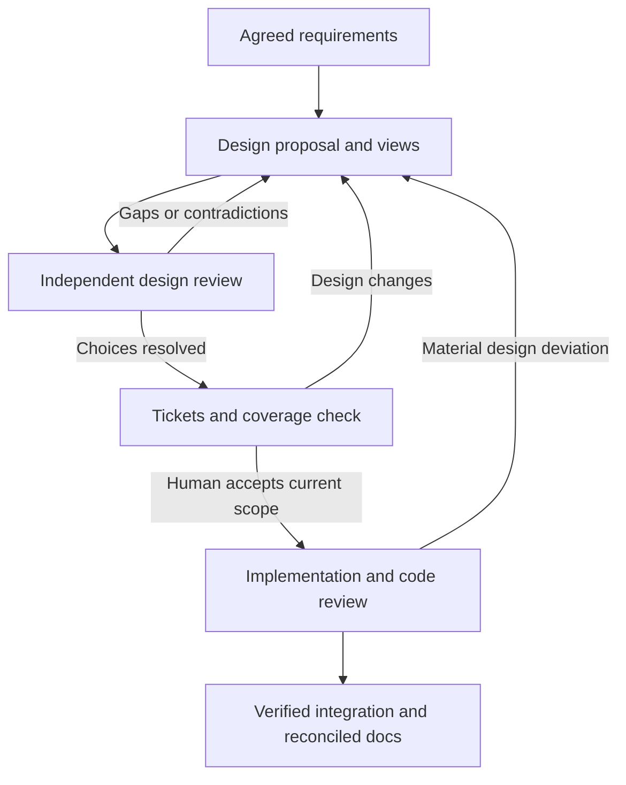

# Understand and approve the design before building it

This guide extends the [setup and SWE manual](MANUAL.md) with design explanation, visualization and independent review. It describes a local extension to Matt Pocock's adapted skills, not a feature attributed to upstream. The architecture branch depends on the workflow work in PR #1; validate these additions separately from live implementation orchestration.

## 1. The purpose and overall process

A spec tells you what users need and what counts as correct. A design explains how the proposed software will meet those requirements. It should let you answer: What components exist? Who owns each responsibility and each piece of data? What happens during success and failure? Why choose this structure over a simpler alternative? How will we know it works?

The process is: clarify requirements; propose a design; independently explain and challenge it; resolve choices with you; break it into tickets; check the plan's coverage; authorize execution. During implementation, reviews compare code with the accepted decisions. At delivery, the documentation is reconciled with what was actually built.



Design review occurs before significant decomposition, and the final readiness checkpoint occurs after decomposition. This prevents both planning the wrong system and starting with a plan that omits part of the accepted design. Earlier review can be reused when its scope remains valid; the final record must identify the current inputs and any targeted refresh.

## 2. Who does what?

| Responsibility | Owner | Durable result |
| --- | --- | --- |
| Explain needs and decide significant tradeoffs | You | Requirements and acceptance decision |
| Propose architecture | Planning session | Design note, views, ADRs |
| Reconstruct the proposal without the author's explanation | Fresh comprehension reviewer | Independent explanation, ambiguity findings |
| Challenge omissions and alternatives | Fresh challenge reviewer | Risks, contradictions, missing requirements |
| Check readiness and dispatch | Coordinator | Current input identities, review/approval evidence, tracker state |
| Implement within accepted constraints | Workers | Code, tests, committed candidate |
| Check actual code | Existing Spec and Standards reviewers | Findings tied to immutable candidate |

Paseo launches and exposes sessions. It does not understand your architecture or make acceptance decisions. The tracker is the durable record of tickets, ownership and evidence. The coordinator is the agent following the process and consulting that record. A profile is a configured way to launch a role with an available harness/model and permissions.

For your Claude planning / Pi implementation arrangement, configure two fresh Pi design-review sessions using an available DeepSeek model, or another verified family different from the design authors. Code review can use Claude when all implementation contributors used DeepSeek. If Claude also writes implementation, Claude no longer meets that candidate's code-review independence rule. Family checks concern the actual contributors and launched settings, not the names of profiles. This package chooses no paid model version for you.

## 3. Choose an appropriate amount of design

| Situation | Useful minimum | Additional work when needed |
| --- | --- | --- |
| Small fix inside accepted boundaries | Brief note linking requirement, existing decision and checks | Diagram only if it clarifies the change |
| Greenfield feature/application | Intended components, interfaces, scenarios and tradeoffs | Shared LikeC4 model when several views help |
| Brownfield feature | Evidence-backed current state plus proposed changes | Transition, compatibility, migration and rollback |
| Cross-cutting boundary/data change | Full design and significant ADRs | Deployment/resource model and operational verification |

Lightweight reduces document size and optional modeling. It does not turn missing acceptance or a failed review into a pass. Existing explicit authorization may cover the small change; the coordinator must point to it rather than ask the same question repeatedly or invent an answer.

Markdown carries explanation and decisions. Mermaid is convenient for a small diagram within that explanation. LikeC4 is useful when several views share component identities and relationships. Its model is an authored description, not automatic proof of what code does. A syntactically valid model can still omit a requirement or describe the wrong system.

For brownfield, inspect code, configuration and tests at a named commit. Label claims observed, inferred or unknown. Keep current, target and transition distinct. Do not replace a messy current-state picture with a clean proposed picture and call it documentation of the existing system.

## 4. Artifacts and their relationships

| Artifact | Purpose | Typical location in the application repository |
| --- | --- | --- |
| Spec | Authoritative behavior and exclusions, stable requirement IDs | docs/specs/feature.md or tracker |
| Overview/model | System boundaries and shared views | docs/architecture/ |
| Feature design | Proposed change, scenarios and tradeoffs | docs/designs/feature.md |
| ADR | Significant decision, alternatives and consequences | docs/adr/ |
| Traceability | Requirement → component → ticket → observable check | docs/designs/feature-traceability.md |
| Readiness record | Exact files, completed reviews and human acceptance reference | docs/designs/feature-readiness.json |
| Project contract | Paths, roles, tooling and readiness rules | docs/agents/architecture.md |

The skills repository ships reusable procedures, templates and a teaching fixture. Each application owns its real architecture. Do not put every application's model into this skills package. Do not duplicate the requirements into each diagram or ticket; link IDs to the authoritative spec.

An ADR is a short decision record, not a long design document. For example: integer cents were selected because exact cents are required, floating-point amounts would require additional rounding rules, and fractional quantities are excluded. Supersede an accepted decision when it changes; retain the history explaining why.

## 5. Set up the extension

Use a separate checkout so you can compare this dependent PR with PR #1. Keep it and the generated application as sibling repositories under `$HOME/code`, outside existing application repositories:

```bash
export MP_SKILLS="$HOME/code/pi-skills-design-validation-01"
mkdir -p "$HOME/code" &&
git clone --branch improve/architecture-design-review --single-branch \
  https://github.com/netname/pi-adapted-mp-skills.git \
  "$MP_SKILLS" &&
cd "$MP_SKILLS" &&
git rev-parse --show-toplevel &&
git rev-parse HEAD &&
npm ci &&
npm test
```

The explicit absolute destination makes the clone independent of your starting directory. The `&&` chain stops at the first failure, including a failed clone or `cd`; it cannot fall through to npm commands in another project. If the destination exists, inspect it or choose a new numbered name. Verify the printed root, record the new skills-under-test SHA and keep that revision fixed for the run. See the manual for [user-owned CLI installation and PATH](MANUAL.md#4-prepare-the-execution-host), including recovery from npm EACCES errors.

These Bash commands work on Linux or a configured Windows Bash environment such as WSL. See the main manual for host/harness setup. The Node helpers use portable filesystem APIs; Windows behavior has not been exercised by this PR's Linux checks. `MP_SKILLS` identifies the package checkout; it is not your application directory. There are now 30 skills and 23 offline tests. `npm ci` installs the pinned development-only YAML parser; execution helpers and the generated application remain dependency-free.

Install the complete checkout with the manual's Pi installation method. Avoid duplicate old/new skill registrations. Claude Code can read the explicit skill and project files as described in the manual; this does not automatically register Claude slash commands.

Run setup in the application, preserving existing conventions. It adds the architecture contract alongside delegation/testing. Configure two actual design-review profiles and the human decision owner. Use the shared templates as starting points, not as accepted records.

## 6. Worked example: understand the quotation tool

Create the disposable quotation lab using section 11 of the main manual, using the new `MP_SKILLS` path and `$HOME/code/quote-workflow-lab-01` as `MP_LAB`. The generated application is a standalone CLI that reads a local JSON catalog and uses Node's standard library; no external application or runtime service is assumed. Provider authentication and optional diagram downloads belong to validation tooling, not the application runtime. The generator now includes a **draft** design, LikeC4 model, proposed ADR, coverage table and ticket scope snapshot. It deliberately includes neither a completed application nor accepted design evidence.

Before launching A/B workers, read these files in the generated application:

1. `docs/specs/quote.md`: R1–R4 define behavior.
2. `docs/architecture/overview.md`: responsibilities and intended state.
3. `docs/designs/quote.md`: alternatives, consequences and scenarios.
4. `docs/adr/001-integer-cents.md`: arithmetic decision.
5. `docs/designs/quote-traceability.md` and `quote-plan.md`: coverage and proposed work.

You should be able to explain why pricing knows nothing about files, why the catalog reader does not print errors, and why C must wait for A/B. For PEN at 1250 cents and quantity 3, the CLI loads products, finds PEN, calls pricing and prints totalCents 3750. For malformed JSON, loading fails and the CLI prints only a concise stderr error with exit 1. The full teaching route is intentionally more elaborate than this tiny program ordinarily needs.

### Visualize and validate

From the generated application's `docs/architecture/model` directory:

```bash
npx --yes --package=likec4@1.60.0 likec4 validate
npx --yes --package=likec4@1.60.0 likec4 start
```

The first command checks model syntax/layout validity and exits. The second starts a local preview; use its printed URL and stop it with Ctrl+C when done. The package version is pinned for the exercise. This may download documentation tooling from npm; it does not add runtime dependencies to the quotation application. In a real project, pin tooling in the project's development dependencies and lockfile for CI reproducibility.

Inspect the component, success and failure views. Rendering makes relationships easier to see; it does not review them. Official references: [LikeC4 tutorial](https://likec4.dev/tutorial/), [CLI](https://likec4.dev/tooling/cli/), [dynamic views](https://likec4.dev/dsl/views/dynamic/).

### Ask for design and review

In the planning session, provide the application path and the package path:

> Read the design-solution skill from this package and the application's architecture contract. Explain this quotation design against R1–R4, inspect the supplied artifacts, and identify assumptions or contradictions. Preserve the supplied acceptance behavior. Present changes before implementation; do not fabricate acceptance.

Then:

> Read review-design from this package. Arrange fresh comprehension and challenge reviews through the configured Paseo profiles. Give each the frozen files, source revision and its axis. Verify actual models. Preserve reports and findings. Complete the plan coverage check and show me the final proposal and remaining decisions before any implementation worker starts.

A useful human review is specific: “Which component rejects an unsafe product? Where does the missing-SKU path appear? Which ticket and test cover accented names? Why is a database excluded?” If the answer requires guessing, improve the design or coverage before authorizing work.

### Capture exact inputs

Set `LAB` to the generated application's absolute path. Run this from any directory:

```bash
node "$MP_SKILLS/scripts/design-check.mjs" snapshot "$LAB" \
  docs/specs/quote.md \
  docs/architecture/overview.md \
  docs/architecture/model/quote.c4 \
  docs/designs/quote.md \
  docs/adr/001-integer-cents.md \
  docs/designs/quote-traceability.md \
  docs/designs/quote-plan.md
```

This prints a map of relative file paths to SHA-256 fingerprints. It writes nothing and approves nothing. A fingerprint changes when file bytes change. Do not include the readiness record itself or review reports in this input set; those refer to the inputs and would otherwise create circular identities.

The coordinator records this map as `inputs` in `quote-readiness.json`, in both review entries and in the human approval entry. Each reviewer must actually have inspected that snapshot. If the final ticket breakdown changes the target, obtain a targeted refresh from each affected reviewer and record the final inputs; do not merely relabel the old report.

Record shape (angle-bracket values below are explanatory placeholders, not usable approval):

```json
{
  "schemaVersion": 1,
  "route": "full",
  "status": "accepted",
  "authorFamilies": ["<actual design-author family>"],
  "inputs": { "<each selected file>": "<its SHA-256>" },
  "reviews": [
    {
      "axis": "comprehension",
      "runId": "<actual fresh run>",
      "model": "<effective model>",
      "family": "<actual independent family>",
      "status": "complete",
      "blockingFindings": 0,
      "inputs": { "<each selected file>": "<its SHA-256>" },
      "report": "docs/designs/reviews/comprehension.md",
      "reportSha256": "<hash of actual report>"
    },
    {
      "axis": "challenge",
      "runId": "<another actual fresh run>",
      "model": "<effective model>",
      "family": "<actual independent family>",
      "status": "complete",
      "blockingFindings": 0,
      "inputs": { "<each selected file>": "<its SHA-256>" },
      "report": "docs/designs/reviews/challenge.md",
      "reportSha256": "<hash of actual report>"
    }
  ],
  "approval": {
    "by": "<actual human>",
    "at": "<ISO timestamp>",
    "reference": "<durable reference to actual acceptance>",
    "inputs": { "<each selected file>": "<its SHA-256>" }
  }
}
```

Use the snapshot command on the two actual report files to calculate their hashes separately. Keep reports and approval references accessible after sessions end. `blockingFindings: 0` means no unresolved blocking findings after recorded dispositions, not that earlier findings disappeared. Freeze decision-bearing files before final review/acceptance; changing an ADR's status afterward also changes its hash. Record acceptance in the separate readiness record to avoid that cycle.

After the human has accepted the actual current proposal and plan, the coordinator can check:

```bash
node "$MP_SKILLS/scripts/design-check.mjs" check "$LAB" \
  docs/designs/quote-readiness.json
```

On the initial scaffold this **must fail**, because it is draft. With complete current records it returns `ready: true`. That result means structural checks passed: selected files and reports match their hashes, the two recorded reviews are complete with no blockers, recorded families differ, and acceptance targets the same files. It cannot authenticate a human, verify Paseo settings, discover a missing requirement/file or judge whether a report is honest. Those are review/coordinator responsibilities; this is not a tamper-proof approval service.

Commit the resulting artifacts before implementation. Continue the main manual's A/B/C execution exercises. The coordinator rechecks readiness before dispatch and integration, and supplies the constraints to workers. The frontier helper remains a dependency check; it does not call this design check itself.

## 7. Failure exercises and acceptance evidence

Run destructive edits only in a disposable copy/branch and retain the failing outputs. Restore the original bytes afterward; never erase a real user's work to make a check pass.

| Exercise | Action | Expected result |
| --- | --- | --- |
| Draft cannot dispatch | Check the scaffold readiness record | Nonzero; no workers launched |
| Missing requirement | Remove R4 from the coverage table before review | Reviewer flags omission; syntax validation alone may still pass |
| Contradictory responsibility | Propose that catalog prints JSON/errors directly | Reviewer challenges conflict with CLI ownership/output contract |
| Stale decision | After a real acceptance, change design/model/spec | Helper rejects stale input; affected work pauses |
| Failed reviewer | Cancel one design-review session | Record stays incomplete; no synthetic pass |
| Same-family review | Configure author/reviewer with same family | Coordinator rejects effective settings; helper rejects matching recorded families |
| Missing environment | Remove required model tooling/profile | Record limitation/incomplete gate; do not claim success |
| Material implementation change | Worker proposes a remote price service | Return to design/human decision before affected work continues |
| Routine internal change | Worker renames a private local variable | Normal code review; no new architecture decision |
| Final reconciliation | Compare accepted design with final integrated source | Record observed state and any superseded decision; tests/reviews remain tied to source SHA |

Final reconciliation can change overview text and hence its fingerprint. Preserve the pre-implementation acceptance record and its source revision as history; do not overwrite it as though it approved later text. If further work is dispatched, record acceptance/targeted review of the updated design first. Pure status documentation at delivery can be reviewed in the final PR without reopening an unchanged product decision.

Use [ARCHITECTURE-VALIDATION.md](ARCHITECTURE-VALIDATION.md) to record actual results. Separate package tests, model validation and live model/Paseo behavior. A green package test suite does not prove independent agents caught the deliberate omission.

### Language exercise: understandable and still precise

Use the [shared plain-language policy](../skills/engineering/_shared/PLAIN-LANGUAGE.md) in the existing planning and comprehension-review sessions. This adds no separate review stage or automated gate.

1. Give the planner this deliberately unclear question: “Should the catalog adapter own error serialization at the process boundary?” Ask it to rewrite the question so a shop operator can understand the decision, with distinct options and their consequences. It must explain that the lab's spec already assigns output behavior; it must not ask the human to approve the same decision again or silently change it.
2. Give it this sentence: “The CLI must emit diagnostics on stderr, suppress stdout, and terminate with status 1 on user/data errors.” Ask for a plain-language rewrite. Check that it retains **all three** outcomes and the condition under which they apply. Keep exact stream names and the exit code, explaining them if necessary.
3. Ask the existing comprehension reviewer to explain the proposed responsibilities and one failure path without the author's conversation. Have it identify any wording that required guessing and any meaning lost during simplification.
4. For `to-questionnaire`, request an asynchronous questionnaire from the same context. Check that known answers are reused, each question asks one thing and conditional questions are marked. The document can contain more than three questions; the short-round limit applies to live chat.
5. Read the result yourself. Can you explain what will be built, why the main choices were made and what still needs your decision? Record unclear passages as feedback in the existing review report.

Do this before freezing the final design inputs. Later wording changes still follow the existing fingerprint-refresh rules. A clear-sounding sentence is not proof that it preserves the requirement. Record this exercise as NOT RUN until you actually perform it; offline package tests cannot establish reader comprehension.

## 8. Adoption in a real repository

Start with one feature and one owner. Reuse existing ADRs, diagrams, tests and tracker conventions. Introduce a minimal contract and scoped design note; do not model the entire brownfield system before making progress. Expand the model only where it helps explain a decision or prevent a recurring mistake.

For CI, configure the project's actual model-validation and readiness commands and make them required through its normal review/branch protections. This package does not install those protections or a Paseo scheduler. Preserve actual human authorization through the project's trusted review process; a writable JSON file alone cannot establish consent.

For another application, supply its own observed boundaries, data ownership, runtime resources and verification commands in that application's contract. The quotation CLI remains the independent worked example for this package; adopting it does not establish compatibility with any other system.
