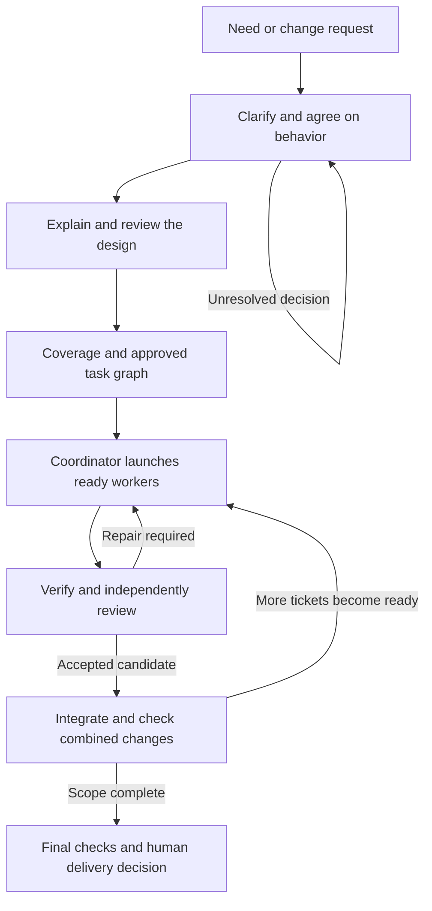
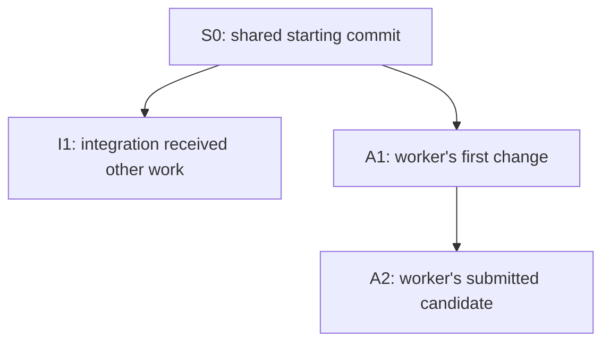
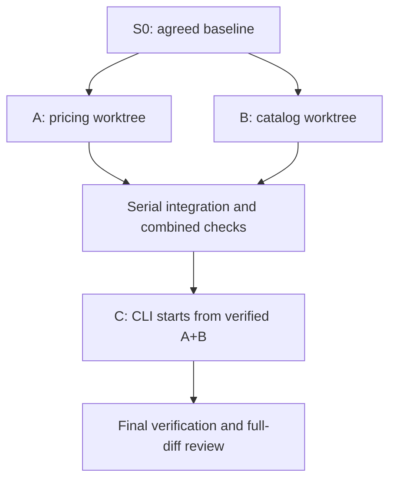

# Skills + Paseo: setup, daily development and PR validation manual

Version: PR #1 workflow plus the dependent architecture-design extension / proposed package 0.2.0. Updated 2026-10-30.

This manual explains how to take a software change from an initial need to a verified, reviewed result using Matt Pocock's adapted skills, coding agents and Paseo. It then shows how to set up that workflow and validate it with a disposable project.

The current combined walkthrough covers [PR #1: orchestration](https://github.com/netname/pi-adapted-mp-skills/pull/1) and [PR #2: architecture/design extension](https://github.com/netname/pi-adapted-mp-skills/pull/2). [WORKFLOW.md](WORKFLOW.md) explains the process; [ARCHITECTURE-GUIDE.md](ARCHITECTURE-GUIDE.md) supplies the detailed design exercise. Treat differences between promised and observed behavior as findings. Upgrade differences are in [MIGRATION-0.2.md](MIGRATION-0.2.md).

## Validate the framework for the first time

**Start here for the worked example and keep this manual as your main route.** The example builds an independent quotation CLI; it also tests whether the framework coordinates planning, workers, reviews and integration correctly. A correct application alone does not prove a correct workflow.

The **manual gives instructions**. The [workflow report](VALIDATION-REPORT.md) and [architecture report](ARCHITECTURE-VALIDATION.md) **record your observations**. Complete both when validating the combined framework. The architecture report contains clearly marked historical preparation checks; these are not your live-run results.

| Step | Who acts | Action / instructions | Checkpoint and evidence before continuing |
| --- | --- | --- | --- |
| 1. Prepare the host | You | Follow [§4](#4-prepare-the-execution-host); authenticate Pi and Claude on the execution host | Both CLIs work; record host/tool versions |
| 2. Freeze the package | You | Follow [§5](#5-check-out-the-exact-pr-not-the-default-branch), using the combined architecture branch | Package tests pass; record the skills SHA; do not update that checkout during the run |
| 3. Configure and test delegation | You, then a diagnostic coordinator | Follow [§6](#6-configure-paseo-and-profiles): save profiles, enable tools, create harmless sessions and test a delegated child | Actual model settings, paths and parent/child run IDs verified; no implementation yet |
| 4. Generate/configure the lab | You and setup agent | Follow [§11](#11-worked-example-create-the-quotation-lab), then [the lab setup sequence](#open-and-configure-the-lab) | Fresh lab, actual delegation settings, canonical tracker path and initial committed lab baseline |
| 5. Open the reports | You | Use [Record the environment first](#record-the-environment-first) | Both report copies identify this run and start with unperformed checks visibly NOT RUN |
| 6. Exercise discovery | Planner/researchers; you decide | Use [the planning rehearsal](#optional-planning-rehearsal) for whole-cycle validation | Cited research, actual human decision and preserved reference scope; otherwise explicitly mark discovery NOT RUN |
| 7. Review/accept the design | Planner, fresh design reviewers, you, coordinator | Go to [architecture guide §6](ARCHITECTURE-GUIDE.md#6-worked-example-understand-the-quotation-tool); return here when its readiness check and handoff are complete | Actual reports, current input fingerprints, applicable human acceptance and committed execution baseline |
| 8. Execute A/B → C | You start one coordinator; it launches workers/reviewers | Follow [§12](#12-execute-the-graph-and-observe-it), including the observation checkpoint | Distinct concurrent A/B worktrees; independent review; serial verified integration; C launches automatically afterward |
| 9. Inspect and exercise failures | You and coordinator in isolated probes | Follow [§13](#13-inspect-the-final-result), [§14](#14-negative-exercises-prove-failures-remain-failures) and [architecture guide §7](ARCHITECTURE-GUIDE.md#7-failure-exercises-and-acceptance-evidence) | Final SHA/evidence agree; failures remain failures; restart does not duplicate workers |
| 10. Report/recommend | You | Follow [§15](#15-evaluate-the-framework-and-recommend-acceptance) | Both reports complete, limitations explicit, evidence retained and proposed PR action stated |

If a checkpoint fails, save the actual result and diagnose it before dependent work continues. Feedback is welcome before completing the run. Use PASS for observed success, FAIL for an observed violation, NOT RUN for an unperformed check and BLOCKED for a missing prerequisite. Never copy an expected outcome into the evidence column as if observed.

Keep three decisions distinct: **lab design acceptance** authorizes this proposal/plan; **framework validation recommendation** assesses observed behavior on your tested configuration; **PR merge authorization** follows ordinary repository review. No lab report automatically authorizes a merge or proves all hosts/providers work.

## Overview: from a need to a change you can accept

### What are we trying to accomplish?

You want working software that solves an agreed problem, with enough evidence to decide whether to accept it. Writing code is one part of that job. You also need to decide what the software should do, divide the work sensibly, check results, combine changes and preserve the decisions behind them.

For example, “I need a quotation tool” is not yet an implementation assignment. Can quantities be decimal? Are prices tax-inclusive? Where does product data come from? What happens when a product is missing? An agent that starts coding before those questions are settled will make product decisions implicitly. The process makes those decisions visible before they become expensive to change.

Once the behavior is clear, the problem changes: now you want agents to implement it without requiring you to launch every ticket manually, share one writable checkout, or accept an implementer's own assurance that everything is correct. The coordinator, isolated workers and independent reviews address that execution problem.

### The process has two connected loops

**The planning loop turns uncertainty into an agreement.** You describe the need. A planning agent explores the existing application, asks questions and researches facts. You supply business decisions. Together you produce a spec: a durable description of required behavior, exclusions and how it will be checked. Before execution, the planner explains the proposed design and its tradeoffs; fresh reviewers reconstruct and challenge it. You resolve consequential choices. For larger work, the agent then proposes implementation tickets and their dependencies. A final coverage check connects requirements, components, tickets and verification before you authorize the current scope.

**The delivery loop turns the agreement into an accepted revision.** A coordinator selects ready tickets, launches implementation workers and collects committed results. Tests and independent reviews produce evidence. Failed results return for repair; accepted results are combined into the integration branch. Completing one ticket can make another ready, so the coordinator repeats the loop until the agreed scope is implemented or a genuine blocker needs your input.



The diagram summarizes control flow, not automatic permission to launch any task or repeat indefinitely. Workers run only when their dependencies and resources permit it; failed work has a bounded repair budget. Changed requirements return to planning rather than becoming undocumented code changes.

### Why each stage exists

| Stage | Question it answers | Why it matters | What you have afterward |
| --- | --- | --- | --- |
| Clarify | What problem should we solve, and what choices remain? | Avoids building an agent's assumptions instead of your intent | Resolved decisions and explicit open questions |
| Specify | What behavior will count as correct? | Gives implementers, tests and reviewers the same target | An agreed spec with examples, exclusions and test seams |
| Design and review | How will the components satisfy the requirements, and why this design? | Makes responsibilities, failure paths and tradeoffs inspectable before coding | Reviewed design and explicit decisions |
| Plan the work | What can be delivered independently, and what must wait? | Enables useful parallelism without premature dependent work | Tickets with acceptance criteria and blocking relationships |
| Implement | How do we make one agreed behavior work? | Keeps each worker's context and changes bounded | Committed code and focused verification evidence |
| Verify and review | Does the candidate work, satisfy the spec and follow standards? | Checks observed behavior and applies independent judgment | Test results, separate review findings and their dispositions |
| Integrate | Do the accepted changes work together? | Individually successful branches can still conflict or interact badly | A verified shared revision for subsequent work |
| Deliver and learn | Is the complete change ready to accept, and what should improve? | Keeps release decisions accountable and the workflow maintainable | Delivery evidence, a human decision and targeted follow-ups |

### How the tools serve that process

**Skills provide the method.** They tell the planning agent how to clarify/specify work, the coordinator how to execute a graph, and reviewers what to inspect. You do not need to memorize all skill names before understanding the process.

**Pi and Claude Code provide agent sessions.** Each session uses a selected model and tools to carry out an assigned role. In this manual's example, Claude Code handles planning/coordinating/review and Pi with DeepSeek handles implementation. This is a role arrangement you configure, not an intrinsic requirement that those products always do those jobs.

**Paseo manages the sessions and their placement.** The coordinator uses it to launch and observe workers in their assigned workspaces. Worktrees separate source edits. Test environments need separate consideration when databases, ports or other resources are shared.

**The tracker preserves the work's state.** It records requirements, dependency edges, ownership, results and evidence pointers. The coordinator can consult it after a restart; the plan should not exist only in a chat window.

**Git, scripts and tests make results inspectable.** A commit identifies the exact source being checked. Helper scripts perform focused checks and record outputs. Reviews interpret the agreed requirements and standards against that source. Section 1 explains which parts are executable checks and which remain agent procedures.

These responsibilities are defined in the package's [coordinator skill](../skills/engineering/implement-spec/SKILL.md), [delegation policy](../skills/engineering/_shared/DELEGATION.md) and [testing policy](../skills/engineering/_shared/TESTING.md).

### Follow one small change all the way through

In the worked example, you agree to quote whole quantities from a JSON product catalog using integer cents. Tax, discounts and inventory are explicitly excluded. That agreement becomes the spec.

The plan has three tickets: **A calculates prices**, **B reads the catalog**, and **C connects them into a command-line tool**. A and B can start together because their interfaces are agreed and neither needs the other's implementation. C waits because it needs both accepted results.

On the architecture extension, first review the supplied draft model, design and coverage and record actual acceptance as described in [the design lab](ARCHITECTURE-GUIDE.md#6-worked-example-understand-the-quotation-tool). The coordinator then launches A and B in separate worktrees. Each worker commits its result. Focused tests check the behavior, and fresh reviewers inspect the spec and standards separately. The coordinator combines accepted work and checks the combined revision, then launches C from that revision without asking you to manually pick the next ticket.

Finally, a complete CLI test demonstrates that three pens at 1250 cents produce a quote of 3750 cents. Final review covers the full change. You inspect the evidence and decide whether to accept the result. In the lab, acceptance remains local; in a real application it can lead to a PR merge and a separate release process.

The artifacts carry the reasoning forward: **decisions inform the spec; the spec informs tickets and tests; tickets identify commits; checks and reviews identify those commits; integration records identify the combined result.** Each handoff carries explicit references so a fresh agent can work without inheriting every previous conversation.

### Where you participate, and what continues without you

You own the goal, scope, business decisions and delivery authorization. During planning, expect questions. During execution of approved work, expect the coordinator to continue through ready tickets, checks, repairs and integration within its configured limits.

It should return to you for an unresolved product decision, a changed scope, an unavailable required capability or an exhausted repair budget. It should not need you to repeatedly say “start the next ready ticket.” A human decision is not replaced by an agent inventing your answer.

For a small clear change, shorten the process: reuse existing requirements and test policy, implement one ticket and review it. For a large uncertain effort, use Wayfinder to resolve decision tickets before producing an implementation graph. Section 8 explains these entry points; sections 9 and 10 explain evidence and integration in more detail.

### What this manual asks you to validate

There are **two separate subjects** in the exercises:

| Subject | What it is | What success demonstrates |
| --- | --- | --- |
| Skills package / workflow PRs | The procedures, briefs and helpers being improved in this repository | Offline checks and live observations support this proposed workflow on your tested configuration |
| Quotation application | The disposable software your agents build using that workflow | Its implementation meets the supplied quote specification |

A correct quotation application alone does not prove the workflow was followed: perhaps one agent did everything in one checkout. Conversely, passing the package's helper tests does not prove the application was built correctly. The lab records both application results and orchestration behavior, including deliberate failures and restart recovery.

The reading sequence is: understand this overview; set up the host and project; run the worked example; inspect the evidence and negative exercises; then decide whether the workflow PR is ready. **Start with the disposable project.** Its results establish behavior only for the local CLI and tested agent configuration; other applications need their own verification contracts.

Questions and artifacts follow a [shared plain-language policy](../skills/engineering/_shared/PLAIN-LANGUAGE.md): explain purpose first, define unfamiliar terms, preserve exact requirements and reuse previous answers. The existing comprehension review checks clarity; the [language exercise](ARCHITECTURE-GUIDE.md#language-exercise-understandable-and-still-precise) lets you validate it. This is informed by STE, without adopting its full controlled dictionary.

For the workflow component map, start with [WORKFLOW.md](WORKFLOW.md#solution-overview). For the design-stage owners, artifact creation sequence and exact handoff into execution, use [the architecture operational route](ARCHITECTURE-GUIDE.md#operational-route-and-completion-checks). The [README documentation map](../README.md#documentation-map) links the current learning and operational paths.

## Reading paths

| Your goal | Read / do |
| --- | --- |
| Understand the purpose and overall process | Start with the overview above; then use sections 1–3 as reference |
| Set up Windows/Linux and your project | Sections 4–7 |
| Use the skills on everyday work | Sections 8–10 |
| Validate this PR | Sections 11–16, using the bundled lab |
| Diagnose a problem | Section 17 |
| Repeat the workflow tomorrow | Section 18 |

Commands in `bash` blocks run in a terminal on the **execution host**. Blocks marked `text` are prompts to send to an agent, not shell commands. Replace uppercase placeholders such as `AGENT_ID` with real values. Shell variables expand in your terminal; they do not automatically expand when pasted into a chat message.

### Jump to a section

[Overview](#overview-from-a-need-to-a-change-you-can-accept) · [Concepts](#1-what-you-are-building) · [Vocabulary](#2-vocabulary-you-will-use) · [Roles](#3-choose-a-role-arrangement) · [Host setup](#4-prepare-the-execution-host) · [PR checkout](#5-check-out-the-exact-pr-not-the-default-branch) · [Paseo profiles](#6-configure-paseo-and-profiles) · [Project setup](#7-configure-each-software-project) · [SWE cycle](#8-use-the-skills-across-the-software-engineering-cycle) · [Testing](#9-understand-tests-without-over-testing-every-edit) · [Integration](#10-what-happens-when-two-tickets-finish) · [Create lab](#11-worked-example-create-the-quotation-lab) · [Execute](#12-execute-the-graph-and-observe-it) · [Inspect](#13-inspect-the-final-result) · [Failure drills](#14-negative-exercises-prove-failures-remain-failures) · [PR decision](#15-evaluate-the-framework-and-recommend-acceptance) · [Real application](#16-move-from-the-lab-to-a-real-application) · [Troubleshooting](#17-troubleshooting) · [Daily practice](#18-daily-checklist-and-retrospective)

## 1. What you are building

The overview described the journey from a need to an accepted change. This section explains the components that make that journey possible. You are configuring a reusable development workflow; the quotation application is the small project used to exercise it. Read the table as a division of responsibility, not as a list of products to install immediately.

| Piece | Plain-language meaning | Owns | Does not establish by itself |
| --- | --- | --- | --- |
| Skill | A written procedure the agent reads | Method and task-specific instructions | That every instruction was followed |
| Harness | The program interacting with the model and tools, such as Pi or Claude Code | Session context and tool execution | Model diversity |
| Model | The selected reasoning/code model | The reasoning within a session | A separate workspace or independent evidence |
| Paseo | The host/client system managing agent sessions and workspaces | Session launch, observation and placement | Your application's test policy |
| Tracker | Durable task records: local Markdown or an issue service | Requirements, dependencies, claims and evidence links | Execution of tasks |
| Coordinator | One active agent following `implement-spec` | Scheduling, collection, integration and tracker writes | A durable background scheduler independent of that session |
| Worktree | Another working directory attached to the same Git repository | Independent source checkout and branch | Separate databases, ports, queues or credentials |
| CI | Deterministic automation running project checks | Repeatable verification and configured merge gates | Understanding ambiguous requirements |

Paseo uses installed coding-agent CLIs; those agents and their authentication must work on the host first. See [Paseo providers](https://paseo.sh/docs/providers). The division of workflow responsibilities above is this package's policy, defined by [implement-spec](../skills/engineering/implement-spec/SKILL.md).

### Written procedures and executable checks: how they work together

A **pull request (PR)** is a proposed set of repository changes for review; it does not run the workflow itself. This PR adds two complementary kinds of material: written procedures for agents and executable programs that check specific conditions.

A useful analogy is a development team's checklist and its test suite. “Review the change before merging” is a checklist instruction. A program that rejects a dirty checkout is an executable check. The first tells someone what to do; the second performs one specific check when it is invoked.

| Material in this repository | Who interprets or executes it? | What it contributes |
| --- | --- | --- |
| `SKILL.md` and shared policy documents | The AI agent reads and interprets the instructions | Which steps to take, what to delegate, when to pause and what evidence to collect |
| Role briefs under `agents/` | The worker/reviewer reads them as supplied task context | The responsibility and output expected of that role |
| JavaScript helper files ending in `.mjs` | Node.js executes their code when a human/agent invokes them | Repeatable checks, structured output, logs and exit status |
| Project configuration and ticket records | The coordinator reads and updates them according to policy | Actual model settings, test commands, requirements and progress |

These are not two alternative workflows. The coordinator uses the written procedure to decide **when and why to call the executable checks**.

### Who creates and handles the `.mjs` files?

`.mjs` identifies a JavaScript module file; here these files are command-line programs run with Node.js. They are ordinary source code, not special Paseo objects and not model conversations.

The new workflow/lab helpers were authored while preparing this PR. They are committed to the skills repository for review and maintenance. They are not created anew by Paseo or generated on every development task. The repository already had other `.mjs` maintenance tools, including its skill validator.

Once this package is installed or checked out, the scripts remain in that package directory. Your software project has its own source, tests and tracker. Workers should use the supplied helper version, not quietly rewrite a helper to make their own ticket pass. Improving a helper is a separate package change with its own review.

The table answers three questions: **why use the script**, **what information you give it**, and **what you get back**. “Input → output” means “what goes in → what comes out.” You do not need to write these scripts yourself. In a normal run, the coordinator calls most of them; the worked example tells you when to run one yourself.

| Script and purpose | Usually run by | Input → output | Important limit |
| --- | --- | --- | --- |
| [frontier.mjs](../scripts/frontier.mjs): find which implementation tickets can start | Coordinator, or you to inspect the lab | A JSON file listing tickets, their status and dependencies → ticket IDs ready to start, such as `["A", "B"]`, or an error if the data is invalid | Reads the supplied file; it does not check whether its claims about completed work are true, reserve tickets, or start agents. The tracker remains authoritative. |
| [design-check.mjs](../scripts/design-check.mjs): detect changes to reviewed design materials and check the readiness record | Planner/coordinator | **Snapshot:** project path and selected files → fingerprints identifying their contents. **Check:** project path and readiness record → readiness result or an error | Can detect mismatches and missing record fields; cannot judge the design, authenticate the human decision, or discover an important omitted file. |
| [review-target.mjs](../scripts/review-target.mjs): prepare the exact committed code changes for review | Coordinator before code review | Project worktree and two Git revisions: where the change started (base) and the proposed result (head) → a temporary review package with revision details, changes and commits | Rejects dirty or mismatched targets. It does not review the code or start reviewers; preserve its output before temporary cleanup. |
| [create.mjs](../examples/validation-lab/create.mjs): create the practice project | You, once for each new lab | A path to a new directory → a quotation-project scaffold containing the spec, tests, proposed design and local tracker | Does not write the application implementation, launch agents or authenticate providers. It refuses an existing destination. |
| [verify.mjs](../examples/validation-lab/verify.mjs): run quotation-lab tests and save their results | Coordinator, or you while inspecting the lab | A clean committed lab worktree, a choice of test group (for example `unit` or `all`), and a folder for evidence → test output, logs and a record of the tested revision and result | This runner is specific to the lab. Passing it does not prove that reviewers were independent or that every possible behavior is tested. |
| [validate-skills.mjs](../scripts/validate-skills.mjs): check the skills package's files | Package maintainer, or anyone running `npm test` | The skills package's files and expected inventory → validation messages and success or failure | Checks the package; it does not run a live Paseo workflow or test the finished quotation application. |

A **worktree** is a separate working directory for a Git repository. A **revision** is a specific commit; its SHA identifies it. A **fingerprint** is a value computed from a file's contents that changes when the contents change. A **clean** worktree has no staged, unstaged or untracked source changes. The [vocabulary](#2-vocabulary-you-will-use) explains these terms in more detail.

The `unit` and `all` choices above are **test groups** used by the lab runner; they are not Paseo agent profiles or model settings. An error or a failed test is a result to investigate, not a passed check.

For example, the coordinator can use its shell tool to run `node /absolute/package/scripts/frontier.mjs /absolute/project/graph.json`. Node performs the calculation; the model reads the result and decides the next step. Paseo manages the surrounding agent sessions. It does not automatically execute every `.mjs` file merely because the files exist.

The package's [npm test script](../package.json) separately runs the skill validator and automated tests of the helpers. Those tests are for the **workflow package**. The quotation lab's tests are for the **application being developed**. Keep those two test results distinct.

### Why an instruction is not a guarantee

Consider this instruction in the coordinator skill: **“Do not start ticket C until A and B are integrated and verified.”** An agent can read it and follow it, but the sentence alone does not install a scheduler rule that makes premature launch impossible. The agent could omit a check, use stale tracker data or misunderstand a worker's “done” message.

The frontier helper reduces this risk by calculating readiness from explicit data. However, if the coordinator incorrectly writes `verified: true` for a ticket, the helper does not independently consult Git or CI to discover that mistake. It checks the supplied graph, not the entire reality behind the graph.

Similarly, the review helper refuses to capture a dirty candidate **when called**. It does not prevent an agent from bypassing the helper and sending some other diff to a reviewer. Even executable checks have a defined scope and can contain bugs. Their results must be used at the right point and tied to the right revision.

A stronger mandatory gate would require additional enforcement—for example, a required CI check that the merge process cannot bypass under the configured permissions. This PR does not automatically install such repository protection or a deterministic end-to-end scheduler. Its current design combines agent-led coordination with focused executable checks.

### Where both fit in a complete development run

Follow the quotation example through one execution:

1. **You and the planning agent agree on behavior.** The spec defines pricing, catalog loading and the CLI, with approved test seams. This is reasoning and human agreement.
2. **The coordinator reads `implement-spec`.** It reads the tracker and exports a graph. It invokes `frontier.mjs`, which returns A and B as eligible. The coordinator still owns claims and the decision to launch.
3. **The coordinator uses Paseo to launch workers.** It selects the configured profiles and allocates separate worktrees. These steps follow the skill; they are not performed by the frontier script.
4. **Workers implement and commit.** They write application code and appropriate tests. Committed verification runs the applicable application checks; the lab's `verify.mjs` records their actual outcome.
5. **The coordinator prepares review.** It calls `review-target.mjs`, then launches two fresh reviewers with the artifacts, role briefs and independent model family. The helper prepares the evidence; the reviewers reason about the code.
6. **The coordinator integrates accepted work.** It constructs/checks any combined candidate, updates integration serially and records the verified revision. It updates the tracker and recomputes the frontier, allowing C only when A and B qualify.
7. **You inspect final delivery evidence.** Final tests and full-diff reviews address the finished application. The validation report also asks whether the orchestration behaved correctly throughout the run.

That last distinction is why this PR needs both **offline tests** and **live validation**. Offline tests show, for example, that the helper rejects a dirty checkout. Live validation shows whether the coordinator actually calls it, uses its result, chooses independent reviewers and stops when a required check fails. Correct helpers are necessary evidence; they are not proof that every surrounding agent action was correct.

Sources for this package's actual responsibilities: [coordinator skill](../skills/engineering/implement-spec/SKILL.md), [delegation policy](../skills/engineering/_shared/DELEGATION.md), [testing policy](../skills/engineering/_shared/TESTING.md), and the linked executable files above.

## 2. Vocabulary you will use

Use this section as a reference while following the overview and lab. The terms describe the artifacts and checkpoints passed between planning, implementation, review and integration; you do not need to memorize them before setup.

| Term | Meaning | Example |
| --- | --- | --- |
| Effort | A bounded objective that may span several sessions | Add a quote command |
| Decision ticket | A question to resolve before or during planning | Are quantities whole numbers or decimals? |
| Implementation ticket | A deliverable with acceptance criteria | Read a catalog from disk |
| Dependency | Work that must finish before another ticket starts | CLI depends on pricing and catalog loading |
| Frontier | Ready, unclaimed tickets with satisfied blockers | Pricing and catalog at the start |
| Claim | A recorded owner/run ID for a task | Ticket A belongs to one particular Paseo session |
| Spec | Agreed behavior, constraints and exclusions | Exact CLI inputs, outputs and errors |
| Seam | A public boundary where behavior can be tested | A function, catalog API or CLI process |
| Vertical slice | A small useful behavior across necessary layers | Quote one product from input to output |
| Base / head | Reference revision and proposed revision for a comparison | Agreed integration SHA / worker candidate SHA |
| Merge base | The common ancestor used to compare diverging branches | Shared starting point of A and B |
| Candidate | A committed revision awaiting verification/review | Ticket A's submitted commit |
| Integrated | Accepted into the integration branch after the required checks | A is now available to dependent work |
| HITL | Human-in-the-loop work | Grilling about a business rule |
| AFK | Work that can proceed without live product decisions | Researching an already precise question |

A worker saying “finished” is not the same as a ticket being integrated. A ticket being integrated is not always the same as its GitHub issue being closed: the project's tracker may defer closure until a PR merges.

### Base and head: which two versions are we discussing?

A Git commit identifies a saved revision of the project. Its SHA is the identifier you record as evidence. A branch name is a movable label pointing at a commit: the label stays the same as more commits are added.

For a review, **base** means the reference revision and **head** means the proposed revision. For example, base can be the integration commit a worker started from, and head can be the commit containing its finished ticket. Base does not always mean `main`, and head does not mean every file currently on disk.

Be careful with capitalization: Git's **`HEAD`** identifies the currently checked-out commit, usually through the current branch. Lowercase **head** in this manual means the proposed review endpoint. In the worker's checkout they may identify the same commit; in the coordinator's checkout they may differ. Uncommitted edits are not part of either commit. Source: [Git glossary](https://git-scm.com/docs/gitglossary).

In this package, the helper resolves the requested base/head to exact SHAs and requires the checkout to match the proposed head and be clean. Review evidence then names those saved versions, not a branch name that can move later. Example: “Spec review passed for base S0, head A2” is precise; “the feature branch was reviewed” is not enough after another commit lands.

### Merge base: where did these histories last share an ancestor?

When two branches diverge, their current tips no longer describe their shared starting point. Git finds a **merge base**: a best common ancestor of the two commits. In an ordinary branching history, this is the shared commit before the separate changes. Unusual histories can have multiple best common ancestors. Source: [git merge-base](https://git-scm.com/docs/git-merge-base).

Consider this history; S0, I1, A1 and A2 are teaching labels for commit SHAs:



If the requested base is I1 and the proposed head is A2, the merge base is S0. That distinction changes what a diff means:

| Comparison | Question it answers in this example |
| --- | --- |
| `git diff I1 A2` | How do the complete saved contents of I1 and A2 differ? |
| `git diff I1...A2` | What changed from their merge base S0 to A2? |

These labels must be replaced with real refs/SHAs if you run the commands. The three-dot form is directional: it compares the merge base to the second endpoint. It does not merge the branches or certify that their changes work together. Source: [git diff](https://git-scm.com/docs/git-diff).

The review helper records **requested base**, **merge base** and **head** separately. Here, reviewing the worker's changes means inspecting S0→A2. Testing integration compatibility requires constructing and checking a revision containing both I1's work and A2's work. They answer different questions.

### Candidate: a specific revision proposed for acceptance

**Candidate** is a workflow term, not a special Git object. It means “this exact committed version is being offered for verification and review.” It may be a worker's ticket result, a combined integration result, or the final proposed delivery.

In the lab, a worker might submit A1. The tests reveal a defect, so it repairs the code and commits A2. A2 is a new candidate: A1's evidence remains part of the history but does not approve A2. A candidate may pass, fail or be blocked; calling it a candidate says nothing about its quality yet.

For every candidate, keep its SHA, relevant base, test results, review reports and outstanding findings together. If source changes, identify the new candidate and refresh the applicable evidence. A report from yesterday cannot approve code that was added today.

### Integrated: accepted into the shared build of the effort

In this workflow, a ticket is **integrated** only when its accepted work is present on the effort's integration branch with the required verification and review evidence. A worker commit sitting on its own branch is not integrated, even if the worker has finished and its tests pass.

Continue the diagram's example: the coordinator combines I1 and A2 into a candidate M1. It verifies the combined behavior and refreshes review, then advances the integration branch to that accepted revision. The tracker records the integrated SHA and evidence. Only then can dependent tickets rely on A's behavior being available in their starting checkout.

A merge commit is not always needed: when the integration branch has not advanced, a fast-forward can accept the reviewed worker revision directly. What matters to this workflow is the accepted shared revision and its evidence, not whether Git created an extra merge commit.

| Statement | What it establishes |
| --- | --- |
| “The worker finished” | A session reported completion |
| “Candidate A2 passed its checks” | A particular revision satisfied those checks |
| “Ticket A is integrated at M1” | Its work is accepted into the shared integration revision |
| “The PR merged into main” | The delivery branch was accepted into the target branch |
| “The release was deployed” | The delivered software reached a runtime environment |

These milestones can occur at different times. Integrated does not mean deployed, and it does not necessarily close a GitHub issue. Source for the package-specific meanings of candidate and integrated: [coordinator procedure](../skills/engineering/implement-spec/SKILL.md) and [testing policy](../skills/engineering/_shared/TESTING.md).

## 3. Choose a role arrangement

Roles divide responsibility within the two loops. The planner works with you to establish the agreement. The coordinator executes the approved plan. Implementers build bounded changes; reviewers judge those changes independently. Planning and coordination can use the same harness/model, but a role change should be explicit so the planning conversation does not drift into unapproved implementation.

Use the table below as a starting arrangement, not a requirement to purchase named model versions:

| Role | Suggested harness | Model family | Fresh session? |
| --- | --- | --- | --- |
| Planning / grilling | Claude Code | Claude | Keep related discussion together |
| Coordinator | Claude Code | Claude | One active coordinator per effort |
| Implementation | Pi | DeepSeek | Yes, one per ticket |
| Spec reviewer | Claude Code | Claude | Yes, independent of implementation |
| Standards reviewer | Claude Code | Claude | Yes, separate from Spec reviewer |
| Researcher | Source-capable configured harness | Any suitable available family | Yes, one question per worker |

The PR requires both review axes to use a family different from **every implementation family contributing to the target**. Two Claude reviewers are acceptable when implementation is DeepSeek. Changing from Pi/DeepSeek to Claude Code/DeepSeek does not create model independence. Neither does opening a new tab with the same implementing family.

If the Claude coordinator starts writing implementation code, record Claude as an implementation contributor. The original Claude review arrangement no longer satisfies the policy for that candidate. Delegate code fixes to the implementation profile, or select another reviewer family. Keep a provenance list; do not erase a contributing family because its session ended.

You do not need to remove Codex to use Claude Code. This lab simply does not require a third harness. Adding one is a separate choice about accounts, capabilities and cost.

Create actual profiles using the models offered by your host. Record exact IDs in the project configuration. Profile names such as “review” are labels, not evidence that a different model ran. This requirement comes from the package's [delegation policy](../skills/engineering/_shared/DELEGATION.md).

## 4. Prepare the execution host

### Windows and Linux are both execution-host options

**Yes: the execution host can be Windows or Linux.** The execution host is the environment where the Paseo daemon launches the agent processes and where their repositories, worktrees and tests run. It need not be a separate server. Paseo offers Windows and Linux desktop builds; Pi documents both native Windows and WSL operation. Sources: [Paseo downloads](https://paseo.sh/download), [Pi on Windows](https://pi.dev/docs/latest/windows).

| Arrangement | Execution environment | Where to install the agents and keep the lab |
| --- | --- | --- |
| Everything on a Windows PC | Native Windows | Windows, using Windows paths |
| Everything on a Linux PC/server | Linux | Linux, using Linux paths |
| Windows client connected to Ubuntu | Remote Ubuntu | Ubuntu; Windows is the viewing/control client |
| Windows PC with a Linux environment in WSL | Linux inside WSL, when that is where the daemon/workers run | Inside the selected WSL environment |

For the first validation run, keep the daemon, providers and lab together in one environment. Merely installing WSL does not turn a native Windows Paseo session into a Linux session. Check which host launched the worker and the worker's actual directory.

The Ubuntu arrangement below is a worked setup choice, not a requirement of the skills. Native Windows support in the underlying tools is also not proof that this PR has passed its Windows acceptance run: record each platform you actually test.

### Shell syntax depends on your chosen host

Most command blocks in this manual use Bash. Run them in a suitable Bash terminal, or translate them deliberately to PowerShell. Native Windows Pi uses Git Bash by default for Bash commands; its optional PowerShell tool is a separate shell choice. Follow [Pi's Windows instructions](https://pi.dev/docs/latest/windows) for setup. WSL runs the Linux form of the tools.

For example, these are complete equivalent variable assignments, using illustrative paths:

```bash
export MP_SKILLS="$HOME/code/pi-skills-validation-01"
export MP_LAB="$HOME/code/quote-workflow-lab-01"
```

```powershell
$env:MP_SKILLS = "C:/code/pi-skills-validation-01"
$env:MP_LAB = "C:/code/quote-workflow-lab-01"
```

In PowerShell, subsequent references are `$env:MP_SKILLS` and `$env:MP_LAB`; Bash uses `$MP_SKILLS` and `$MP_LAB`. Bash `export`, backslash continuations and heredocs are not PowerShell syntax. The Linux Claude installer below also needs the official Windows alternative if you choose native Windows. Use the [Claude Code quickstart](https://code.claude.com/docs/en/quickstart).

The Node helpers use platform path APIs, but the complete Windows/provider workflow still needs its own validation. The `npm run smoke` entry point specifically invokes Bash. Do not infer that every command block is a native PowerShell command because Node itself runs on Windows.

### Recommended arrangement for a Windows workstation and Ubuntu server

Put Git repositories, worktrees, Node, Pi, Claude Code and the Paseo daemon on **the same Ubuntu host**, under the same ordinary development user. Use Windows as the client/editor/terminal. This keeps absolute paths, CLI credentials and test environments consistent.

Do not configure a reviewer with a Windows path when its agent runs on Ubuntu. A Windows installation of a provider does not automatically make that provider available to a remote Paseo daemon. A separately running Windows daemon is a different host with different settings.

On the Windows client, first confirm `ssh user@your-ubuntu-host` works using your SSH key/agent. In Paseo Desktop choose **Settings → Add host → Remote SSH** and enter `ssh://user@your-ubuntu-host`. The remote daemon must already be running; connecting through SSH does not install or start it. Select that host before opening the lab. These steps come from [Paseo connectivity](https://paseo.sh/docs/connectivity).

For the complete walkthrough, use Git, Node 24 LTS, npm, a working Pi model and an independent Claude model. The lab/helpers themselves support Node 20+, but that lower minimum does not establish compatibility with current agent CLIs. Check the installed agents' requirements before launch. The generated application uses only Node's standard library; package validation separately installs its development-only YAML parser. Authentication and model calls may incur charges under your existing accounts. See [Node downloads](https://nodejs.org/en/download) and [Pi package requirements](https://github.com/earendil-works/pi/blob/main/packages/coding-agent/package.json).

In the Ubuntu terminal:

```bash
git --version
node --version
npm --version
```

If Git commits have no identity, configure the desired name and email in the disposable lab after initializing it. Do not overwrite your global Git identity just to run the example.

### Prepare a user-owned CLI installation directory

For the Ubuntu walkthrough, install npm-based agent CLIs into `$HOME/.local` explicitly. This works even if the system npm default points at `/usr/lib/node_modules`; no administrator install or system-directory ownership change is needed.

```bash
mkdir -p "$HOME/.local/bin" &&
export PATH="$HOME/.local/bin:$PATH" &&
command -v node &&
node --version &&
npm --version &&
npm config get prefix
```

If Node does not meet the installed agents' requirements, select/install Node 24 LTS through your existing Node manager or [Node's installation instructions](https://nodejs.org/en/download) before proceeding. The printed npm prefix may still be `/usr`; the `--prefix "$HOME/.local"` option in each install command below deliberately overrides it for that command only.

For future Bash login shells, add the PATH entry once:

```bash
touch "$HOME/.profile" &&
{ grep -qxF 'export PATH="$HOME/.local/bin:$PATH"' "$HOME/.profile" ||
  printf '%s\n' 'export PATH="$HOME/.local/bin:$PATH"' >> "$HOME/.profile"; }
```

Already-open shells, Herdr panes and daemons do not receive later environment changes automatically. Run the export in the pane that starts Paseo and inspect provider diagnostics if its executable paths differ from your terminal. Other shells should use their normal startup file. See [npm's EACCES guidance](https://docs.npmjs.com/resolving-eacces-permissions-errors-when-installing-packages-globally/).

### Install or verify Pi

If Pi already works, keep it and record the version. For a new npm-based installation, the current official package is:

```bash
npm install --global --prefix "$HOME/.local" --ignore-scripts @earendil-works/pi-coding-agent &&
command -v pi &&
pi --version &&
pi
```

Configure/authenticate your existing DeepSeek access in Pi, select it with `/model`, and perform a trivial request. Do not replace a working provider configuration with an invented endpoint or model ID. Pi's [installation page](https://pi.dev/) and [model-selection guide](https://pi.dev/docs/latest/models) are the source of truth for the installed version.

### Install or verify Claude Code

The official native Linux installer is:

```bash
curl -fsSL https://claude.ai/install.sh | bash
claude --version
claude
```

Complete the CLI's login process on the execution host and check a simple request. Use the [official quickstart](https://code.claude.com/docs/en/quickstart) for authentication or platform-specific alternatives. Do not put API keys in the lab, tracker, evidence or PR.

### Install or verify Paseo

For headless Ubuntu, the documented CLI path is:

```bash
npm install --global --prefix "$HOME/.local" @getpaseo/cli &&
command -v paseo &&
paseo --help
```

After the checks succeed, run `paseo` from the prepared shell and follow the host's connection/pairing flow. A desktop installation bundles and starts its own daemon; do not accidentally validate against that local daemon when your source and providers live on Ubuntu. See [Paseo getting started](https://paseo.sh/docs) and [connectivity](https://paseo.sh/docs/connectivity).

Before installing or updating over an existing setup, record versions and account configuration. Do not run broad global upgrades midway through a validation run.

## 5. Check out the exact PR, not the default branch

A package install from the default branch does not validate an unmerged PR. Use a dedicated checkout outside any existing application repository. The skills package and generated lab are sibling directories:

```text
~/code/pi-skills-validation-01       skills package under test
~/code/quote-workflow-lab-01         separate application repository
```

For a first validation of the current combined framework, use the architecture branch below; it includes the orchestration changes. Only when intentionally testing PR #1 alone, substitute `improve/paseo-testing-workflow` and record that narrower scope. These commands capture the branch at clone time: record the printed SHA and keep it fixed for the run.

```bash
export MP_SKILLS="$HOME/code/pi-skills-validation-01"
mkdir -p "$HOME/code" &&
git clone --branch improve/architecture-design-review --single-branch \
  https://github.com/netname/pi-adapted-mp-skills.git \
  "$MP_SKILLS" &&
cd "$MP_SKILLS" &&
git rev-parse --show-toplevel &&
git rev-parse HEAD &&
npm ci &&
npm test
```

The destination is an absolute path derived from `$HOME`, so the clone goes to the same place regardless of the terminal's starting directory. Each `&&` runs the following command only after the preceding command succeeds. A failed clone or `cd` therefore prevents the Git/npm checks from running in another project. If the destination already exists, inspect it or choose a fresh numbered directory; do not overwrite or reset it.

### What each command does

| Command | Explanation | Expected result |
| --- | --- | --- |
| `export MP_SKILLS=…` | Stores the absolute skills-checkout path and exposes it to child processes. | Later commands use this exact destination. |
| `mkdir -p "$HOME/code"` | Creates the parent directory if needed. | The destination's parent exists. |
| `git clone … "$MP_SKILLS"` | Downloads the selected branch directly into the absolute destination. | A new skills repository, without depending on the previous working directory. |
| `cd "$MP_SKILLS"` | Enters that checkout. | Subsequent commands operate on the skills package. |
| `git rev-parse --show-toplevel` | Prints the Git repository root. | It matches `$MP_SKILLS`; investigate any mismatch. |
| `git rev-parse HEAD` | Prints the exact revision under test. | Save this as the skills-under-test SHA. |
| `npm ci` | Installs exact development dependencies from package-lock.json, including the YAML parser. | Reproducible validation tooling. |
| `npm test` | Validates the skills, then runs the package's offline tests. | Exit 0 with no failed checks. |

### Understand the clone command

This is the complete clone command when `MP_SKILLS` has been set above:

```bash
git clone --branch improve/architecture-design-review --single-branch \
  https://github.com/netname/pi-adapted-mp-skills.git \
  "$MP_SKILLS"
```

- `--branch` selects the combined architecture/workflow PR branch; the slash in the name is not a filesystem path.
- `--single-branch` limits the fetched branch history, not the checkout to one commit.
- `"$MP_SKILLS"` is the absolute local destination, kept identical to the path used by later commands.
- A trailing `\` continues the same Bash command onto the next line; it must be the final character on that line.

The command does not merge the PR or update GitHub. It gets the branch state at clone time. Source: [git clone](https://git-scm.com/docs/git-clone).

### Understand paths and version identity

`$HOME` is the home directory of the current execution-host user. Quotes preserve spaces while allowing variables to expand. `MP_SKILLS` and `MP_LAB` are names chosen for this manual; they are not built-in Git or Paseo settings. Keep them pointed at different sibling directories.

Print the actual values when diagnosing a path problem:

```bash
printf 'Skills checkout: %s\nLab: %s\n' "$MP_SKILLS" "${MP_LAB:-not-created-yet}"
pwd
```

For an existing checkout, use this complete check block after setting `MP_SKILLS` to its actual location:

```bash
cd "$MP_SKILLS" &&
git rev-parse --show-toplevel &&
git rev-parse HEAD &&
test -f package-lock.json &&
npm ci &&
npm test
```

If a previous relative clone landed elsewhere, update `MP_SKILLS` to that checkout's actual absolute path. A missing package.json or package-lock.json is a reason to verify the directory and revision before changing dependencies. Do not generate a replacement lockfile to hide a wrong-directory error.

Record the SHA printed by Git, not a commit ID copied from an older conversation. Keep the package checkout unchanged during a validation run. A new revision needs a new run record; a fresh numbered lab avoids mixing changed fixtures with old evidence. The variable assignments last for the current shell and its children, so set them again in a fresh terminal.

### Understand the test result

`npm test` is defined by this repository's [package.json](../package.json): skill validation followed by Node's test runner. A validation failure prevents the runner from starting. Run `npm ci` first; the checks themselves are offline and need no model authentication.

This corrected architecture branch has 23 offline tests; PR #1 has 19. Judge success by the complete result and exit status, not by matching a fixed number. In Bash, `echo $?` immediately after `npm test` prints that command's exit status: `0` means success; a nonzero value means it failed. Run it immediately because another command replaces the status.

Passing package checks does not establish that live Paseo sessions, model separation or the generated application pass. Those are later exercises. The generated application itself uses only local files and Node's standard library. Source: [npm test](https://docs.npmjs.com/cli/v11/commands/npm-test/).

### Install the package into the lab project later

Do not run a lab installation command yet: `$MP_LAB` may not exist. In [§11: Generate a new directory](#generate-a-new-directory), the generator creates the application directory first. The same command block then enters it and runs `pi install -l "$MP_SKILLS"`. Follow that block once; there is no separate installation to repeat here.

The `-l` option records a project-local installation. Pi loads the package from its existing checkout after project trust. Check startup diagnostics and avoid duplicate skill copies with shadowing names. Keep unrelated packages where needed, but verify the configured Paseo delegation path. See [Pi packages](https://pi.dev/docs/latest/packages) and [Pi skills](https://pi.dev/docs/latest/skills).

## 6. Configure Paseo and profiles

### What is a profile?

A **Paseo agent profile** is a named preset of launch settings: provider, model, thinking level, mode and supported features, with notes describing when to use it. It saves choosing those options repeatedly. Profiles are saved on a particular host; changing one affects future selections, not sessions already launched. Source: [Paseo agent profiles](https://paseo.sh/docs/agent-profiles).

For this workflow, imagine a preset named `mp-build` that selects Pi and your configured DeepSeek model. The coordinator selects those settings, then gives a fresh worker its actual assignment: “Implement ticket A in this worktree.” `mp-code-review` selects your Claude review settings, then receives the Spec brief and a particular candidate to review. These example names have no built-in meaning.

Keep four concepts separate:

| Concept | Example | What it supplies |
| --- | --- | --- |
| Agent profile | `mp-build` | Saved launch settings |
| Role brief | `agents/mp-review-spec.md` | How to perform a role |
| Task prompt | Review ticket A at a specific SHA | The assignment for this run |
| Session / run | A concrete Paseo agent ID | The actual execution and its history |

The profile is not a running agent, a skill, a worktree or a ticket. Several fresh sessions can use the same profile. The coordinator still needs to place them in the correct workspaces and send the right instructions. In this package, role briefs are supplied explicitly; naming a profile `mp-code-review` does not automatically load that file.

Also distinguish **agent profiles** from this manual's **test profiles**. Fast / Verify change / Verify candidate are project-defined selections of checks. They do not select an AI model or create a Paseo agent.

### Create role profiles on the execution host

You configure profiles in **Paseo**, not by typing a skill command into Pi/Claude. First confirm both providers are discovered on the intended host. A Windows client connected to Linux must configure that Linux host, not accidentally its local daemon.

1. Open **Settings → your execution host → Agents → Agent profiles**.
2. Select **New profile** and enter a name from the table below.
3. Choose the installed provider and an actual available model. Select supported mode/thinking settings appropriate to the role; do not guess unavailable options.
4. Fill **When to use** with the notes below, then **Save**.
5. Repeat for the remaining profiles. These names are examples, not preinstalled keywords.

| Profile label | Harness / model family for this example | When to use notes |
| --- | --- | --- |
| `mp-plan` | Claude Code / Claude | Plan and coordinate one effort. Delegate implementation; own tracker and integration. May research when configured with source access. |
| `mp-build` | Pi / DeepSeek | Implement one ticket in its assigned worktree; return committed revision and verification evidence. Do not dispatch reviews. |
| `mp-design-review` | Pi / DeepSeek | Independently reconstruct or challenge a Claude-authored design. Use separate fresh sessions for comprehension and challenge. |
| `mp-code-review` | Claude Code / Claude | Review code implemented only by DeepSeek. Use separate fresh sessions for Spec and Standards; no edits or test execution. |

These four presets can cover all role rows in the lab's `docs/agents/delegation.md`: Planning → `mp-plan`; Implementation → `mp-build`; Spec and Standards → `mp-code-review`; Design comprehension and challenge → `mp-design-review`; Research → a source-capable `mp-plan` session, or a separately configured research profile. Reusing settings never means reusing the author/implementer conversation as its reviewer. Check source access before selecting a research profile.

Record **actual** profiles, harness/providers, exact model IDs and families in that file. Editing the file does not create a Paseo profile; saving a Paseo profile does not update the file. Reconcile both. Changing an implementation/design-author family can invalidate this example's review assignments. A profile label is not enforcement of read-only access or a guarantee of model identity.

Source: [Paseo agent profiles](https://paseo.sh/docs/agent-profiles). Available controls depend on the installed version/provider. If a control is absent, record the version and gap rather than inventing a UI action or setting.

### Enable delegation access

**Delegation access** means the coordinator can call Paseo to discover providers/profiles, launch child agents/workspaces, monitor them and collect output. It is distinct from model authentication and tracker access. For this first run use built-in Paseo tools:

1. Open **Settings → your execution host → Agents**.
2. Turn on **Enable Paseo tools**; injection is off by default.
3. Start a new coordinator session or reload the existing one so it receives the tools.
4. Run the discovery and child-launch checks below before trusting the full graph.

The CLI is an alternative for an agent with shell access to the correct running Paseo host; it does not require tool injection. Use one verified route for the first exercise. Enabling tools does not itself install this package, choose the correct model, supply role briefs or prove the coordinator follows workflow rules. Sources: [orchestration](https://paseo.sh/docs/orchestration) and [MCP reference](https://paseo.sh/docs/mcp).

### Create the first Pi and Claude sessions

For workflow validation, create agents **inside Paseo**. Running `pi` or `claude` directly in a terminal is useful for installation/authentication checks but does not establish that Paseo can manage that session.

1. Select the correct host and a local workspace at the skills checkout for harmless preflight checks. No application exists yet. If the lab already exists, use its workspace and `AGENTS.md` instead.
2. Start creating an agent. Open the model picker and select the saved profile under **Profiles**.
3. Check the actual provider/model and workspace directory before sending a task. Button placement may differ between versions; profile selection is documented by Paseo.
4. Create one Pi session using `mp-build` and one Claude session using `mp-plan`, each with this harmless prompt:

```text
This is a setup check, not an implementation assignment.
Report the working directory and read README.md in this workspace.
Summarize the project's purpose. Do not edit files, run tests, create commits,
or launch other agents. Report any missing file or capability honestly.
```

Inspect effective provider/model in Paseo's session settings or available status metadata, rather than accepting generated self-identification. Record run IDs, directory and inspected model settings. Stop/archive these diagnostic sessions when their work is complete; they are not the A/B workers.

### Test discovery and one delegated child

In the diagnostic Claude session, first send:

```text
Without modifying files or creating agents, inspect the available Paseo tools,
current host/workspace, providers, models and saved profiles. Identify mp-plan,
mp-build, mp-design-review and mp-code-review and any missing capabilities.
Do not invent model IDs or silently substitute profiles.
```

After discovery succeeds, test an actual launch:

```text
Use the installed Paseo tool schemas or CLI help to launch exactly one fresh Pi
child using the verified mp-build settings in this workspace. Its only task is
to read README.md and return a short summary. No edits, tests, commits, further
delegation or implementation. Record the child run ID, effective settings and
workspace; observe its terminal status and collect its output. Do not launch
replacement children if its status is unknown. Report any capability gap.
```

Success means you can inspect the child in Paseo, verify its model/directory, and see the parent collect its actual output. Discovery alone does not prove launch access. Missing tools, authentication or observable settings remain blockers. Keep this evidence in the run report once the lab is created. Source: [Paseo orchestration](https://paseo.sh/docs/orchestration).

### Prove a profile works before using the full graph

Start one harmless session for each harness. Ask it to report its working directory and read one project file. Independently inspect the effective model/provider in the host's session settings or available status metadata. Save that inspection as evidence. Do not accept only “I am Claude” in generated prose.

If Paseo does not expose enough information to verify the effective model, record the limitation. Under this PR's policy the independent-review gate remains unverified until you can establish it; do not silently weaken the gate.

Code reviewers read the exact candidate and relevant unchanged source, return reports in their session responses, and leave report-file creation to the coordinator in its evidence store. Reviewers are instructed to be read-only. Configure actual provider permissions where available. Neither profile notes nor a “plan” label by itself proves filesystem isolation. The coordinator checks candidate cleanliness afterward.

### Optional administrative terminals: Herdr, tmux or your editor

Paseo owns the validation agents and their lifecycle. Use a normal terminal, VS Code Remote SSH terminal, tmux or Herdr to inspect Git, files and logs and run manual verification. None is an additional framework requirement. Do not launch duplicate A/B/C workers through another tool.

If you already use Herdr on the Linux execution host, it is suitable for persistent administrative panes. From the host shell:

```bash
herdr session attach quote-validation
```

Keep one pane for Git/reports and another for diagnostic/test commands. Detach with `Ctrl+B q`; reattach with the same command. Panes remain running while the server remains alive; detaching is not a promise of recovery after a host/server restart. If you run the Paseo daemon in a persistent pane, continue to create validation agents through Paseo. Otherwise keep the existing daemon arrangement. Sources: [Herdr CLI](https://herdr.dev/tui/docs/cli-reference/) and [remote/persistent sessions](https://herdr.dev/tui/docs/how-to-work/).

For the first run, use the terminal arrangement you already know. Validate orchestration through Paseo before adding a second agent-management workflow.

### Useful observation commands

Use the app for the first run; these commands help when diagnosing it:

```bash
paseo --help
paseo ls -a -g --json
paseo workspace ls
paseo logs AGENT_ID
paseo provider diagnostic claude
```

Run them on the intended host. Confirm options with the installed CLI's help if its version differs. Do not infer exact model/profile launch flags from these examples. The coordinator should use discovered tool schemas. Sources: [CLI reference](https://paseo.sh/docs/cli) and [MCP reference](https://paseo.sh/docs/mcp).

## 7. Configure each software project

**Following the worked example?** Create the lab first and follow the complete [lab setup sequence in §11](#open-and-configure-the-lab). Return here for general project guidance. Do not run project setup in the skills checkout or before the target project exists.

For another project, select its existing directory and host, inspect current conventions, then run setup once and update only changed decisions. In a Pi session whose working directory is the target project, invoke:

```text
/skill:setup-matt-pocock-skills
```

Use the Claude explicit-file alternative below when Claude is the setup session. Review the proposed changes, populate actual configuration, and confirm the project owner has resolved relevant decisions.

Expected project artifacts:

| File | What it tells the agent |
| --- | --- |
| `AGENTS.md` | Short navigation pointers and project-wide constraints |
| `GLOSSARY.md` | Meaning of domain terms |
| `docs/adr/…` | Durable decisions when their tradeoffs warrant an ADR |
| `docs/agents/issue-tracker.md` | Where tasks live and how status/claims/closure work |
| `docs/agents/triage-labels.md` | Project's labels for incoming work, when configured |
| `docs/agents/delegation.md` | Real profiles, model families, concurrency and retries |
| `docs/agents/testing.md` | Commands, test selection, environments and evidence |
| Spec and ticket files/issues | Behavior and dependency graph for this effort |

### Use the same procedure from Claude Code

This is a Pi-native package. Installing it with Pi does not register `/skill:…` commands in Claude Code. For PR validation, use the exact same files by explicit path, without maintaining another copied installation:

```text
Read /ABSOLUTE/SKILLS/PATH/skills/engineering/setup-matt-pocock-skills/SKILL.md
and follow that procedure for /ABSOLUTE/PROJECT/PATH.
Resolve relative references from the skill's directory, not from the project directory.
Treat Pi-only installation checks as checks of the Pi worker environment.
Use discovered Paseo tools for delegation. Do not invoke an imaginary /skill command here.
```

Apply the same pattern to `wayfinder`, `grill-with-docs`, `to-spec`, `to-tickets` or `implement-spec`. This explicit-file route tests the PR's adaptations. Switching to an independently installed upstream Claude skill would test a different workflow.

You may later add a small project `CLAUDE.md` pointer to shared project instructions, but it is not necessary for the lab when the coordinator supplies them explicitly. Do not copy all instructions into multiple files and then maintain them separately.

### Two setup checks: command visibility and shared tracker paths

**Skill command visibility.** Setup now treats `enableSkillCommands: false` as a discoverability setting, not a failure. Manually typed `/skill:name` commands still work. If invocation fails, inspect installation paths, startup diagnostics and YAML frontmatter. Source: [Pi skills](https://github.com/earendil-works/pi/blob/main/packages/coding-agent/docs/skills.md).

**Local tracker location.** Git worktrees do not share untracked/ignored files. Setup records a canonical absolute state root, normally the original project's `.scratch/` directory, so a worker must receive the **canonical absolute path** in the original lab directory. The bundled lab makes this explicit. If a worker creates a second tracker in its own worktree, validation fails even if the implementation is correct. This is a project configuration requirement, not an automatic tracker service supplied by Paseo.

## 8. Use the skills across the software engineering cycle

This section maps the overview's planning and delivery loops to specific skills. Choose a route based on what is already known; the skills are tools for making progress, not a ceremony to repeat for every edit.

### Choose your entry point

| Starting situation | Begin with | Move to execution when |
| --- | --- | --- |
| A broad goal with many unresolved decisions | `wayfinder`, research and human discussions | Enough decisions are resolved to specify a bounded deliverable |
| A bounded feature whose behavior needs clarification | `grill-with-docs`, then `to-spec` and `to-tickets` where useful | Behavior, test seams and the proposed breakdown are agreed |
| An already approved spec and task graph | `implement-spec` | Required project configuration and verification resources are available |
| One clear small ticket | `implement` in standalone mode | Its scope and checks are understood; independent review is still required |
| A bug whose cause is unknown | `diagnosing-bugs` | The failure is understood well enough to implement and verify a scoped fix |

### Hand off from planning to execution deliberately

The handoff includes the accepted design, independent review reports, requirement coverage and current readiness record described in [the architecture guide](ARCHITECTURE-GUIDE.md). It is an agreed set of artifacts, not just a model switch. The coordinator needs the spec, ticket graph, tracker location, model-role configuration and testing/environment contract. Requirements still marked undecided cannot be resolved by silently choosing convenient implementation behavior.

At that boundary you can say: “This spec and breakdown are approved. Execute this graph under the configured limits; return for new product decisions or genuine blockers.” The coordinator then owns routine dispatch, collection and integration. You retain scope and delivery decisions.

### Match each skill to its purpose

| Stage | Main skill(s) | Your role | Output / evidence |
| --- | --- | --- | --- |
| Intake | `triage`, `ask-matt` | Clarify the request and priority | Routed issue, missing facts |
| Explore a large uncertainty | `wayfinder`, `research` | Decide destination and answer HITL questions | Decision map, cited research, resolved questions |
| Define behavior | `grill-with-docs`, `domain-modeling`, `prototype` | Answer business questions and inspect examples | Shared language, decisions, prototype where useful |
| Specify | `to-spec` | Approve seams/behavior not already agreed | Spec with exclusions and testing decisions |
| Decompose | `to-tickets` | Check useful slices and real dependencies | Approved task graph |
| Build | `implement-spec` / `implement`, `tdd` | Observe or resolve new product questions | Committed worker candidates and check evidence |
| Review | `code-review` | Decide genuine tradeoffs or requirement changes | Separate Spec/Standards findings tied to revisions |
| Integrate | `implement-spec` | Approve delivery when appropriate | Verified combined revision |
| Deliver | `pr` | Review and authorize the merge/release | PR evidence, residual risks and required checks |
| Maintain | `diagnosing-bugs`, `improve-codebase-architecture` | Confirm reproduced behavior / scope | Regression fix or scoped improvement |
| Improve the process | `retro` | Choose useful improvements | Targeted workflow/check changes |

The relevant procedures live in the [engineering skills directory](../skills/engineering) and [productivity skills directory](../skills/productivity). A PR description is not a deployment process: add the application's release, rollback, migration and operational checks in its own project policy.

### When to keep a session, and when to start a fresh one

Keep grilling → spec → tickets in the same planning conversation when the reasoning still fits. That preserves why decisions were made. Persist the decisions anyway: another session must be able to continue without reading the entire chat.

Start each implementation ticket with a fresh context and specific pointers. Start each review axis fresh. A reviewer needs the agreed behavior, standards, candidate source and diff—not the implementer's persuasive explanation of why its code is correct.

The coordinator can continue across ticket completions while its context remains manageable. When it restarts, it must reconstruct state from tracker records and real Paseo/Git state before dispatching anything.

### Planning prompts

For an uncertain effort:

```text
Use wayfinder to find the route to a small quoting tool.
Chart unresolved decisions and dependencies. Batch only ready research.
Pause at human business decisions; do not answer the grilling questions for me.
Do not implement yet.
```

For a bounded change:

```text
Use grill-with-docs to clarify this behavior, then to-spec and to-tickets.
Reuse decisions already agreed in the project. Tell me what new decision is needed
before asking me to reconfirm an existing one.
```

In Pi, invoke the explicit `/skill:name` form when you want to force a skill. In Claude Code, prepend the explicit-file instruction from section 7.

## 9. Understand tests without over-testing every edit

The delivery loop needs evidence at three scales: while a worker edits, when it submits a ticket, and when accepted changes are combined. Fast feedback helps the worker correct mistakes; committed checks let others assess an exact revision; combined checks catch interactions between tickets.

Tests and reviews answer complementary questions. A test executes a selected behavior and checks its result. The Spec reviewer inspects whether the change satisfies the agreed requirements, including omissions. The Standards reviewer inspects documented conventions and design concerns. Tests do not prove that every required case was specified, and a persuasive review is not evidence that a command actually passed.

A **category** says what boundary the test crosses. A **profile** says which checks to run at a particular workflow point. Keep those distinctions in mind when reading the tables below: the objective is useful evidence at each handoff, not the maximum number of test runs.

| Category | Lab example | What it can catch | What it does not prove |
| --- | --- | --- | --- |
| Unit | `calculateTotalCents(1250, 3)` returns `3750` | Arithmetic, validation, overflow | Real file reading or CLI wiring |
| Component | A public module exercised as a whole | Module behavior behind its interface | Every external dependency |
| Integration | `loadCatalog(path)` reads a real temporary JSON file | Parsing, filesystem errors, catalog validation | User-facing CLI composition |
| E2E | Start the CLI process with a real catalog and inspect output/exit | Full command-line user journey | Browser/UI behavior in another application |

The lab combines component-level catalog behavior with integration against the filesystem; categories can overlap. Do not manufacture a fourth suite just to fill a classification table.

| Execution profile | Purpose | Lab behavior |
| --- | --- | --- |
| Fast | Short feedback while editing | Run the relevant focused suite; dirty source is allowed |
| Verify change | Check a committed ticket candidate | A: unit; B: integration; C: all |
| Verify candidate | Check the combined integrated state | A only: unit; A+B: unit + integration; final: all |

Before the CLI ticket exists, its acceptance tests are intentionally red. That is not a failure of A or B. Conversely, final delivery cannot skip them. Test selection follows the **delivered behavior**, not a blanket “run everything after every edit” rule. See [testing policy](../skills/engineering/_shared/TESTING.md).

For a database-backed application, worktrees still share a database unless you configure otherwise. Either allocate isolated databases/sites/namespaces per run or serialize tests through an exclusive environment lease. A lease needs an owner, acquisition/release rules and recovery after failure. A text note alone is not a concurrency lock.

## 10. What happens when two tickets finish

Parallel implementation reduces waiting when tickets are independent. Integration brings those separate changes back into one coherent application. The two activities have different ownership: multiple workers can write in their own worktrees, but this workflow gives one coordinator control of the shared integration branch.

This serial integration point prevents workers from racing to change the shared starting revision. It also gives every dependent ticket a clear answer to “which accepted code am I building on?” The tracker records that answer as an integrated SHA with supporting evidence.

Suppose A and B started from integration revision `S0`:



1. A commits a candidate and verifies it. The coordinator arranges both independent reviews.
2. If integration is still `S0`, A can advance it to the reviewed candidate.
3. B's original candidate was based on `S0`. After A lands, B is no longer a direct replacement for integration. The coordinator constructs a combined candidate based on the latest integration tip.
4. That combined candidate gets the required checks and refreshed review. Only then does integration advance again.
5. C starts only after both A and B have verified integration records.

Even a conflict-free merge produces a different target. A green B branch does not by itself prove A+B is green. This is required by the procedure in [implement-spec](../skills/engineering/implement-spec/SKILL.md); the lab checks whether the coordinator actually follows it.

## 11. Worked example: create the quotation lab

### What A, B and C mean

These letters identify three implementation tickets, not models, profiles or different applications:

| Ticket | Worker implements | Verification boundary | Dependency |
| --- | --- | --- | --- |
| A | `src/pricing.mjs`: total in integer cents | Pricing unit tests | No implementation blocker; design/readiness gates still apply |
| B | `src/catalog.mjs`: read and validate a JSON catalog | Real filesystem integration tests | Can overlap A in a different worktree |
| C | `src/cli.mjs`: parse input and combine catalog/pricing | Complete CLI process E2E | Waits for verified integration of A and B |

A and B use separate fresh sessions with the same implementation profile. C uses another fresh session later. The coordinator creates these workers and their worktrees; you do not manually launch each ticket. The model/profile/run distinctions are explained in [§6](#6-configure-paseo-and-profiles).

### What you will build

An operator runs:

```bash
node src/cli.mjs catalog.json PEN 3
```

For a product named `Bolígrafo`, priced at 1250 cents, the successful output is:

```json
{"sku":"PEN","name":"Bolígrafo","quantity":3,"totalCents":3750}
```

There is no completed implementation in the scaffold. The agents must create it. The bundled tests are customer-supplied acceptance examples. They are not permission to modify tests until the application looks green.

### Generate a new directory

These commands assume section 5 set `MP_SKILLS`. Generate the application beside the skills checkout, outside any existing application repository. The application uses Node's standard library and a local JSON catalog; agent providers and optional diagram tooling are validation tools, not application runtime services:

```bash
export MP_LAB="$HOME/code/quote-workflow-lab-01"
mkdir -p "$HOME/code" &&
node "$MP_SKILLS/examples/validation-lab/create.mjs" "$MP_LAB" &&
cd "$MP_LAB" &&
git init -b main &&
pi install -l "$MP_SKILLS"
```

The generator refuses an existing destination. Use a new numbered directory for a fresh attempt rather than deleting a failed run's evidence. The generator itself only creates the scaffold; the following commands initialize Git and install the Pi package locally. If a later command fails, inspect the newly created directory and resume the failed step; do not rerun the generator over it. No command in this block installs providers, launches agents or changes global setup.

Generated artifacts include:

- A complete agreed spec in `docs/specs/quote.md`.
- A glossary, standards, project instructions and testing/tracker configuration.
- Acceptance tests for pricing, catalog I/O and CLI behavior.
- Three Markdown tickets and a derived graph under `.scratch/quote-demo/`.
- A delegation template requiring your real profile/model settings.

### Open and configure the lab

**You act next.** Confirm Paseo Desktop is connected to the execution host where `MP_LAB` exists, such as `sen03`. Open that lab directory as a project in Paseo; alternatively, register it on that host from the lab terminal:

```bash
cd "$MP_LAB" &&
paseo project create
```

Check the host and absolute path shown in Paseo before starting a session. Registration does not configure profiles or implement code. See [Paseo CLI projects](https://paseo.sh/docs/cli#projects).

Print both actual absolute paths from the same host shell:

```bash
printf 'Skills package: %s\nLab project: %s\n' "$MP_SKILLS" "$MP_LAB"
```

If a value is empty, set it to the actual existing checkout/directory; do not create another lab merely to obtain a path. Variables are shell-specific and may need to be set again in a new terminal.

#### Recommended: configure with Claude in Paseo

In the lab project on the correct host, create a fresh Claude planning session using the profile you configured in [§6](#create-role-profiles-on-the-execution-host). Replace both placeholders in the complete prompt below with the printed absolute paths before sending it to that session:

```text
Read PACKAGE_PATH/skills/engineering/setup-matt-pocock-skills/SKILL.md and
follow that procedure for APPLICATION_PATH. Resolve references relative to
the skill file. Treat Pi-specific installation checks as checks of the Pi
worker environment. Use only actual discovered Paseo settings.

Inspect and preserve the supplied local tracker, quote specification, testing
contract, acceptance tests and application scope. Use the canonical absolute
tracker path already recorded in the lab's AGENTS.md; do not create another
tracker in a worktree. Inspect existing project instructions before changing
anything, and complete them rather than replacing them unnecessarily.

Help me populate docs/agents/delegation.md with the actual Paseo profiles,
provider/model IDs and model families I provide or that can be independently
verified. A profile must already exist in Paseo; do not invent one. Preserve
the configured worker and retry limits unless I decide to change them.

Do not implement the application, accept the design on my behalf, alter the
supplied acceptance tests, install or change global packages, create a remote
repository, or launch implementation workers. Report missing settings and any
conflict with the installed Pi/Paseo versions. Summarize files changed and
questions that need my decision so I can inspect the result.
```

`PACKAGE_PATH` is the skills checkout; `APPLICATION_PATH` is the generated lab. They are placeholders, not literal paths. Pi package installation does not create Claude slash commands. Respond to setup questions with existing verified decisions and settings; do not assume the agent can infer your actual model IDs from profile names.

#### Alternative: configure with Pi

Instead of the Claude route, create a Pi session in Paseo in the **same lab project**. Confirm Pi loaded the project-local package installed above. Send the following two messages in that session:

```text
/skill:setup-matt-pocock-skills
```

```text
Configure this quotation lab using its existing instructions and actual Paseo
profiles. Preserve the supplied spec, acceptance tests, testing contract, scope
and canonical absolute tracker path in AGENTS.md. Inspect existing files before
changing them; resolve all delegation.md placeholders using verified provider,
model and family information, asking me when information is missing. Do not
implement the application, fabricate design acceptance, modify global
installations, create a remote repository, or launch implementation workers.
Summarize changes, missing settings and conflicts for my inspection.
```

Use **one** setup path, not both. If Pi cannot find the skill, inspect installation/startup diagnostics and the [command visibility guidance](#two-setup-checks-command-visibility-and-shared-tracker-paths).

#### Inspect the configuration before committing

You inspect the agent's proposed changes; the setup session can help explain them. From a terminal on the execution host:

```bash
cd "$MP_LAB" &&
git status --short &&
git diff &&
cat AGENTS.md &&
cat docs/agents/delegation.md &&
cat docs/agents/testing.md &&
cat docs/agents/architecture.md
```

`git diff` shows tracked changes; new untracked files also appear in `git status`, so open any relevant new file separately. Check:

- `AGENTS.md` points to the lab instructions and its canonical tracker root, `$MP_LAB/.scratch/quote-demo`. All worktrees must use that **original absolute path**.
- `docs/agents/issue-tracker.md` describes ownership and tracker transitions. `delegation.md` contains real profile names, provider/model IDs and families, with no unresolved required `configure` placeholders.
- `testing.md` identifies usable lab commands and resources; `architecture.md` identifies required design review and acceptance. The supplied specification, tests and scope remain intact.
- Profiles have actually been saved in Paseo; the Markdown file records them but does not create them. Design reviewers differ from design authors, and code reviewers differ from every implementation family contributing to their target.
- Any missing tools, model identity or unresolved decision is recorded as a blocker. Do not start implementation until the configuration and design-readiness gates are complete.

#### Commit the initial lab baseline

After you have inspected the intended setup changes, commit the project configuration and supplied scaffold:

```bash
cd "$MP_LAB" &&
git add . &&
git commit -m "Define quote lab specification, acceptance tests and workflow" &&
git rev-parse HEAD
```

Record this output as the **initial lab baseline SHA**, distinct from the skills-package SHA. The tracker/evidence under `.scratch/` is ignored: retain it separately; the commit does not save it.

Later, after actual design review and human acceptance, the [architecture handoff](ARCHITECTURE-GUIDE.md#commit-and-hand-off-to-execution) records the **approved execution baseline**. It may be a later commit; workers start from that accepted revision. Preserve both identities in the reports.

**Next:** copy the two reports below, run the optional planning rehearsal if validating the whole cycle, then follow the linked design review. Return to §12 only after the design readiness check and handoff.

### Record the environment first

Copy both reports after generating the lab. This copies templates; it does not mark any check as passed:

```bash
cp "$MP_SKILLS/docs/VALIDATION-REPORT.md" \
  "$MP_LAB/.scratch/quote-demo/validation-report.md" &&
cp "$MP_SKILLS/docs/ARCHITECTURE-VALIDATION.md" \
  "$MP_LAB/.scratch/quote-demo/architecture-validation.md"
```

Fill run identity and actual Node/Git/Pi/Paseo/Claude versions/models in both. The workflow report covers execution/recovery; the architecture report covers design/review/readiness. Add evidence from the harmless session/delegation checks. Historical offline checks in the architecture template are reference information, not results from your run. After copying, relative documentation links may not resolve: use the recorded skills checkout or GitHub links. No secrets belong in reports. These copies are ignored by Git, so retain them separately.

**Next:** do the planning rehearsal below for whole-cycle validation, then [architecture guide §6](ARCHITECTURE-GUIDE.md#6-worked-example-understand-the-quotation-tool). After its accepted readiness record is committed, return to [§12](#12-execute-the-graph-and-observe-it).

### Optional planning rehearsal

The ready-made spec and tickets make execution repeatable. To exercise the earlier SWE stages too, run this rehearsal before implementation:

1. Ask Wayfinder to investigate a quote tool, but put its map in a separate `.scratch/quote-discovery/` directory.
2. Create two independent research questions: how Node reports CLI exit status, and how its standard library reads a UTF-8 file. Ask for current official sources and saved notes.
3. Create one HITL decision: integer quantities versus measured/decimal quantities. Observe that the coordinator asks you; answer “positive whole quantities for this lab.”
4. Resolve money representation: integer cents. Confirm no tax, discounts or inventory.
5. Use grilling, then `to-spec` and `to-tickets`, asking the agent to compare its result with the supplied reference rather than overwriting it.

Success means cited research artifacts, no blocked research launched prematurely, the human decision preserved and a graph equivalent to A+B→C. Prose need not match word-for-word. If the planner invents external-system requirements or answers the human decision itself, record a failure.

Use the supplied reference spec/tickets for the execution test after the rehearsal. This separates planning variability from orchestration correctness.

Before following section 12 on the architecture-extension branch, complete the design review and acceptance exercise in [ARCHITECTURE-GUIDE.md](ARCHITECTURE-GUIDE.md). The new scaffold deliberately starts with a draft design; A/B being dependency-ready is insufficient.

## 12. Execute the graph and observe it

### First, inspect the frontier yourself

```bash
node "$MP_SKILLS/scripts/frontier.mjs" \
  "$MP_LAB/.scratch/quote-demo/graph.json"
```

Expected result:

```json
["A", "B"]
```

C must not be included. The graph is an export of ticket state. Have the coordinator regenerate it after transitions; do not independently edit it to unblock a ticket.

### Start the coordinator

Start one fresh Claude Code session inside Paseo for the lab, using your planning/coordinator profile. Continue only after the human has actually accepted the current design and plan and the readiness check passes. Supply this prompt with the two absolute paths and the approved execution baseline SHA filled in:

```text
Read /ABSOLUTE/SKILLS/PATH/skills/engineering/implement-spec/SKILL.md and follow it
for /ABSOLUTE/LAB/PATH. Resolve skill references relative to their files.

Use the agreed spec at docs/specs/quote.md and the canonical tracker path in AGENTS.md.
Read project tracker, delegation and testing configuration. Verify the recorded human
acceptance of the current spec, design and three-ticket plan. Do not invent approval
or reconfirm an existing decision that covers the current inputs.

Use the configured Paseo implementation and independent review profiles.
Maximum two implementation workers. You are the sole tracker and integration writer.
Do not implement code yourself. Never have a worker dispatch its own review.

Create a dedicated integration branch/worktree from the approved execution baseline
commit APPROVED_EXECUTION_BASELINE_SHA. Confirm it matches the accepted inputs.
For this first supervised run, launch A and B into separate worktrees and ask both to
pause before editing until I have inspected their run IDs, base revisions, worktree
paths and effective models. This is an observation checkpoint, not a new requirement.

Once I release them, continue the graph automatically through committed verification,
two-axis review and serial integration. Do not launch C before verified integration
of A and B. Use the lab evidence runner for committed checks. Record every transition.

Use only local delivery for this disposable lab. Do not create a remote repository,
push, merge main, or delete worktrees/evidence before I inspect the results.
If a capability cannot be verified or a required check fails, record the blocker.
```

### At the observation checkpoint

Inspect both workers in Paseo and run this in the original lab terminal:

```bash
git -C "$MP_LAB" worktree list --porcelain
```

Record these observations:

| Check | Expected |
| --- | --- |
| Worker identity | Distinct A and B run IDs |
| Worktree | Distinct absolute directories and branches |
| Base | Both start from the approved integration revision |
| Implementation model | The effective configured implementation family, not just its label |
| Tracker | Both claimed once; C still unclaimed |
| Ownership | Only coordinator edits tracker/integration |
| Source | No worker writing in another worker's checkout |

Then release both:

```text
The observation checkpoint is complete. Release A and B and continue automatically
within the configured limits. Record worker, review and integration evidence.
Pause only for a genuine blocker, required human decision or the final inspection.
```

This is the only intentional launch checkpoint. You should not need to type “run the next ticket” for C. If you do, the automatic frontier loop did not pass its intended validation.

### What to watch as work progresses

A and B may finish at different times. That is normal. Their implementation periods should overlap in this deliberately staged run. The exact completion order does not matter.

The coordinator must collect a **commit SHA**, not just a final chat message. It must arrange two review sessions with the role briefs, exact source/diff and relevant spec/standards. It must preserve failed results and use the configured retry budget.

For B's integration after A, or vice versa, expect a new combined candidate and evidence for both implemented seams. C's starting revision should contain both accepted modules. When C finishes, final acceptance requires all suites plus review of the full diff from the original baseline.

### Run the committed verification helper yourself when needed

Set `MP_CANDIDATE` to the actual worktree path shown by the coordinator:

```bash
export MP_CANDIDATE="/absolute/path/to/candidate-worktree"
node "$MP_SKILLS/examples/validation-lab/verify.mjs" \
  "$MP_CANDIDATE" unit "$MP_LAB/.scratch/quote-demo/evidence"
```

Profiles are `unit`, `integration`, `e2e`, `combined-ab` and `all`. Use `all` for the final result. The helper prints a JSON manifest and creates a unique evidence directory containing stdout/stderr logs. It returns a nonzero exit for failed tests, timeouts, dirty source or a changed HEAD.

Use an ignored evidence directory or one outside the candidate. Putting evidence in an unignored source directory dirties the candidate and correctly fails verification. The helper runs the supplied acceptance suites; if you add other required checks, extend the project contract and run/preserve those too.

## 13. Inspect the final result

Ask the coordinator for the final integration worktree path, SHA, original baseline SHA, all ticket records, review artifacts and verification manifest locations. Do not accept “all green” without those pointers.

### Inspect behavior

Create a catalog outside the candidate source checkout:

```bash
cat > "$MP_LAB/.scratch/quote-demo/catalog.json" <<'JSON'
[{"sku":"PEN","name":"Bolígrafo","unitPriceCents":1250}]
JSON
node "$MP_CANDIDATE/src/cli.mjs" \
  "$MP_LAB/.scratch/quote-demo/catalog.json" PEN 3
```

Expected: exactly the JSON quote shown in section 11, exit code 0, no stderr. Use the E2E suite for the formal assertions; visual output alone is not sufficient.

### Inspect verification and source

```bash
node "$MP_SKILLS/examples/validation-lab/verify.mjs" \
  "$MP_CANDIDATE" all "$MP_LAB/.scratch/quote-demo/evidence"
git -C "$MP_CANDIDATE" status --short
git -C "$MP_CANDIDATE" log --oneline --graph --all
```

Expected: manifest `passed: true`, required tests executed, clean candidate, and history retaining both parallel changes. Compare the manifest's head with the final revision in the tracker and review reports.

### Capture a full review target

Use the approved execution baseline SHA from the architecture handoff (the coordinator’s original integration base), not the earlier initial scaffold baseline or a branch name that may move:

```bash
export MP_BASELINE="paste-the-approved-execution-baseline-SHA"
node "$MP_SKILLS/scripts/review-target.mjs" \
  --repo "$MP_CANDIDATE" --base "$MP_BASELINE" --head HEAD
```

The helper prints the temporary artifact directory. Read its manifest and diff. The diff should include pricing, catalog and CLI. Reviewers must receive these artifacts and the candidate source at that revision. Preserve the artifacts in the evidence store before temporary-directory cleanup.

A successful capture is **not** review approval. You still need both review results, verified model independence and dispositions for blocking findings.

### Complete the tracker

For each ticket, record its integrated SHA, successful verification and both review results, plus previous failures/repairs. The local lab can consider work resolved after final accepted integration. On a GitHub project whose lifecycle requires merging a PR, leave closure to that configured lifecycle.

After inspection, authorize cleanup of only clean, inactive lab worktrees whose commits/evidence are retained. Keep the original lab directory and report until the skills PR is accepted. Do not use `git clean -fd`, a hard reset or indiscriminate branch deletion as a cleanup shortcut.

## 14. Negative exercises: prove failures remain failures

The happy path is necessary but insufficient. Run these exercises in isolated probe worktrees or a fresh numbered lab. Never inject a fault into an active worker/reviewer checkout. Record the candidate SHA before each exercise and stop competing writers first.

### N1. Dirty review target

After a valid final candidate exists, create a separate probe worktree:

```bash
git -C "$MP_LAB" worktree add --detach \
  "$HOME/code/quote-review-probe-01" FINAL_INTEGRATION_SHA
export MP_PROBE="$HOME/code/quote-review-probe-01"
printf 'uncommitted review probe\n' > "$MP_PROBE/review-probe.txt"
node "$MP_SKILLS/scripts/review-target.mjs" \
  --repo "$MP_PROBE" --base "$MP_BASELINE" --head HEAD
```

Expected: nonzero exit and a dirty-worktree message, no successful review capture. Stage `review-probe.txt` with `git add` and repeat: still rejected. To test an unstaged tracked edit, remove/reset only this explicitly created probe file in the disposable checkout, then append a line to its tracked `GLOSSARY.md` and repeat. Inspect each change; do not use broad cleanup commands on other work.

The automated package tests cover staged, unstaged and untracked cases too. This manual exercise confirms the coordinator does not bypass the guard by reviewing an old clean commit elsewhere and calling the dirty candidate approved.

### N2. Failing test gate

In another disposable final-candidate worktree, ask the implementation profile to introduce an explicit temporary fault: calculate the three-pen example as 3751 instead of 3750. Commit that fault; do not alter the tests.

Run profile `all`. Expected: exit nonzero, `passed: false`, failure logs retained. Give that candidate to the coordinator as a rejected probe, not as authorized production work. It must keep the ticket unresolved, arrange repair if asked and not unblock dependents from the failed revision. A later repair gets a new commit and new verification/review evidence.

This tests the difference between a test failure and an environment failure. Both block the gate, but their recorded reasons should differ.

### N3. Missing or cancelled review axis

In a fresh supervised review, ask the Standards worker to pause before producing its report. Record its run ID, then stop that specific worker using the Paseo UI or documented CLI. Leave the Spec result available.

Expected: the report says Standards incomplete/cancelled and does not synthesize an overall pass. A replacement worker must be fresh, use the independent profile and receive the same immutable target if it has not changed. If the original worker already completed, the cancellation drill was not executed; repeat with an observable checkpoint.

### N4. Wrong model family

Create a temporary review profile using the same family as the implementation profile, and ask the coordinator to inspect it before launching the review. Do not overwrite your normal review profile.

Expected: the coordinator rejects that profile for this candidate, records why and selects a compliant configured alternative or pauses. The review must not pass merely because the profile's label says “review.” If a provider fallback occurs after launch, inspect the actual session again.

### N5. Dependency and claim checks

Copy the normalized graph to a separate probe file, leaving the real tracker unchanged. Test one mutation at a time:

| Probe | Expected helper result |
| --- | --- |
| A in `review`; B ready; C blocked by A+B | Only B ready |
| A ready but has a nonempty `claim` | A omitted from ready results |
| C depends on a nonexistent ID | Nonzero exit: unknown blocker |
| A depends on C while C depends on A | Nonzero exit: cycle |
| A says integrated without verified SHA fields | Nonzero exit: invalid completion |

The helper validates structure, not the truth of a fabricated SHA. Verify real Git/CI evidence separately. Never set `verified: true` just to make the helper return the ticket you want.

### N6. Restart the coordinator without duplicate work

Use a new lab run. At the A/B observation checkpoint, ensure run IDs, ownership and branch paths are persisted. End or detach from the coordinator session while keeping the worker sessions observable. Do not restart the entire Paseo daemon for this exercise.

Start a fresh coordinator with the same skill and project pointers:

```text
Resume this effort from the canonical tracker. Before launching anything, reconcile
recorded worker IDs against Paseo and their branches against Git. Establish whether
the previous coordinator is still active. Do not steal ownership from a live or
unknown coordinator and do not duplicate a claimed worker. Report your reconciliation.
```

Expected: it checks live state, establishes single ownership and reuses/collects existing runs. If worker sessions stopped with their parent on your provider/version, record that observed behavior and resume explicitly; do not claim workers survived. An uncertain run remains a blocker until reconciled.

### N7. Merge conflict and changed-target review

In a separate lab, add an explicit temporary test requirement that A and B each add its own distinct, required note to the same line of a tracked `docs/demo-notes.md`. Create that one-line file in the baseline before dispatch. Both notes must survive final integration.

This deliberate overlap is for testing conflict handling; it is not a recommended ticket design. When the second branch is combined, inspect the conflict. The coordinator must resolve by preserving both requirements, create a new combined revision, run affected checks and refresh review. Blindly choosing one side or reusing approval for the pre-merge head fails the exercise.

If the merge happens cleanly, the conflict scenario was not triggered. Record it as not exercised rather than passed, then repeat with changes that actually overlap. Keep this drill separate from the standard three-ticket graph.

### N8. Unavailable environment and retry budget

Temporarily declare a required verification environment unavailable in a fresh lab's project testing contract. Ask the coordinator to run that gate. Expected: blocked/unverified, not “skipped, therefore passed.” Restore availability only through an explicit recorded change.

For bounded retries, use a controlled failing candidate and tell the implementation workers to report the failure without changing it. With two repair attempts configured, the coordinator must pause after those two repair attempts fail; it must not launch an endless sequence. Record the original attempt separately from repair attempts 1 and 2.

This exercises scheduling and reporting. It does **not** prove real database lease recovery; that needs an application adapter with a real shared resource.

## 15. Evaluate the framework and recommend acceptance

Use the [workflow report](VALIDATION-REPORT.md) and, for the combined framework, the [architecture report](ARCHITECTURE-VALIDATION.md). Complete the copies in your run's tracker directory, not the package templates. An agent can help assemble evidence; you own the assessment. Keep these outcomes distinct:

- **PASS:** required behavior was observed with evidence.
- **FAIL:** observed behavior violated the contract.
- **NOT RUN:** the check was not performed.
- **BLOCKED:** a prerequisite prevented it, such as missing tools, credentials or environment.

Do not convert NOT RUN into PASS because the agent says it would work.

| Acceptance area | Required evidence |
| --- | --- |
| Exact version | Skills commit, lab baseline and installed tool/model versions |
| Installation | Package provenance; expected skills available without shadowing |
| Planning | Optional rehearsal results, explicitly labeled if omitted |
| Delegation | Actual run IDs, effective providers/models, explicit role briefs |
| Parallelism | A/B overlap and distinct worktrees; no competing writers |
| Dependencies | C starts only after verified A+B integration |
| Test policy | Correct ticket-specific suites and full final acceptance |
| Review | Separate axes, independent families, exact base/head and dispositions |
| Integration | Serial updates; refreshed evidence for combined revisions |
| Failure handling | Dirty work, failed tests and cancelled axes do not pass |
| Recovery | No duplicate worker on coordinator resumption |
| Limits | Model/permissions/resource gaps recorded rather than hidden |

For initial approval of the orchestration PR, treat live installation, A/B→C execution, independent review, failure gating and restart reconciliation as required. A planning rehearsal is optional for that narrow acceptance, but required if you want to claim the whole SWE-cycle walkthrough has been validated. Real shared-service leasing remains outside this local-filesystem exercise.

A successful local lab supports accepting the workflow on the tested host/configuration. It is not a universal compatibility claim for all models, Windows-native paths or remote hosts.

To share results with the PR, copy a concise report into a PR comment or a committed report file after checking logs for credentials/private paths. This manual does not automatically publish your logs. Cite the skills SHA and attach/link the relevant evidence; a screenshot of a green final chat alone is insufficient.

### Report a problem before finishing the run

You can provide useful feedback at any stage. For each finding record skills SHA, host/tool versions, section/prompt, expected behavior, actual behavior, minimal reproduction, run/ticket IDs, relevant candidate SHA, evidence location and impact. Include confusing instructions as findings even if execution eventually succeeds. Retain failures instead of replacing them with successful retries. Remove secrets before sharing.

### Make the decision explicit

| Decision | Meaning | Record |
| --- | --- | --- |
| Lab design acceptance | You authorize the exact reviewed proposal and A/B/C plan | Actual decision reference and input identities in the readiness record |
| Framework recommendation | You assess observed behavior on this configuration | Both live reports, failures, limitations and proposed PR action |
| Repository merge authorization | Maintainer follows ordinary PR review/CI/authorization | PR decision; a lab report alone does not grant it |

A recommendation can say:

```text
Validated skills SHA: <actual SHA>
Host / tools / effective models: <record or report link>
Scope exercised: <orchestration / architecture / whole SWE cycle>
Observed results and evidence: <report and artifact locations>
Blocking defects: <list, or none observed within the tested scope>
NOT RUN / BLOCKED checks and limitations: <list>
Recommendation: <keep draft / request fixes / ready for maintainer decision>
Assessed by: <human and date>
```

For combined-framework acceptance, include both design-readiness and execution/recovery results. For whole-cycle claims, also complete the research/grilling rehearsal and applicable questionnaire/language checks. A partial run can support feedback or a narrower recommendation, but cannot certify unperformed gates. Preserve artifacts before allowing cleanup; final archival policy improvements remain tracked in [Issue #3](https://github.com/netname/pi-adapted-mp-skills/issues/3).

## 16. Move from the lab to a real application

Keep the same role, ticket and review structure. Replace only the application-specific contract:

1. Point the tracker instructions at your real issue service and closure rules.
2. Replace lab acceptance commands with the application's existing test/lint/typecheck commands.
3. Classify expensive integration/E2E checks and map them to profiles by changed behavior/risk.
4. Define how each worktree gets dependencies and safe configuration.
5. Allocate real database/cache/queue/storage/port resources, or implement and test an exclusive lease.
6. Add migration, security, deployment, rollback and monitoring checks appropriate to the application.
7. Verify the combined revision in CI before authorizing delivery.

Keep application-specific decisions in the target application's testing and architecture contracts. The quotation lab establishes a general process using a local JSON file and CLI, without assuming any external application.

For maintenance, reproduce a bug at an approved public seam, write a regression test and route the fix through the same committed verification/review path. For a changed requirement, amend the spec/tickets first and invalidate approvals for affected candidates. For a broad refactor, preserve behavior and use compatible migration steps rather than parallel workers breaking each other's interfaces.

## 17. Troubleshooting

| Symptom | Likely cause | Next action |
| --- | --- | --- |
| npm install fails with EACCES under /usr | System-wide default global prefix | Use the explicit user-owned prefix and PATH preparation in section 4; do not change system directory ownership |
| Git/npm runs in another project | A prior cd failed or the clone destination differs from MP_SKILLS | Use the absolute-path, chained command block in section 5; verify the Git root and lockfile |
| Wrong skill behavior | Main/old package or shadowing duplicate | Check PR SHA, installed package path and startup diagnostics |
| `/skill:…` works in Pi but not Claude | Pi command syntax used in another harness | Use the exact-file prompt from section 7 |
| Paseo cannot find Pi/Claude | Daemon environment differs from your terminal | Inspect host provider diagnostics, binary path and authentication |
| Model exists in Pi but not in Paseo profile list | Provider discovery/configuration mismatch | Refresh/check installed host capabilities; do not invent IDs |
| Research has plausible claims but no sources | Wrong brief or missing retrieval capability | Mark unresolved and collect a properly cited artifact |
| Worker cannot see ticket files | `.scratch` did not appear in its worktree | Supply canonical absolute tracker path from original lab |
| Duplicate workers | Claim state ignored or multiple coordinators | Reconcile run IDs and establish one coordinator before more launches |
| C starts after A says “done” | Worker completion confused with integration | Stop C before edits; inspect verified A/B integration records |
| Review helper rejects candidate | Dirty checkout or head mismatch | Inspect status and commit intended source; never hide omitted work |
| Verification fails immediately | Required module not implemented yet or wrong profile | Check ticket stage and command; final all-suite failures remain blockers |
| Verification dirties source | Evidence written into tracked tree or test mutation | Use ignored/external evidence; inspect source mutation and reverify |
| A+B breaks despite green A and B | Integration result was not checked | Create and verify a combined candidate |
| Review profile silently changed model | Fallback or host configuration changed | Verify effective settings and invalidate unverified approval |
| Pi blocks push | Optional git-guardrails enabled | Inspect its configuration; lab needs no push; do not disable blindly |
| Coordinator keeps asking to launch the next ticket | Loop instruction not followed | Record failure; supply the coordinator skill and durable state, not repeated manual dispatch |
| Setup insists commands are unreachable with discovery disabled | An older or shadowed setup skill may be loaded | Inspect skill provenance; the corrected setup only reports visibility and does not block |

When reporting a problem, include the stage, expected/observed behavior, exact skills/tool versions, run ID, revision, command exit and relevant log. A good failure report often improves the workflow more than another optimistic retry.

## 18. Daily checklist and retrospective

Before a session: select the correct host/project, read the active spec, inspect existing claims/runs and confirm available verification resources. Start a new worker for new implementation scope; do not reuse a review conversation as an implementer.

Before a handoff: persist decisions, unresolved questions, run IDs, branches and evidence pointers. State exactly which revision is verified and which gates remain incomplete.

Before delivery: verify the combined candidate, resolve blocking findings, refresh invalidated approvals and follow the project's merge/release authorization.

Afterward, use `retro` to identify one or two concrete improvements. Prefer an executable check for a recurring mechanical error, a clearer brief for a recurring misunderstanding, or a corrected environment contract for repeated infrastructure failures. Avoid adding a page of instructions for every incident.

## Sources and version boundaries

These sources were consulted for this manual. External interfaces can change; retain version information with each validation run.

- [PR #1](https://github.com/netname/pi-adapted-mp-skills/pull/1) and [PR #2](https://github.com/netname/pi-adapted-mp-skills/pull/2): orchestration and architecture/design changes; record the exact tested SHA.
- [Package delegation policy](../skills/engineering/_shared/DELEGATION.md), [testing policy](../skills/engineering/_shared/TESTING.md), [coordinator](../skills/engineering/implement-spec/SKILL.md), [review](../skills/engineering/code-review/SKILL.md): normative local workflow requirements.
- [Paseo getting started](https://paseo.sh/docs): desktop versus headless installation.
- [Paseo providers](https://paseo.sh/docs/providers): installed external-agent model.
- [Paseo profiles](https://paseo.sh/docs/agent-profiles): saved settings and delegation notes.
- [Paseo orchestration](https://paseo.sh/docs/orchestration), [MCP reference](https://paseo.sh/docs/mcp): tool access and workspace/session placement.
- [Paseo CLI](https://paseo.sh/docs/cli), [worktrees](https://paseo.sh/docs/worktrees): observation commands and workspace isolation.
- [Pi installation](https://pi.dev/), [packages](https://pi.dev/docs/latest/packages), [skills](https://pi.dev/docs/latest/skills): current package name, installation scope, loading and invocation.
- [Claude Code quickstart](https://code.claude.com/docs/en/quickstart): native installation and initial login.
- [Upstream Matt Pocock skills v1.3.1](https://github.com/mattpocock/skills/tree/v1.3.1): source methodology for the selective port; this manual's coordinator/testing restrictions include local adaptations.

The worked example, its acceptance criteria and failure exercises are original teaching fixtures for this PR. They are not examples claimed to come from Paseo or Matt Pocock.
