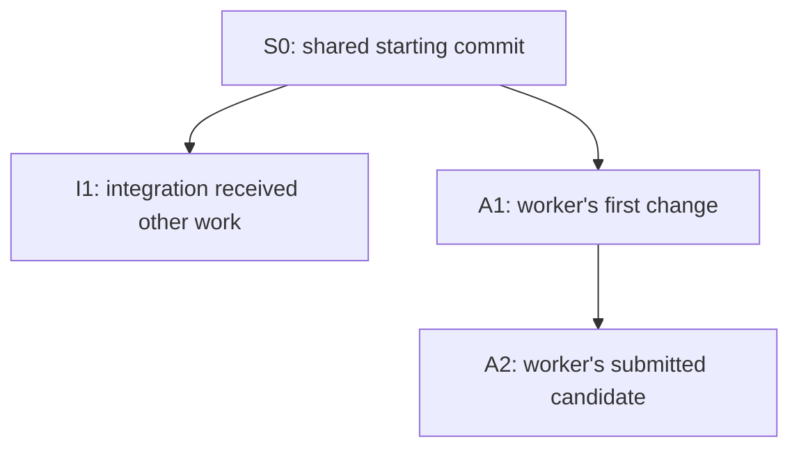
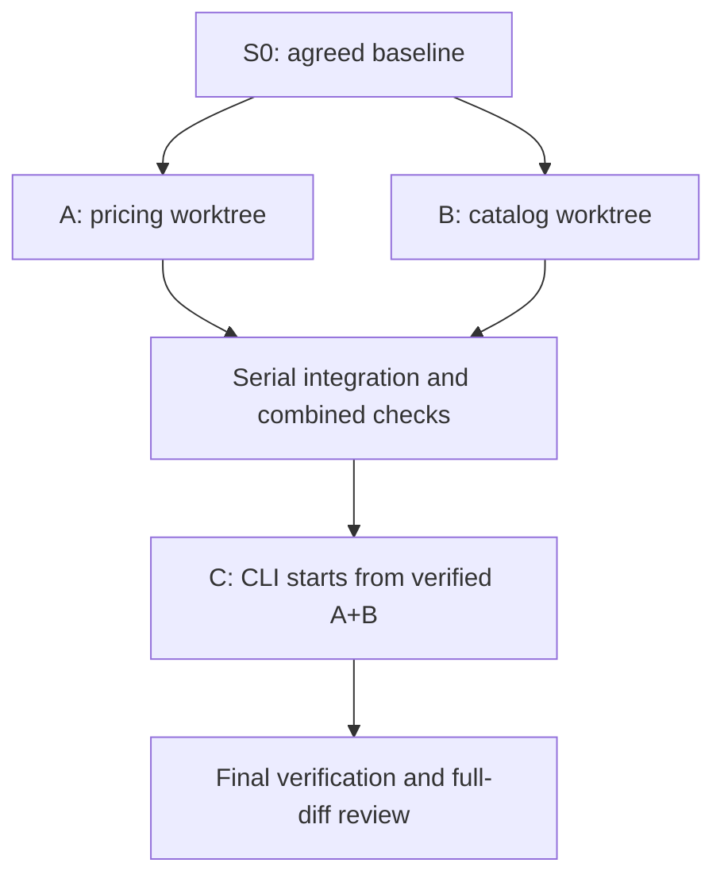

# Skills + Paseo: setup, daily development and PR validation manual

Version: PR #1 / proposed package 0.2.0. Documentation checked on 2026-10-26.

This manual teaches the workflow and gives you a repeatable laboratory for testing it. You will use Claude Code for planning/coordinating/review, Pi with DeepSeek for implementation, and Paseo to launch and observe the sessions. You can substitute available models while preserving independent review.

**Start with a disposable project.** Completing the example produces evidence about this PR's workflow; it does not demonstrate that ERPNext environments, migrations or browser tests are configured correctly.

The manual describes the actual branch in [PR #1](https://github.com/netname/pi-adapted-mp-skills/pull/1). The short operational contract remains [WORKFLOW.md](WORKFLOW.md); upgrade differences are in [MIGRATION-0.2.md](MIGRATION-0.2.md). When behavior differs from these instructions, record a validation finding instead of improvising a pass.

## Reading paths

| Your goal | Read / do |
| --- | --- |
| Understand the pieces | Sections 1–3 |
| Install on Ubuntu with a Windows client | Sections 4–7 |
| Use the skills on everyday work | Sections 8–10 |
| Validate this PR | Sections 11–16, using the bundled lab |
| Diagnose a problem | Section 17 |
| Repeat the workflow tomorrow | Section 18 |

Commands in `bash` blocks run in a terminal on the **execution host**. Blocks marked `text` are prompts to send to an agent, not shell commands. Replace uppercase placeholders such as `AGENT_ID` with real values. Shell variables expand in your terminal; they do not automatically expand when pasted into a chat message.

### Jump to a section

[Concepts](#1-what-you-are-building) · [Vocabulary](#2-vocabulary-you-will-use) · [Roles](#3-choose-a-role-arrangement) · [Host setup](#4-prepare-the-execution-host) · [PR checkout](#5-check-out-the-exact-pr-not-the-default-branch) · [Paseo profiles](#6-configure-paseo-and-profiles) · [Project setup](#7-configure-each-software-project) · [SWE cycle](#8-use-the-skills-across-the-software-engineering-cycle) · [Testing](#9-understand-tests-without-over-testing-every-edit) · [Integration](#10-what-happens-when-two-tickets-finish) · [Create lab](#11-worked-example-create-the-quotation-lab) · [Execute](#12-execute-the-graph-and-observe-it) · [Inspect](#13-inspect-the-final-result) · [Failure drills](#14-negative-exercises-prove-failures-remain-failures) · [PR decision](#15-decide-whether-pr-1-is-ready) · [Real application](#16-move-from-the-lab-to-a-real-application) · [Troubleshooting](#17-troubleshooting) · [Daily practice](#18-daily-checklist-and-retrospective)

## 1. What you are building

Imagine a small development team. You discuss the product with a planner. A coordinator assigns bounded work. Implementers build it in separate checkouts. Reviewers inspect the committed results. The coordinator combines only verified work and records what happened.

| Piece | Plain-language meaning | Owns | Does not establish by itself |
| --- | --- | --- | --- |
| Skill | A written procedure the agent reads | Method and task-specific instructions | That every instruction was followed |
| Harness | The program interacting with the model and tools, such as Pi or Claude Code | Session context and tool execution | Model diversity |
| Model | The selected reasoning/code model | The reasoning within a session | A separate workspace or independent evidence |
| Paseo | The host/client system managing agent sessions and workspaces | Session launch, observation and placement | Your application's test policy |
| Tracker | Durable task records: local Markdown or an issue service | Requirements, dependencies, claims and evidence links | Execution of tasks |
| Coordinator | One active agent following `implement-spec` | Scheduling, collection, integration and tracker writes | A durable background scheduler independent of that session |
| Worktree | Another working directory attached to the same Git repository | Independent source checkout and branch | Separate databases, ports, queues or credentials |
| CI | Deterministic automation running project checks | Repeatable verification and configured merge gates | Understanding ambiguous requirements |

Paseo uses installed coding-agent CLIs; those agents and their authentication must work on the host first. See [Paseo providers](https://paseo.sh/docs/providers). The division of workflow responsibilities above is this package's policy, defined by [implement-spec](../skills/engineering/implement-spec/SKILL.md).

### A workflow instruction is not an executable guarantee

The PR has two kinds of behavior:

- **Executable checks:** `frontier.mjs` validates a supplied graph; `review-target.mjs` rejects dirty review candidates and captures commit identities. The lab's `verify.mjs` runs acceptance suites and preserves their results.
- **Agent procedures:** choosing profiles, checking model families, creating worktrees, honoring concurrency limits, pausing at human decisions, reconciling a restart and merging serially.

A successful helper test does not prove the second group. That is why the lab includes observation and failure exercises. The supplied graph's `verified: true` field is an assertion supplied by the coordinator, not a Git/CI lookup performed by the frontier helper.

## 2. Vocabulary you will use

| Term | Meaning | Example |
| --- | --- | --- |
| Effort | A bounded objective that may span several sessions | Add a quote command |
| Decision ticket | A question to resolve before or during planning | Are quantities whole numbers or decimals? |
| Implementation ticket | A deliverable with acceptance criteria | Read a catalog from disk |
| Dependency | Work that must finish before another ticket starts | CLI depends on pricing and catalog loading |
| Frontier | Ready, unclaimed tickets with satisfied blockers | Pricing and catalog at the start |
| Claim | A recorded owner/run ID for a task | Ticket A belongs to one particular Paseo session |
| Spec | Agreed behavior, constraints and exclusions | Exact CLI inputs, outputs and errors |
| Seam | A public boundary where behavior can be tested | A function, catalog API or CLI process |
| Vertical slice | A small useful behavior across necessary layers | Quote one product from input to output |
| Base / head | Reference revision and proposed revision for a comparison | Agreed integration SHA / worker candidate SHA |
| Merge base | The common ancestor used to compare diverging branches | Shared starting point of A and B |
| Candidate | A committed revision awaiting verification/review | Ticket A's submitted commit |
| Integrated | Accepted into the integration branch after the required checks | A is now available to dependent work |
| HITL | Human-in-the-loop work | Grilling about a business rule |
| AFK | Work that can proceed without live product decisions | Researching an already precise question |

A worker saying “finished” is not the same as a ticket being integrated. A ticket being integrated is not always the same as its GitHub issue being closed: the project's tracker may defer closure until a PR merges.

### Base and head: which two versions are we discussing?

A Git commit identifies a saved revision of the project. Its SHA is the identifier you record as evidence. A branch name is a movable label pointing at a commit: the label stays the same as more commits are added.

For a review, **base** means the reference revision and **head** means the proposed revision. For example, base can be the integration commit a worker started from, and head can be the commit containing its finished ticket. Base does not always mean `main`, and head does not mean every file currently on disk.

Be careful with capitalization: Git's **`HEAD`** identifies the currently checked-out commit, usually through the current branch. Lowercase **head** in this manual means the proposed review endpoint. In the worker's checkout they may identify the same commit; in the coordinator's checkout they may differ. Uncommitted edits are not part of either commit. Source: [Git glossary](https://git-scm.com/docs/gitglossary).

In this package, the helper resolves the requested base/head to exact SHAs and requires the checkout to match the proposed head and be clean. Review evidence then names those saved versions, not a branch name that can move later. Example: “Spec review passed for base S0, head A2” is precise; “the feature branch was reviewed” is not enough after another commit lands.

### Merge base: where did these histories last share an ancestor?

When two branches diverge, their current tips no longer describe their shared starting point. Git finds a **merge base**: a best common ancestor of the two commits. In an ordinary branching history, this is the shared commit before the separate changes. Unusual histories can have multiple best common ancestors. Source: [git merge-base](https://git-scm.com/docs/git-merge-base).

Consider this history; S0, I1, A1 and A2 are teaching labels for commit SHAs:



If the requested base is I1 and the proposed head is A2, the merge base is S0. That distinction changes what a diff means:

| Comparison | Question it answers in this example |
| --- | --- |
| `git diff I1 A2` | How do the complete saved contents of I1 and A2 differ? |
| `git diff I1...A2` | What changed from their merge base S0 to A2? |

These labels must be replaced with real refs/SHAs if you run the commands. The three-dot form is directional: it compares the merge base to the second endpoint. It does not merge the branches or certify that their changes work together. Source: [git diff](https://git-scm.com/docs/git-diff).

The review helper records **requested base**, **merge base** and **head** separately. Here, reviewing the worker's changes means inspecting S0→A2. Testing integration compatibility requires constructing and checking a revision containing both I1's work and A2's work. They answer different questions.

### Candidate: a specific revision proposed for acceptance

**Candidate** is a workflow term, not a special Git object. It means “this exact committed version is being offered for verification and review.” It may be a worker's ticket result, a combined integration result, or the final proposed delivery.

In the lab, a worker might submit A1. The tests reveal a defect, so it repairs the code and commits A2. A2 is a new candidate: A1's evidence remains part of the history but does not approve A2. A candidate may pass, fail or be blocked; calling it a candidate says nothing about its quality yet.

For every candidate, keep its SHA, relevant base, test results, review reports and outstanding findings together. If source changes, identify the new candidate and refresh the applicable evidence. A report from yesterday cannot approve code that was added today.

### Integrated: accepted into the shared build of the effort

In this workflow, a ticket is **integrated** only when its accepted work is present on the effort's integration branch with the required verification and review evidence. A worker commit sitting on its own branch is not integrated, even if the worker has finished and its tests pass.

Continue the diagram's example: the coordinator combines I1 and A2 into a candidate M1. It verifies the combined behavior and refreshes review, then advances the integration branch to that accepted revision. The tracker records the integrated SHA and evidence. Only then can dependent tickets rely on A's behavior being available in their starting checkout.

A merge commit is not always needed: when the integration branch has not advanced, a fast-forward can accept the reviewed worker revision directly. What matters to this workflow is the accepted shared revision and its evidence, not whether Git created an extra merge commit.

| Statement | What it establishes |
| --- | --- |
| “The worker finished” | A session reported completion |
| “Candidate A2 passed its checks” | A particular revision satisfied those checks |
| “Ticket A is integrated at M1” | Its work is accepted into the shared integration revision |
| “The PR merged into main” | The delivery branch was accepted into the target branch |
| “The release was deployed” | The delivered software reached a runtime environment |

These milestones can occur at different times. Integrated does not mean deployed, and it does not necessarily close a GitHub issue. Source for the package-specific meanings of candidate and integrated: [coordinator procedure](../skills/engineering/implement-spec/SKILL.md) and [testing policy](../skills/engineering/_shared/TESTING.md).

## 3. Choose a role arrangement

Use this as a starting arrangement, not a requirement to purchase named model versions:

| Role | Suggested harness | Model family | Fresh session? |
| --- | --- | --- | --- |
| Planning / grilling | Claude Code | Claude | Keep related discussion together |
| Coordinator | Claude Code | Claude | One active coordinator per effort |
| Implementation | Pi | DeepSeek | Yes, one per ticket |
| Spec reviewer | Claude Code | Claude | Yes, independent of implementation |
| Standards reviewer | Claude Code | Claude | Yes, separate from Spec reviewer |
| Researcher | Source-capable configured harness | Any suitable available family | Yes, one question per worker |

The PR requires both review axes to use a family different from **every implementation family contributing to the target**. Two Claude reviewers are acceptable when implementation is DeepSeek. Changing from Pi/DeepSeek to Claude Code/DeepSeek does not create model independence. Neither does opening a new tab with the same implementing family.

If the Claude coordinator starts writing implementation code, record Claude as an implementation contributor. The original Claude review arrangement no longer satisfies the policy for that candidate. Delegate code fixes to the implementation profile, or select another reviewer family. Keep a provenance list; do not erase a contributing family because its session ended.

You do not need to remove Codex to use Claude Code. This lab simply does not require a third harness. Adding one is a separate choice about accounts, capabilities and cost.

Create actual profiles using the models offered by your host. Record exact IDs in the project configuration. Profile names such as “review” are labels, not evidence that a different model ran. This requirement comes from the package's [delegation policy](../skills/engineering/_shared/DELEGATION.md).

## 4. Prepare the execution host

### Windows and Linux are both execution-host options

**Yes: the execution host can be Windows or Linux.** The execution host is the environment where the Paseo daemon launches the agent processes and where their repositories, worktrees and tests run. It need not be a separate server. Paseo offers Windows and Linux desktop builds; Pi documents both native Windows and WSL operation. Sources: [Paseo downloads](https://paseo.sh/download), [Pi on Windows](https://pi.dev/docs/latest/windows).

| Arrangement | Execution environment | Where to install the agents and keep the lab |
| --- | --- | --- |
| Everything on a Windows PC | Native Windows | Windows, using Windows paths |
| Everything on a Linux PC/server | Linux | Linux, using Linux paths |
| Windows client connected to Ubuntu | Remote Ubuntu | Ubuntu; Windows is the viewing/control client |
| Windows PC with a Linux environment in WSL | Linux inside WSL, when that is where the daemon/workers run | Inside the selected WSL environment |

For the first validation run, keep the daemon, providers and lab together in one environment. Merely installing WSL does not turn a native Windows Paseo session into a Linux session. Check which host launched the worker and the worker's actual directory.

The Ubuntu arrangement below is a worked setup choice, not a requirement of the skills. Native Windows support in the underlying tools is also not proof that this PR has passed its Windows acceptance run: record each platform you actually test.

### Shell syntax depends on your chosen host

Most command blocks in this manual use Bash. Run them in a suitable Bash terminal, or translate them deliberately to PowerShell. Native Windows Pi uses Git Bash by default for Bash commands; its optional PowerShell tool is a separate shell choice. Follow [Pi's Windows instructions](https://pi.dev/docs/latest/windows) for setup. WSL runs the Linux form of the tools.

For example, these are complete equivalent variable assignments, using illustrative paths:

```bash
export MP_SKILLS="$HOME/dev/pi-adapted-mp-skills-pr1"
export MP_LAB="$HOME/dev/paseo-quote-lab-01"
```

```powershell
$env:MP_SKILLS = "C:/dev/pi-adapted-mp-skills-pr1"
$env:MP_LAB = "C:/dev/paseo-quote-lab-01"
```

In PowerShell, subsequent references are `$env:MP_SKILLS` and `$env:MP_LAB`; Bash uses `$MP_SKILLS` and `$MP_LAB`. Bash `export`, backslash continuations and heredocs are not PowerShell syntax. The Linux Claude installer below also needs the official Windows alternative if you choose native Windows. Use the [Claude Code quickstart](https://code.claude.com/docs/en/quickstart).

The Node helpers use platform path APIs, but the complete Windows/provider workflow still needs its own validation. The `npm run smoke` entry point specifically invokes Bash. Do not infer that every command block is a native PowerShell command because Node itself runs on Windows.

### Recommended arrangement for a Windows workstation and Ubuntu server

Put Git repositories, worktrees, Node, Pi, Claude Code and the Paseo daemon on **the same Ubuntu host**, under the same ordinary development user. Use Windows as the client/editor/terminal. This keeps absolute paths, CLI credentials and test environments consistent.

Do not configure a reviewer with a Windows path when its agent runs on Ubuntu. A Windows installation of a provider does not automatically make that provider available to a remote Paseo daemon. A separately running Windows daemon is a different host with different settings.

On the Windows client, first confirm `ssh user@your-ubuntu-host` works using your SSH key/agent. In Paseo Desktop choose **Settings → Add host → Remote SSH** and enter `ssh://user@your-ubuntu-host`. The remote daemon must already be running; connecting through SSH does not install or start it. Select that host before opening the lab. These steps come from [Paseo connectivity](https://paseo.sh/docs/connectivity).

For the lab you need Git, Node supported by your installed agents, npm, a working Pi model, and a working independent Claude model. The lab/helpers themselves require Node 20 or newer and no npm dependencies. Authentication and model calls may incur charges under your existing accounts.

In the Ubuntu terminal:

```bash
git --version
node --version
npm --version
```

If Git commits have no identity, configure the desired name and email in the disposable lab after initializing it. Do not overwrite your global Git identity just to run the example.

### Install or verify Pi

If Pi already works, keep it and record the version. For a new npm-based installation, the current official package is:

```bash
npm install -g --ignore-scripts @earendil-works/pi-coding-agent
pi --version
pi
```

Configure/authenticate your existing DeepSeek access in Pi, select it with `/model`, and perform a trivial request. Do not replace a working provider configuration with an invented endpoint or model ID. Pi's [installation page](https://pi.dev/) and [model-selection guide](https://pi.dev/docs/latest/models) are the source of truth for the installed version.

### Install or verify Claude Code

The official native Linux installer is:

```bash
curl -fsSL https://claude.ai/install.sh | bash
claude --version
claude
```

Complete the CLI's login process on the execution host and check a simple request. Use the [official quickstart](https://code.claude.com/docs/en/quickstart) for authentication or platform-specific alternatives. Do not put API keys in the lab, tracker, evidence or PR.

### Install or verify Paseo

For headless Ubuntu, the documented CLI path is:

```bash
npm install -g @getpaseo/cli
paseo
```

Follow the host's connection/pairing flow. A desktop installation bundles and starts its own daemon; do not accidentally validate against that local daemon when your source and providers live on Ubuntu. See [Paseo getting started](https://paseo.sh/docs) and [connectivity](https://paseo.sh/docs/connectivity).

Before installing or updating over an existing setup, record versions and account configuration. Do not run broad global upgrades midway through a validation run.

## 5. Check out the exact PR, not the default branch

A package install from the repository's default branch does not validate an unmerged PR. Use a dedicated checkout of the PR branch:

```bash
mkdir -p "$HOME/dev"
cd "$HOME/dev"
git clone --branch improve/paseo-testing-workflow --single-branch \
  https://github.com/netname/pi-adapted-mp-skills.git \
  pi-adapted-mp-skills-pr1
export MP_SKILLS="$HOME/dev/pi-adapted-mp-skills-pr1"
cd "$MP_SKILLS"
git rev-parse HEAD
npm test
```

### What each command does

The block above prepares a local copy of the **skills package** and tests that package. It does not yet create the quotation lab, install the skills into Pi, start Paseo, or launch AI workers. Those steps come later.

Run these commands in order in a Bash terminal on the chosen execution host. If a command reports an error, stop and resolve it before continuing; separate lines in an interactive shell do not automatically stop after a failure.

| Command | Explanation | Expected result |
| --- | --- | --- |
| `mkdir -p "$HOME/dev"` | Creates a `dev` directory inside your home directory. `-p` creates missing parent directories and tolerates an existing directory. `dev` is simply our chosen folder name for development projects. | The directory exists; success normally prints nothing. |
| `cd "$HOME/dev"` | Changes this terminal's current working directory to that folder. The relative destination in the next command will be created here. | The terminal is now working in your development folder. |
| `git clone …` | Downloads the repository and checks out the selected PR branch into a new local directory. The three displayed lines are one command; see the breakdown below. | A `pi-adapted-mp-skills-pr1` directory containing the repository, with the PR branch checked out. |
| `export MP_SKILLS="$HOME/dev/pi-adapted-mp-skills-pr1"` | Defines an environment variable holding the absolute path to that checkout. `export` also makes it available to programs launched from this shell. It stores a path; it does not install or copy anything. | Later commands can refer to the checkout as `$MP_SKILLS`. |
| `cd "$MP_SKILLS"` | Enters the skills repository using that variable. | Commands now run from the directory containing the package's `package.json`. |
| `git rev-parse HEAD` | Prints the full commit ID currently checked out. Record it to identify exactly which revision you tested, even if the PR branch advances later. | A hexadecimal commit SHA. Save it as the **skills-under-test SHA**. |
| `npm test` | Executes the `test` script defined by this repository's `package.json`. Here it validates the skills and runs the offline helper/lab tests. | A validation result and test summary; success requires no failing checks and exit code 0. |

### Understand the clone command

Here is the complete command again, with its original line breaks:

```bash
git clone --branch improve/paseo-testing-workflow --single-branch \
  https://github.com/netname/pi-adapted-mp-skills.git \
  pi-adapted-mp-skills-pr1
```

- `git clone` creates a local Git repository from the remote repository.
- `--branch improve/paseo-testing-workflow` selects the branch containing this PR instead of the default branch. The slash is part of the branch name, not a request to create an `improve` folder.
- `--single-branch` limits the clone to the selected branch's history and configures ordinary future fetches for that branch. It does not mean “one commit”; this command has no shallow-history option.
- The HTTPS URL identifies the source repository on GitHub.
- `pi-adapted-mp-skills-pr1` is the local destination directory name. It is deliberately distinct from an ordinary checkout so you can recognize it as the PR-validation copy.
- Each trailing `\` continues the same Bash command onto the next line. It must be the final character before the newline—do not add spaces or a comment after it.

The command downloads the branch's state at the time you clone. It does not merge the PR, modify GitHub or automatically keep the local checkout updated. Source: [git clone reference](https://git-scm.com/docs/git-clone).

### Understand the paths and variables

`$HOME` is the current user's home directory as seen by this Bash environment. On Linux it might be `/home/alberto`; under native Windows Git Bash it commonly points into the Windows user directory. Use the actual value for your host rather than assuming the example username.

Double quotes keep paths containing spaces together as one argument while still allowing `$HOME` and `$MP_SKILLS` to expand. `MP_SKILLS` is a name chosen for this manual, not a built-in Git, Pi or Paseo setting. The manual later uses `MP_LAB` for the separate application being built: do not point both variables at the same directory.

For example, if `$HOME` is `/home/alberto`, the commands create/use `/home/alberto/dev/pi-adapted-mp-skills-pr1`. They leave your terminal inside that checkout. To inspect your actual paths, run:

```bash
printf '%s\n' "$HOME"
printf '%s\n' "$MP_SKILLS"
pwd
```

The variable assignment lasts for the current shell and processes it launches; it does not permanently configure every terminal or an already-running Paseo daemon. A fresh terminal generally needs the `export MP_SKILLS=…` line again. See section 4 for the separate PowerShell variable syntax.

### Understand the test result

`npm test` is a project-defined command, not a universal suite that npm supplies. For this checkout, [package.json](../package.json) defines it as skill validation followed by Node's test runner. If skill validation fails, the test runner is not started. No dependency installation or model authentication is needed for these offline checks.

At this manual revision the package has 11 offline tests; future PR revisions can change that count. Judge success by the complete result and exit status, not by matching a fixed number. In Bash, `echo $?` immediately after `npm test` prints that command's exit status: `0` means success; a nonzero value means it failed. Run it immediately because another command replaces the status.

Passing here means the package's static/helper checks passed on this machine. It does not mean the quotation application has been implemented or the live Paseo workflow has been validated. Those are later exercises. Sources: [npm test reference](https://docs.npmjs.com/cli/v11/commands/npm-test/) and this repository's [test script](../package.json).

If the directory already exists, inspect it before fetching/checking out. Do not run the clone command over it or reset away local changes. Record the SHA printed by `git rev-parse HEAD` as **skills-under-test SHA**. Keep this checkout unchanged throughout one validation run; fetching a new PR revision requires a new run record.

The package's offline tests validate skill structure and helper behavior. They do not launch Paseo. No `npm install` is required for this package's tests.

Keep `MP_SKILLS` available in the terminal for later commands. After opening a new terminal, set it again to the same absolute path.

### How the Pi install works

Install the complete directory into the **lab project's** configuration, after creating the lab in section 11:

```bash
cd "$MP_LAB"
pi install -l "$MP_SKILLS"
```

Local-path packages are loaded from that location; `-l` records a project installation. Pi must trust the project before loading its project packages. Check startup diagnostics and reload after edits. Avoid a second copy of these skills under another skill directory, because duplicate names can shadow the version you intended to test. See [Pi packages](https://pi.dev/docs/latest/packages) and [Pi skills](https://pi.dev/docs/latest/skills).

The updated package does not require removing your existing pi-subagents or pi-web-access installations. Keep them if other workflows use them. Their presence must not cause this workflow to silently use the old delegation path.

## 6. Configure Paseo and profiles

### What is a profile?

A **Paseo agent profile** is a named preset of launch settings: provider, model, thinking level, mode and supported features, with notes describing when to use it. It saves choosing those options repeatedly. Profiles are saved on a particular host; changing one affects future selections, not sessions already launched. Source: [Paseo agent profiles](https://paseo.sh/docs/agent-profiles).

For this workflow, imagine a preset named `mp-build` that selects Pi and your configured DeepSeek model. The coordinator selects those settings, then gives a fresh worker its actual assignment: “Implement ticket A in this worktree.” `mp-spec-review` selects your Claude review settings, then receives the Spec brief and a particular candidate to review. These example names have no built-in meaning.

Keep four concepts separate:

| Concept | Example | What it supplies |
| --- | --- | --- |
| Agent profile | `mp-build` | Saved launch settings |
| Role brief | `agents/mp-review-spec.md` | How to perform a role |
| Task prompt | Review ticket A at a specific SHA | The assignment for this run |
| Session / run | A concrete Paseo agent ID | The actual execution and its history |

The profile is not a running agent, a skill, a worktree or a ticket. Several fresh sessions can use the same profile. The coordinator still needs to place them in the correct workspaces and send the right instructions. In this package, role briefs are supplied explicitly; naming a profile `mp-spec-review` does not automatically load that file.

Also distinguish **agent profiles** from this manual's **test profiles**. Fast / Verify change / Verify candidate are project-defined selections of checks. They do not select an AI model or create a Paseo agent.

In the selected execution host's settings:

1. Confirm that Pi and Claude Code are discovered and can start sessions.
2. Open **Settings → host → Agents** and enable Paseo tools. Start/reload the coordinator afterward so it receives those tools.
3. Create profiles for planning/coordinator, implementation, Spec review, Standards review and research.
4. For each profile, select the actual provider, model and appropriate mode/thinking setting.
5. Add short “When to use” notes, then send an explicit task when creating a session.

Tool injection is disabled by default. CLI orchestration is an alternative; enabling injection is useful for this lab because it makes delegation directly visible to the coordinator. Sources: [orchestration](https://paseo.sh/docs/orchestration), [profiles](https://paseo.sh/docs/agent-profiles), [MCP reference](https://paseo.sh/docs/mcp).

Suggested profile notes, written in your own profile UI:

| Profile label | Notes |
| --- | --- |
| `mp-plan` | Planning and single-coordinator work. Delegate implementation; keep tracker/integration ownership. |
| `mp-build` | Implement one ticket in its allocated worktree. Return committed revision and verification evidence. Do not dispatch reviews. |
| `mp-spec-review` | Fresh Spec-axis review. Read the supplied brief/spec/diff. No source edits or test execution. |
| `mp-standards-review` | Fresh Standards-axis review. Read project standards and supplied brief/diff. Separate blocking violations from suggestions. |
| `mp-research` | Bounded primary-source research. Save a cited artifact; make uncertainties visible. |

These are proposed labels; they are not preinstalled profiles or special Paseo keywords. Record their real model settings in `docs/agents/delegation.md` inside the target project.

### Prove a profile works before using the full graph

Start one harmless session for each harness. Ask it to report its working directory and read one project file. Independently inspect the effective model/provider in the host's session settings or available status metadata. Save that inspection as evidence. Do not accept only “I am Claude” in generated prose.

If Paseo does not expose enough information to verify the effective model, record the limitation. Under this PR's policy the independent-review gate remains unverified until you can establish it; do not silently weaken the gate.

Reviewers are instructed to be read-only. Configure actual provider permissions where available. Neither profile notes nor a “plan” label by itself proves filesystem isolation. The coordinator checks candidate cleanliness afterward.

### Useful observation commands

Use the app for the first run; these commands help when diagnosing it:

```bash
paseo --help
paseo ls -a -g --json
paseo workspace ls
paseo logs AGENT_ID
paseo provider diagnostic claude
```

Run them on the intended host. Confirm options with the installed CLI's help if its version differs. Do not infer exact model/profile launch flags from these examples. The coordinator should use discovered tool schemas. Sources: [CLI reference](https://paseo.sh/docs/cli) and [MCP reference](https://paseo.sh/docs/mcp).

## 7. Configure each software project

Run setup once in the target project, then update only changed decisions:

```text
/skill:setup-matt-pocock-skills
```

For the lab, add this instruction:

```text
Preserve the supplied local tracker, agreed quote spec and testing contract.
Use the canonical absolute tracker path already in AGENTS.md.
Populate delegation.md from the actual Paseo host profiles; do not invent model IDs.
Do not change global installations, supplied acceptance tests or the lab's scope.
Report any setup instruction that conflicts with the installed Pi/Paseo version.
```

Expected project artifacts:

| File | What it tells the agent |
| --- | --- |
| `AGENTS.md` | Short navigation pointers and project-wide constraints |
| `GLOSSARY.md` | Meaning of domain terms |
| `docs/adr/…` | Durable decisions when their tradeoffs warrant an ADR |
| `docs/agents/issue-tracker.md` | Where tasks live and how status/claims/closure work |
| `docs/agents/triage-labels.md` | Project's labels for incoming work, when configured |
| `docs/agents/delegation.md` | Real profiles, model families, concurrency and retries |
| `docs/agents/testing.md` | Commands, test selection, environments and evidence |
| Spec and ticket files/issues | Behavior and dependency graph for this effort |

### Use the same procedure from Claude Code

This is a Pi-native package. Installing it with Pi does not register `/skill:…` commands in Claude Code. For PR validation, use the exact same files by explicit path, without maintaining another copied installation:

```text
Read /ABSOLUTE/SKILLS/PATH/skills/engineering/setup-matt-pocock-skills/SKILL.md
and follow that procedure for /ABSOLUTE/PROJECT/PATH.
Resolve relative references from the skill's directory, not from the project directory.
Treat Pi-only installation checks as checks of the Pi worker environment.
Use discovered Paseo tools for delegation. Do not invoke an imaginary /skill command here.
```

Apply the same pattern to `wayfinder`, `grill-with-docs`, `to-spec`, `to-tickets` or `implement-spec`. This explicit-file route tests the PR's adaptations. Switching to an independently installed upstream Claude skill would test a different workflow.

You may later add a small project `CLAUDE.md` pointer to shared project instructions, but it is not necessary for the lab when the coordinator supplies them explicitly. Do not copy all instructions into multiple files and then maintain them separately.

### Two setup traps this PR still needs to expose

**Skill command visibility.** The current setup skill inherits a claim that `enableSkillCommands: false` makes skills unreachable. Current Pi documentation says manually typed `/skill:name` commands still work even when interactive command discovery is disabled. If setup stops solely for that reason, record a compatibility defect; for the main lab keep command discovery enabled. Do not interpret the inherited claim as current Pi behavior. Source: [Pi skills, “Understand how skills load”](https://pi.dev/docs/latest/skills#understand-how-skills-load).

**Local tracker location.** Git worktrees do not share untracked/ignored files. The generic local tracker uses `.scratch/`, so a worker must receive the **canonical absolute path** in the original lab directory. The bundled lab makes this explicit. If a worker creates a second tracker in its own worktree, validation fails even if the implementation is correct. This is a project configuration requirement, not an automatic tracker service supplied by Paseo.

## 8. Use the skills across the software engineering cycle

Not every change needs every stage. Enter at the first stage where you lack a necessary decision or artifact.

| Stage | Main skill(s) | Your role | Output / evidence |
| --- | --- | --- | --- |
| Intake | `triage`, `ask-matt` | Clarify the request and priority | Routed issue, missing facts |
| Explore a large uncertainty | `wayfinder`, `research` | Decide destination and answer HITL questions | Decision map, cited research, resolved questions |
| Define behavior | `grill-with-docs`, `domain-modeling`, `prototype` | Answer business questions and inspect examples | Shared language, decisions, prototype where useful |
| Specify | `to-spec` | Approve seams/behavior not already agreed | Spec with exclusions and testing decisions |
| Decompose | `to-tickets` | Check useful slices and real dependencies | Approved task graph |
| Build | `implement-spec` / `implement`, `tdd` | Observe or resolve new product questions | Committed worker candidates and check evidence |
| Review | `code-review` | Decide genuine tradeoffs or requirement changes | Separate Spec/Standards findings tied to revisions |
| Integrate | `implement-spec` | Approve delivery when appropriate | Verified combined revision |
| Deliver | `pr` | Review and authorize the merge/release | PR evidence, residual risks and required checks |
| Maintain | `diagnosing-bugs`, `improve-codebase-architecture` | Confirm reproduced behavior / scope | Regression fix or scoped improvement |
| Improve the process | `retro` | Choose useful improvements | Targeted workflow/check changes |

The relevant procedures live in the [engineering skills directory](../skills/engineering) and [productivity skills directory](../skills/productivity). A PR description is not a deployment process: add the application's release, rollback, migration and operational checks in its own project policy.

### When to keep a session, and when to start a fresh one

Keep grilling → spec → tickets in the same planning conversation when the reasoning still fits. That preserves why decisions were made. Persist the decisions anyway: another session must be able to continue without reading the entire chat.

Start each implementation ticket with a fresh context and specific pointers. Start each review axis fresh. A reviewer needs the agreed behavior, standards, candidate source and diff—not the implementer's persuasive explanation of why its code is correct.

The coordinator can continue across ticket completions while its context remains manageable. When it restarts, it must reconstruct state from tracker records and real Paseo/Git state before dispatching anything.

### Planning prompts

For an uncertain effort:

```text
Use wayfinder to find the route to a small quoting tool.
Chart unresolved decisions and dependencies. Batch only ready research.
Pause at human business decisions; do not answer the grilling questions for me.
Do not implement yet.
```

For a bounded change:

```text
Use grill-with-docs to clarify this behavior, then to-spec and to-tickets.
Reuse decisions already agreed in the project. Tell me what new decision is needed
before asking me to reconfirm an existing one.
```

In Pi, invoke the explicit `/skill:name` form when you want to force a skill. In Claude Code, prepend the explicit-file instruction from section 7.

## 9. Understand tests without over-testing every edit

A **category** says what boundary the test crosses. A **profile** says which checks to run at a particular workflow point.

| Category | Lab example | What it can catch | What it does not prove |
| --- | --- | --- | --- |
| Unit | `calculateTotalCents(1250, 3)` returns `3750` | Arithmetic, validation, overflow | Real file reading or CLI wiring |
| Component | A public module exercised as a whole | Module behavior behind its interface | Every external dependency |
| Integration | `loadCatalog(path)` reads a real temporary JSON file | Parsing, filesystem errors, catalog validation | User-facing CLI composition |
| E2E | Start the CLI process with a real catalog and inspect output/exit | Full command-line user journey | Browser/UI behavior in another application |

The lab combines component-level catalog behavior with integration against the filesystem; categories can overlap. Do not manufacture a fourth suite just to fill a classification table.

| Execution profile | Purpose | Lab behavior |
| --- | --- | --- |
| Fast | Short feedback while editing | Run the relevant focused suite; dirty source is allowed |
| Verify change | Check a committed ticket candidate | A: unit; B: integration; C: all |
| Verify candidate | Check the combined integrated state | A only: unit; A+B: unit + integration; final: all |

Before the CLI ticket exists, its acceptance tests are intentionally red. That is not a failure of A or B. Conversely, final delivery cannot skip them. Test selection follows the **delivered behavior**, not a blanket “run everything after every edit” rule. See [testing policy](../skills/engineering/_shared/TESTING.md).

For a database-backed application, worktrees still share a database unless you configure otherwise. Either allocate isolated databases/sites/namespaces per run or serialize tests through an exclusive environment lease. A lease needs an owner, acquisition/release rules and recovery after failure. A text note alone is not a concurrency lock.

## 10. What happens when two tickets finish

Suppose A and B started from integration revision `S0`:



1. A commits a candidate and verifies it. The coordinator arranges both independent reviews.
2. If integration is still `S0`, A can advance it to the reviewed candidate.
3. B's original candidate was based on `S0`. After A lands, B is no longer a direct replacement for integration. The coordinator constructs a combined candidate based on the latest integration tip.
4. That combined candidate gets the required checks and refreshed review. Only then does integration advance again.
5. C starts only after both A and B have verified integration records.

Even a conflict-free merge produces a different target. A green B branch does not by itself prove A+B is green. This is enforced as a procedure in [implement-spec](../skills/engineering/implement-spec/SKILL.md); the lab checks whether the coordinator actually follows it.

## 11. Worked example: create the quotation lab

### What you will build

An operator runs:

```bash
node src/cli.mjs catalog.json PEN 3
```

For a product named `Bolígrafo`, priced at 1250 cents, the successful output is:

```json
{"sku":"PEN","name":"Bolígrafo","quantity":3,"totalCents":3750}
```

There is no completed implementation in the scaffold. The agents must create it. The bundled tests are customer-supplied acceptance examples. They are not permission to modify tests until the application looks green.

### Generate a new directory

These commands assume section 5 set `MP_SKILLS`:

```bash
export MP_LAB="$HOME/dev/paseo-quote-lab-01"
node "$MP_SKILLS/examples/validation-lab/create.mjs" "$MP_LAB"
cd "$MP_LAB"
git init -b main
pi install -l "$MP_SKILLS"
```

The generator refuses an existing destination. Use a new numbered directory for a fresh attempt rather than deleting a failed run's evidence. It does not initialize Git, install providers, launch agents or modify your global setup.

Generated artifacts include:

- A complete agreed spec in `docs/specs/quote.md`.
- A glossary, standards, project instructions and testing/tracker configuration.
- Acceptance tests for pricing, catalog I/O and CLI behavior.
- Three Markdown tickets and a derived graph under `.scratch/quote-demo/`.
- A delegation template requiring your real profile/model settings.

Run setup as described in section 7, or fill the delegation table yourself. Resolve every `configure` value before execution. Preserve the supplied spec and tracker location.

Then commit the baseline, including any project package declaration and configuration:

```bash
cd "$MP_LAB"
git add .
git commit -m "Define quote lab specification, acceptance tests and workflow"
git rev-parse HEAD
```

Record this as **lab baseline SHA**. It is different from the **skills-under-test SHA**. The tracker/evidence under `.scratch/` is ignored and must be retained separately; it is not saved by this commit.

Register/open this lab on the intended Paseo host. The documented CLI route is:

```bash
cd "$MP_LAB"
paseo project create
```

Alternatively open the directory through the app. Check the selected host and directory before starting the planning/coordinator session. See [Paseo CLI projects](https://paseo.sh/docs/cli#projects).

### Record the environment first

Copy [VALIDATION-REPORT.md](VALIDATION-REPORT.md) into the lab's `.scratch/quote-demo/` as `validation-report.md`. Fill its environment section. Record actual Node/Git/Pi/Paseo/Claude versions and exact models. No secrets belong in the report.

### Optional planning rehearsal

The ready-made spec and tickets make execution repeatable. To exercise the earlier SWE stages too, run this rehearsal before implementation:

1. Ask Wayfinder to investigate a quote tool, but put its map in a separate `.scratch/quote-discovery/` directory.
2. Create two independent research questions: how Node reports CLI exit status, and how its standard library reads a UTF-8 file. Ask for current official sources and saved notes.
3. Create one HITL decision: integer quantities versus measured/decimal quantities. Observe that the coordinator asks you; answer “positive whole quantities for this lab.”
4. Resolve money representation: integer cents. Confirm no tax, discounts or inventory.
5. Use grilling, then `to-spec` and `to-tickets`, asking the agent to compare its result with the supplied reference rather than overwriting it.

Success means cited research artifacts, no blocked research launched prematurely, the human decision preserved and a graph equivalent to A+B→C. Prose need not match word-for-word. If the planner invents ERPNext requirements or answers the human decision itself, record a failure.

Use the supplied reference spec/tickets for the execution test after the rehearsal. This separates planning variability from orchestration correctness.

## 12. Execute the graph and observe it

### First, inspect the frontier yourself

```bash
node "$MP_SKILLS/scripts/frontier.mjs" \
  "$MP_LAB/.scratch/quote-demo/graph.json"
```

Expected result:

```json
["A", "B"]
```

C must not be included. The graph is an export of ticket state. Have the coordinator regenerate it after transitions; do not independently edit it to unblock a ticket.

### Start the coordinator

Start one fresh Claude Code session inside Paseo for the lab, using your planning/coordinator profile. Supply this prompt with the two absolute paths filled in:

```text
Read /ABSOLUTE/SKILLS/PATH/skills/engineering/implement-spec/SKILL.md and follow it
for /ABSOLUTE/LAB/PATH. Resolve skill references relative to their files.

Use the agreed spec at docs/specs/quote.md and the canonical tracker path in AGENTS.md.
Read project tracker, delegation and testing configuration. The spec and three-ticket
breakdown are approved for this validation run. Do not reconfirm existing decisions.

Use the configured Paseo implementation and independent review profiles.
Maximum two implementation workers. You are the sole tracker and integration writer.
Do not implement code yourself. Never have a worker dispatch its own review.

Create a dedicated integration branch/worktree from the committed lab baseline.
For this first supervised run, launch A and B into separate worktrees and ask both to
pause before editing until I have inspected their run IDs, base revisions, worktree
paths and effective models. This is an observation checkpoint, not a new requirement.

Once I release them, continue the graph automatically through committed verification,
two-axis review and serial integration. Do not launch C before verified integration
of A and B. Use the lab evidence runner for committed checks. Record every transition.

Use only local delivery for this disposable lab. Do not create a remote repository,
push, merge main, or delete worktrees/evidence before I inspect the results.
If a capability cannot be verified or a required check fails, record the blocker.
```

### At the observation checkpoint

Inspect both workers in Paseo and run this in the original lab terminal:

```bash
git -C "$MP_LAB" worktree list --porcelain
```

Record these observations:

| Check | Expected |
| --- | --- |
| Worker identity | Distinct A and B run IDs |
| Worktree | Distinct absolute directories and branches |
| Base | Both start from the approved integration revision |
| Implementation model | The effective configured implementation family, not just its label |
| Tracker | Both claimed once; C still unclaimed |
| Ownership | Only coordinator edits tracker/integration |
| Source | No worker writing in another worker's checkout |

Then release both:

```text
The observation checkpoint is complete. Release A and B and continue automatically
within the configured limits. Record worker, review and integration evidence.
Pause only for a genuine blocker, required human decision or the final inspection.
```

This is the only intentional launch checkpoint. You should not need to type “run the next ticket” for C. If you do, the automatic frontier loop did not pass its intended validation.

### What to watch as work progresses

A and B may finish at different times. That is normal. Their implementation periods should overlap in this deliberately staged run. The exact completion order does not matter.

The coordinator must collect a **commit SHA**, not just a final chat message. It must arrange two review sessions with the role briefs, exact source/diff and relevant spec/standards. It must preserve failed results and use the configured retry budget.

For B's integration after A, or vice versa, expect a new combined candidate and evidence for both implemented seams. C's starting revision should contain both accepted modules. When C finishes, final acceptance requires all suites plus review of the full diff from the original baseline.

### Run the committed verification helper yourself when needed

Set `MP_CANDIDATE` to the actual worktree path shown by the coordinator:

```bash
export MP_CANDIDATE="/absolute/path/to/candidate-worktree"
node "$MP_SKILLS/examples/validation-lab/verify.mjs" \
  "$MP_CANDIDATE" unit "$MP_LAB/.scratch/quote-demo/evidence"
```

Profiles are `unit`, `integration`, `e2e`, `combined-ab` and `all`. Use `all` for the final result. The helper prints a JSON manifest and creates a unique evidence directory containing stdout/stderr logs. It returns a nonzero exit for failed tests, timeouts, dirty source or a changed HEAD.

Use an ignored evidence directory or one outside the candidate. Putting evidence in an unignored source directory dirties the candidate and correctly fails verification. The helper runs the supplied acceptance suites; if you add other required checks, extend the project contract and run/preserve those too.

## 13. Inspect the final result

Ask the coordinator for the final integration worktree path, SHA, original baseline SHA, all ticket records, review artifacts and verification manifest locations. Do not accept “all green” without those pointers.

### Inspect behavior

Create a catalog outside the candidate source checkout:

```bash
cat > "$MP_LAB/.scratch/quote-demo/catalog.json" <<'JSON'
[{"sku":"PEN","name":"Bolígrafo","unitPriceCents":1250}]
JSON
node "$MP_CANDIDATE/src/cli.mjs" \
  "$MP_LAB/.scratch/quote-demo/catalog.json" PEN 3
```

Expected: exactly the JSON quote shown in section 11, exit code 0, no stderr. Use the E2E suite for the formal assertions; visual output alone is not sufficient.

### Inspect verification and source

```bash
node "$MP_SKILLS/examples/validation-lab/verify.mjs" \
  "$MP_CANDIDATE" all "$MP_LAB/.scratch/quote-demo/evidence"
git -C "$MP_CANDIDATE" status --short
git -C "$MP_CANDIDATE" log --oneline --graph --all
```

Expected: manifest `passed: true`, required tests executed, clean candidate, and history retaining both parallel changes. Compare the manifest's head with the final revision in the tracker and review reports.

### Capture a full review target

Use the lab baseline SHA you recorded, not a branch name that may move:

```bash
export MP_BASELINE="paste-the-recorded-lab-baseline-SHA"
node "$MP_SKILLS/scripts/review-target.mjs" \
  --repo "$MP_CANDIDATE" --base "$MP_BASELINE" --head HEAD
```

The helper prints the temporary artifact directory. Read its manifest and diff. The diff should include pricing, catalog and CLI. Reviewers must receive these artifacts and the candidate source at that revision. Preserve the artifacts in the evidence store before temporary-directory cleanup.

A successful capture is **not** review approval. You still need both review results, verified model independence and dispositions for blocking findings.

### Complete the tracker

For each ticket, record its integrated SHA, successful verification and both review results, plus previous failures/repairs. The local lab can consider work resolved after final accepted integration. On a GitHub project whose lifecycle requires merging a PR, leave closure to that configured lifecycle.

After inspection, authorize cleanup of only clean, inactive lab worktrees whose commits/evidence are retained. Keep the original lab directory and report until the skills PR is accepted. Do not use `git clean -fd`, a hard reset or indiscriminate branch deletion as a cleanup shortcut.

## 14. Negative exercises: prove failures remain failures

The happy path is necessary but insufficient. Run these exercises in isolated probe worktrees or a fresh numbered lab. Never inject a fault into an active worker/reviewer checkout. Record the candidate SHA before each exercise and stop competing writers first.

### N1. Dirty review target

After a valid final candidate exists, create a separate probe worktree:

```bash
git -C "$MP_LAB" worktree add --detach \
  "$HOME/dev/quote-review-probe-01" FINAL_INTEGRATION_SHA
export MP_PROBE="$HOME/dev/quote-review-probe-01"
printf 'uncommitted review probe\n' > "$MP_PROBE/review-probe.txt"
node "$MP_SKILLS/scripts/review-target.mjs" \
  --repo "$MP_PROBE" --base "$MP_BASELINE" --head HEAD
```

Expected: nonzero exit and a dirty-worktree message, no successful review capture. Stage `review-probe.txt` with `git add` and repeat: still rejected. To test an unstaged tracked edit, remove/reset only this explicitly created probe file in the disposable checkout, then append a line to its tracked `GLOSSARY.md` and repeat. Inspect each change; do not use broad cleanup commands on other work.

The automated package tests cover staged, unstaged and untracked cases too. This manual exercise confirms the coordinator does not bypass the guard by reviewing an old clean commit elsewhere and calling the dirty candidate approved.

### N2. Failing test gate

In another disposable final-candidate worktree, ask the implementation profile to introduce an explicit temporary fault: calculate the three-pen example as 3751 instead of 3750. Commit that fault; do not alter the tests.

Run profile `all`. Expected: exit nonzero, `passed: false`, failure logs retained. Give that candidate to the coordinator as a rejected probe, not as authorized production work. It must keep the ticket unresolved, arrange repair if asked and not unblock dependents from the failed revision. A later repair gets a new commit and new verification/review evidence.

This tests the difference between a test failure and an environment failure. Both block the gate, but their recorded reasons should differ.

### N3. Missing or cancelled review axis

In a fresh supervised review, ask the Standards worker to pause before producing its report. Record its run ID, then stop that specific worker using the Paseo UI or documented CLI. Leave the Spec result available.

Expected: the report says Standards incomplete/cancelled and does not synthesize an overall pass. A replacement worker must be fresh, use the independent profile and receive the same immutable target if it has not changed. If the original worker already completed, the cancellation drill was not executed; repeat with an observable checkpoint.

### N4. Wrong model family

Create a temporary review profile using the same family as the implementation profile, and ask the coordinator to inspect it before launching the review. Do not overwrite your normal review profile.

Expected: the coordinator rejects that profile for this candidate, records why and selects a compliant configured alternative or pauses. The review must not pass merely because the profile's label says “review.” If a provider fallback occurs after launch, inspect the actual session again.

### N5. Dependency and claim checks

Copy the normalized graph to a separate probe file, leaving the real tracker unchanged. Test one mutation at a time:

| Probe | Expected helper result |
| --- | --- |
| A in `review`; B ready; C blocked by A+B | Only B ready |
| A ready but has a nonempty `claim` | A omitted from ready results |
| C depends on a nonexistent ID | Nonzero exit: unknown blocker |
| A depends on C while C depends on A | Nonzero exit: cycle |
| A says integrated without verified SHA fields | Nonzero exit: invalid completion |

The helper validates structure, not the truth of a fabricated SHA. Verify real Git/CI evidence separately. Never set `verified: true` just to make the helper return the ticket you want.

### N6. Restart the coordinator without duplicate work

Use a new lab run. At the A/B observation checkpoint, ensure run IDs, ownership and branch paths are persisted. End or detach from the coordinator session while keeping the worker sessions observable. Do not restart the entire Paseo daemon for this exercise.

Start a fresh coordinator with the same skill and project pointers:

```text
Resume this effort from the canonical tracker. Before launching anything, reconcile
recorded worker IDs against Paseo and their branches against Git. Establish whether
the previous coordinator is still active. Do not steal ownership from a live or
unknown coordinator and do not duplicate a claimed worker. Report your reconciliation.
```

Expected: it checks live state, establishes single ownership and reuses/collects existing runs. If worker sessions stopped with their parent on your provider/version, record that observed behavior and resume explicitly; do not claim workers survived. An uncertain run remains a blocker until reconciled.

### N7. Merge conflict and changed-target review

In a separate lab, add an explicit temporary test requirement that A and B each add its own distinct, required note to the same line of a tracked `docs/demo-notes.md`. Create that one-line file in the baseline before dispatch. Both notes must survive final integration.

This deliberate overlap is for testing conflict handling; it is not a recommended ticket design. When the second branch is combined, inspect the conflict. The coordinator must resolve by preserving both requirements, create a new combined revision, run affected checks and refresh review. Blindly choosing one side or reusing approval for the pre-merge head fails the exercise.

If the merge happens cleanly, the conflict scenario was not triggered. Record it as not exercised rather than passed, then repeat with changes that actually overlap. Keep this drill separate from the standard three-ticket graph.

### N8. Unavailable environment and retry budget

Temporarily declare a required verification environment unavailable in a fresh lab's project testing contract. Ask the coordinator to run that gate. Expected: blocked/unverified, not “skipped, therefore passed.” Restore availability only through an explicit recorded change.

For bounded retries, use a controlled failing candidate and tell the implementation workers to report the failure without changing it. With two repair attempts configured, the coordinator must pause after those two repair attempts fail; it must not launch an endless sequence. Record the original attempt separately from repair attempts 1 and 2.

This exercises scheduling and reporting. It does **not** prove real database lease recovery; that needs an application adapter with a real shared resource.

## 15. Decide whether PR #1 is ready

Use the companion [validation report](VALIDATION-REPORT.md). Keep three outcomes distinct:

- **PASS:** required behavior was observed with evidence.
- **FAIL:** observed behavior violated the contract.
- **NOT RUN / BLOCKED:** no adequate evidence, including missing tools or credentials.

Do not convert NOT RUN into PASS because the agent says it would work.

| Acceptance area | Required evidence |
| --- | --- |
| Exact version | Skills commit, lab baseline and installed tool/model versions |
| Installation | Package provenance; expected skills available without shadowing |
| Planning | Optional rehearsal results, explicitly labeled if omitted |
| Delegation | Actual run IDs, effective providers/models, explicit role briefs |
| Parallelism | A/B overlap and distinct worktrees; no competing writers |
| Dependencies | C starts only after verified A+B integration |
| Test policy | Correct ticket-specific suites and full final acceptance |
| Review | Separate axes, independent families, exact base/head and dispositions |
| Integration | Serial updates; refreshed evidence for combined revisions |
| Failure handling | Dirty work, failed tests and cancelled axes do not pass |
| Recovery | No duplicate worker on coordinator resumption |
| Limits | Model/permissions/resource gaps recorded rather than hidden |

For initial approval of the orchestration PR, treat live installation, A/B→C execution, independent review, failure gating and restart reconciliation as required. A planning rehearsal is optional for that narrow acceptance, but required if you want to claim the whole SWE-cycle walkthrough has been validated. Real database/environment leasing and ERPNext remain explicitly out of scope.

A successful local lab supports accepting the workflow on the tested host/configuration. It is not a universal compatibility claim for all models, Windows-native paths or remote hosts.

To share results with the PR, copy a concise report into a PR comment or a committed report file after checking logs for credentials/private paths. This manual does not automatically publish your logs. Cite the skills SHA and attach/link the relevant evidence; a screenshot of a green final chat alone is insufficient.

## 16. Move from the lab to a real application

Keep the same role, ticket and review structure. Replace only the application-specific contract:

1. Point the tracker instructions at your real issue service and closure rules.
2. Replace lab acceptance commands with the application's existing test/lint/typecheck commands.
3. Classify expensive integration/E2E checks and map them to profiles by changed behavior/risk.
4. Define how each worktree gets dependencies and safe configuration.
5. Allocate real database/cache/queue/storage/port resources, or implement and test an exclusive lease.
6. Add migration, security, deployment, rollback and monitoring checks appropriate to the application.
7. Verify the combined revision in CI before authorizing delivery.

For ERPNext, this later means deciding Bench/site topology, database ownership, workers, migrations, fixtures and browser-test environments. Do that after the general workflow passes. The quotation lab intentionally proves none of those details.

For maintenance, reproduce a bug at an approved public seam, write a regression test and route the fix through the same committed verification/review path. For a changed requirement, amend the spec/tickets first and invalidate approvals for affected candidates. For a broad refactor, preserve behavior and use compatible migration steps rather than parallel workers breaking each other's interfaces.

## 17. Troubleshooting

| Symptom | Likely cause | Next action |
| --- | --- | --- |
| Wrong skill behavior | Main/old package or shadowing duplicate | Check PR SHA, installed package path and startup diagnostics |
| `/skill:…` works in Pi but not Claude | Pi command syntax used in another harness | Use the exact-file prompt from section 7 |
| Paseo cannot find Pi/Claude | Daemon environment differs from your terminal | Inspect host provider diagnostics, binary path and authentication |
| Model exists in Pi but not in Paseo profile list | Provider discovery/configuration mismatch | Refresh/check installed host capabilities; do not invent IDs |
| Research has plausible claims but no sources | Wrong brief or missing retrieval capability | Mark unresolved and collect a properly cited artifact |
| Worker cannot see ticket files | `.scratch` did not appear in its worktree | Supply canonical absolute tracker path from original lab |
| Duplicate workers | Claim state ignored or multiple coordinators | Reconcile run IDs and establish one coordinator before more launches |
| C starts after A says “done” | Worker completion confused with integration | Stop C before edits; inspect verified A/B integration records |
| Review helper rejects candidate | Dirty checkout or head mismatch | Inspect status and commit intended source; never hide omitted work |
| Verification fails immediately | Required module not implemented yet or wrong profile | Check ticket stage and command; final all-suite failures remain blockers |
| Verification dirties source | Evidence written into tracked tree or test mutation | Use ignored/external evidence; inspect source mutation and reverify |
| A+B breaks despite green A and B | Integration result was not checked | Create and verify a combined candidate |
| Review profile silently changed model | Fallback or host configuration changed | Verify effective settings and invalidate unverified approval |
| Pi blocks push | Optional git-guardrails enabled | Inspect its configuration; lab needs no push; do not disable blindly |
| Coordinator keeps asking to launch the next ticket | Loop instruction not followed | Record failure; supply the coordinator skill and durable state, not repeated manual dispatch |
| Setup insists commands are unreachable with discovery disabled | Inherited Pi compatibility assumption | Record the known setup issue from section 7; distinguish discovery from invocation |

When reporting a problem, include the stage, expected/observed behavior, exact skills/tool versions, run ID, revision, command exit and relevant log. A good failure report often improves the workflow more than another optimistic retry.

## 18. Daily checklist and retrospective

Before a session: select the correct host/project, read the active spec, inspect existing claims/runs and confirm available verification resources. Start a new worker for new implementation scope; do not reuse a review conversation as an implementer.

Before a handoff: persist decisions, unresolved questions, run IDs, branches and evidence pointers. State exactly which revision is verified and which gates remain incomplete.

Before delivery: verify the combined candidate, resolve blocking findings, refresh invalidated approvals and follow the project's merge/release authorization.

Afterward, use `retro` to identify one or two concrete improvements. Prefer an executable check for a recurring mechanical error, a clearer brief for a recurring misunderstanding, or a corrected environment contract for repeated infrastructure failures. Avoid adding a page of instructions for every incident.

## Sources and version boundaries

These sources were consulted for this manual. External interfaces can change; retain version information with each validation run.

- [PR #1](https://github.com/netname/pi-adapted-mp-skills/pull/1): exact proposed workflow being validated.
- [Package delegation policy](../skills/engineering/_shared/DELEGATION.md), [testing policy](../skills/engineering/_shared/TESTING.md), [coordinator](../skills/engineering/implement-spec/SKILL.md), [review](../skills/engineering/code-review/SKILL.md): normative local workflow requirements.
- [Paseo getting started](https://paseo.sh/docs): desktop versus headless installation.
- [Paseo providers](https://paseo.sh/docs/providers): installed external-agent model.
- [Paseo profiles](https://paseo.sh/docs/agent-profiles): saved settings and delegation notes.
- [Paseo orchestration](https://paseo.sh/docs/orchestration), [MCP reference](https://paseo.sh/docs/mcp): tool access and workspace/session placement.
- [Paseo CLI](https://paseo.sh/docs/cli), [worktrees](https://paseo.sh/docs/worktrees): observation commands and workspace isolation.
- [Pi installation](https://pi.dev/), [packages](https://pi.dev/docs/latest/packages), [skills](https://pi.dev/docs/latest/skills): current package name, installation scope, loading and invocation.
- [Claude Code quickstart](https://code.claude.com/docs/en/quickstart): native installation and initial login.
- [Upstream Matt Pocock skills v1.3.1](https://github.com/mattpocock/skills/tree/v1.3.1): source methodology for the selective port; this manual's coordinator/testing restrictions include local adaptations.

The worked example, its acceptance criteria and failure exercises are original teaching fixtures for this PR. They are not examples claimed to come from Paseo or Matt Pocock.
