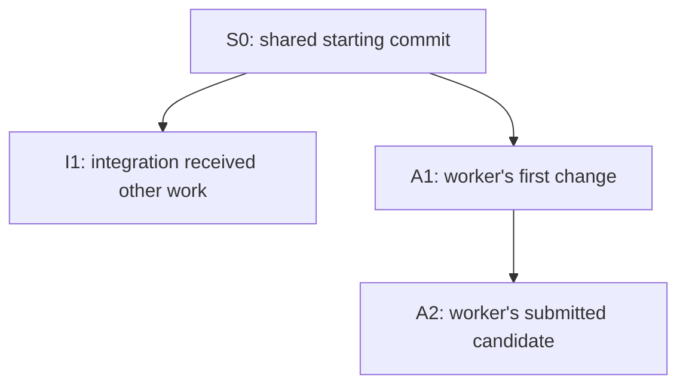
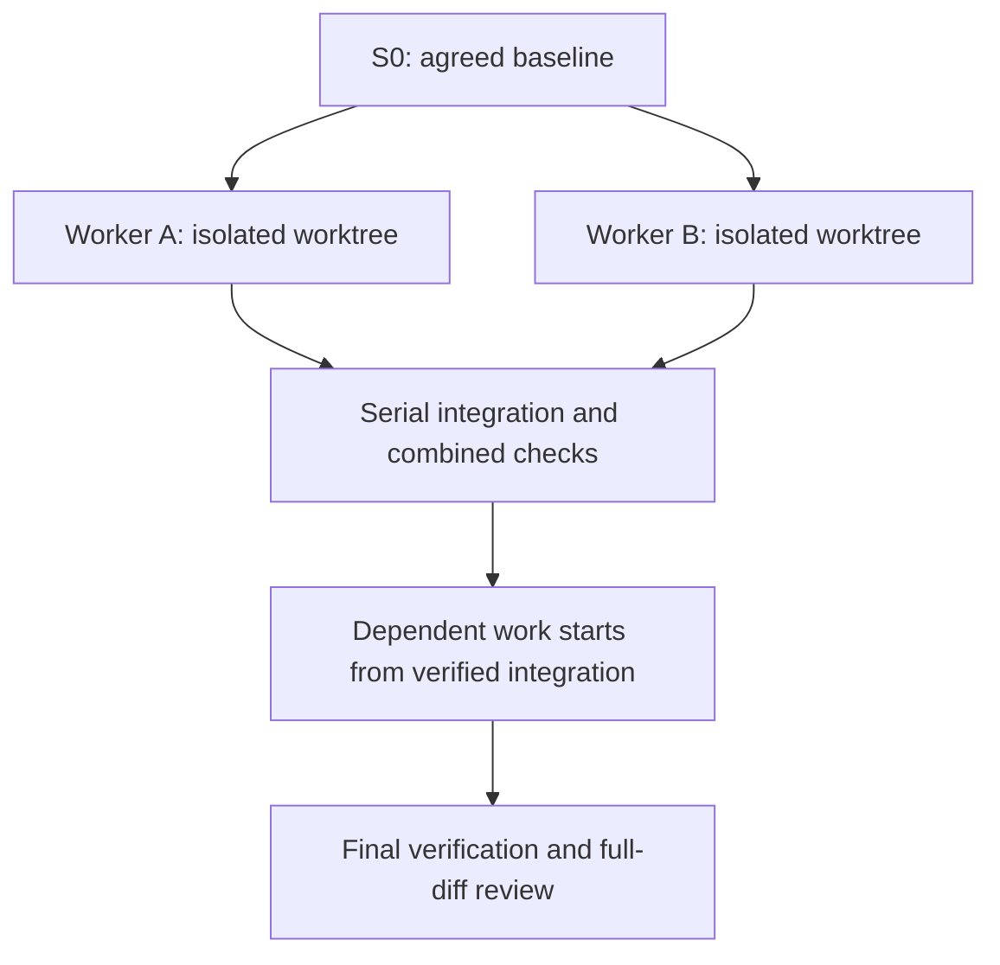

# Skills + Paseo: project setup and everyday use

This manual is for using the skills in **your own software project**. It explains setup, the project folders and artifacts, roles, helper scripts, testing and the complete development lifecycle. For the disposable quotation exercise that evaluates the pending PRs, use the separate [PR validation guide](PR-VALIDATION.md); do not run its commands inside an existing project.

Read in order: [workflow overview](WORKFLOW.md#solution-overview) → [stages and artifacts](#stages-and-artifacts) → [project folders](#project-folders-and-effort-directories) → [tools and scripts](#skills-sessions-and-scripts) → [host and project setup](#prepare-the-execution-host). [The architecture guide](ARCHITECTURE-GUIDE.md) expands design review and acceptance. These three guides describe normal work; the validation guide and its report templates describe the experiment.

## Stages and artifacts

The stages name **work on one change**, not chapters in this manual. Reuse already accepted decisions/documents when they still apply; create only what the change needs. The human owns product decisions and final acceptance. One coordinator session owns the tracker and serial integration. Paseo launches the configured sessions; it does not decide whether the work is correct. The [workflow](WORKFLOW.md#planning-and-execution) explains gates and recovery in depth.

| Stage | Main action and responsible role | Durable output or evidence | Gate before moving on |
| --- | --- | --- | --- |
| **1 Discover and clarify** | Planner investigates unknowns using research, grilling, prototypes and optional Wayfinder; human answers consequential choices | Decision map and decision tickets when needed, research notes and human answers | Needed product choices resolved or visibly open |
| **2 Specify** | Planner uses `to-spec` to consolidate agreed behavior | Spec with requirement IDs, examples and exclusions | Observable acceptance criteria and testable seams |
| **3 Design and review** | Planner uses `design-solution`; fresh reviewers use `review-design` for comprehension and challenge | Proposed overview/design, optional model and ADR, separate review findings | Blocking findings resolved; actual reviewer identities and target recorded |
| **4 Plan and authorize** | Planner uses `to-tickets`, maps requirements to work; human accepts scope and plan | Implementation tickets/dependencies, plan snapshot, traceability and human decision | Coverage and dependency/resource assumptions checked |
| **5 Check readiness** | Coordinator checks current inputs, profiles, tracker and test resources | Readiness record and committed execution baseline | Accepted files still match reviewed files; configured checks pass |
| **6 Implement** | Coordinator uses `implement-spec` to claim and launch fresh workers in worktrees | Scoped code commits, claims/run IDs and focused test evidence | Clean committed candidate and required Verify change checks |
| **7 Review and integrate** | Fresh `code-review` sessions assess Spec and Standards; coordinator integrates one candidate at a time | Exact base/head reviews, dispositions, combined verification and integrated SHA | Both axes and combined checks cover the accepted revision; repeat 6–7 for new ready tickets |
| **8 Verify complete change** | Coordinator runs final required checks and full-change review | Final integrated SHA, full-diff reports, final test evidence and reconciled documentation | Complete agreed scope and no unresolved blockers |
| **9 Evaluate and decide** | Human inspects delivery evidence and decides whether to accept/merge/release under project policy | PR or delivery record, known limitations and follow-ups | Repository/CI authorization is separate from a workflow report |

Example: a product owner chooses whether quantities can be fractional (Stage 1). The spec gives the chosen behavior a requirement ID (2). The design assigns calculation to a component and explains why (3). A ticket names the scoped implementation and a test (4). The coordinator confirms acceptance (5), a worker commits it (6), fresh reviewers and combined tests assess it (7), and a full-change review checks delivery (8). The owner then decides (9). An answer, ticket, code commit and review are **different kinds of artifact**; none proves the others occurred.

## Project folders and effort directories

The **skills package checkout** holds reusable procedures and scripts. The **target project repository** owns its requirements, architecture, code and operating rules. Configure the paths for the project you actually use; do not copy another application's spec, design or tests into it.

| Path in your project | Meaning | Typical author / stage |
| --- | --- | --- |
| `AGENTS.md` | First set of project instructions and pointers to operating contracts | Maintainer at setup |
| `GLOSSARY.md`, `CODING_STANDARDS.md` | Meaning of project terms and conventions; adapt to existing files | Maintainer/team |
| `docs/agents/issue-tracker.md` | Tracker selection, states, claim/closure rules and canonical state root | Maintainer at setup |
| `docs/agents/delegation.md` | Actual provider/model profiles, reviewer independence, concurrency and retry policy | Maintainer at setup |
| `docs/agents/testing.md` | Commands, test boundaries/profiles and resource isolation | Maintainer at setup |
| `docs/agents/architecture.md` | Rules for authoring, reviewing and accepting designs | Maintainer at setup |
| `docs/specs/<feature>.md` **or configured tracker spec** | Authoritative behavior and exclusions | Planner, Stage 2 |
| `docs/architecture/overview.md`, optional `model/` | Existing or intended system components, boundaries and views | Planner, Stage 3; reconcile at Stage 8 |
| `docs/designs/<feature>.md`, optional `reviews/`, plan/traceability/readiness | Proposed change, review evidence, coverage and acceptance | Planner/reviewers/coordinator, Stages 3–5 |
| `docs/adr/<decision>.md` | A significant choice, alternatives and consequences | Planner + human, Stage 3 |
| `src/`, `test/` (or existing project conventions) | Implementation and automated checks | Workers, Stages 6–8 |
| `.scratch/<effort-slug>/` **when using the local tracker** | Ignored effort-specific tracker, claims, events and evidence | Planner/coordinator throughout |

There is no required `docs/architecture.md` file. `docs/agents/architecture.md` is the **process contract**; `docs/architecture/overview.md` is the **application overview**; `docs/designs/<feature>.md` explains **one proposed change**. An ADR records one consequential decision. A Wayfinder **map** indexes decision tickets; it is different from an architecture **model** showing software components. The spec owns requirements; other artifacts link requirement IDs instead of maintaining competing versions. [Design guide](ARCHITECTURE-GUIDE.md#artifacts-and-relationships).

Call `.scratch/<effort-slug>/` an **effort directory**. Choose a short, stable, lowercase hyphenated slug for a bounded objective, not a stage/model/worker name. The local tracker template calls it `<feature-slug>` and may put `map.md`, `issues/NN-name.md` and `spec.md` there. If your project instead keeps its authoritative spec in `docs/specs/`, link it from tickets rather than making a second spec. For GitHub/GitLab trackers, issues and maps live in that service; a local ignored evidence area may still be useful. Record one canonical **absolute** state root in the original project and pass it to every worktree: ignored files do not automatically appear in other worktrees. Back up ignored state separately. [Local tracker template](../skills/engineering/setup-matt-pocock-skills/issue-tracker-local.md).

## Skills, sessions and scripts

A **skill** is a written procedure (for example `wayfinder`, `to-spec`, `implement-spec`); a **role brief** under the package's `agents/` is context supplied to a worker or reviewer. Pi or Claude Code runs a **session** with a chosen model. A Paseo **profile** stores launch settings, while a **task prompt** gives that particular session its assignment. The coordinator uses these, checks real models and tracker state, and calls the scripts at the appropriate point. A script is code run by Node when invoked; neither a skill file nor a profile is an executable scheduling guarantee. [Coordinator procedure](../skills/engineering/implement-spec/SKILL.md).

| Program in the skills checkout | Input → output | Stage and limit |
| --- | --- | --- |
| `scripts/frontier.mjs` | Exported JSON ticket graph → ready, unclaimed IDs | 5–7; does not claim, launch, or verify that tracker claims are true |
| `scripts/design-check.mjs snapshot` / `check` | Selected files → fingerprints; readiness JSON + files → result | 3–5 and rechecks; cannot judge design quality or authenticate approval |
| `scripts/review-target.mjs` | Clean candidate worktree + base/head Git refs → manifest, diff and commit list | 7–8; prepares review input, does not perform independent review |
| Project-specific test commands | Source/environment → observed test results | 6–8; choose the applicable suite and retain exact revision/exit/logs |
| `scripts/validate-skills.mjs` (`npm test` in package) | Package files → structural test results | Package maintenance, not evidence that your application or live agents passed |

For each helper, pass real project paths and read its nonzero error rather than inventing success. The actual coordinator must call the checks and act on their results; Paseo does not run `.mjs` files merely because they exist. `examples/validation-lab/create.mjs` and `verify.mjs` belong only to the [PR experiment](PR-VALIDATION.md), not normal project setup. [Execution details](WORKFLOW.md#normalized-frontier-input) · [testing policy](../skills/engineering/_shared/TESTING.md).

## Vocabulary

Use this section as a reference while following the workflow in your project. The terms describe the artifacts and checkpoints passed between planning, implementation, review and integration; you do not need to memorize them before setup.

| Term | Meaning | Example |
| --- | --- | --- |
| Effort | A bounded objective that may span several sessions | Add a file-import command |
| Decision ticket | A question to resolve before or during planning | Should invalid input rows stop an import? |
| Implementation ticket | A deliverable with acceptance criteria | Validate one input row |
| Dependency | Work that must finish before another ticket starts | Import command depends on parser and error reporter |
| Frontier | Ready, unclaimed tickets with satisfied blockers | Parser and error reporter at the start |
| Claim | A recorded owner/run ID for a task | Ticket A belongs to one particular Paseo session |
| Spec | Agreed behavior, constraints and exclusions | Accepted input rows, error rules and exclusions |
| Seam | A public boundary where behavior can be tested | A parser function or CLI process |
| Vertical slice | A small useful behavior across necessary layers | Import one record from input to result |
| Base / head | Reference revision and proposed revision for a comparison | Agreed integration SHA / worker candidate SHA |
| Merge base | The common ancestor used to compare diverging branches | Shared starting point of A and B |
| Candidate | A committed revision awaiting verification/review | Ticket A's submitted commit |
| Integrated | Accepted into the integration branch after the required checks | A is now available to dependent work |
| HITL | Human-in-the-loop work | Grilling about a business rule |
| AFK | Work that can proceed without live product decisions | Researching an already precise question |

A worker saying “finished” is not the same as a ticket being integrated. A ticket being integrated is not always the same as its GitHub issue being closed: the project's tracker may defer closure until a PR merges.

### Base and head: which two versions are we discussing?

A Git commit identifies a saved revision of the project. Its SHA is the identifier you record as evidence. A branch name is a movable label pointing at a commit: the label stays the same as more commits are added.

For a review, **base** means the reference revision and **head** means the proposed revision. For example, base can be the integration commit a worker started from, and head can be the commit containing its finished ticket. Base does not always mean `main`, and head does not mean every file currently on disk.

Be careful with capitalization: Git's **`HEAD`** identifies the currently checked-out commit, usually through the current branch. Lowercase **head** in this manual means the proposed review endpoint. In the worker's checkout they may identify the same commit; in the coordinator's checkout they may differ. Uncommitted edits are not part of either commit. Source: [Git glossary](https://git-scm.com/docs/gitglossary).

In this package, the helper resolves the requested base/head to exact SHAs and requires the checkout to match the proposed head and be clean. Review evidence then names those saved versions, not a branch name that can move later. Example: “Spec review passed for base S0, head A2” is precise; “the feature branch was reviewed” is not enough after another commit lands.

### Merge base: where did these histories last share an ancestor?

When two branches diverge, their current tips no longer describe their shared starting point. Git finds a **merge base**: a best common ancestor of the two commits. In an ordinary branching history, this is the shared commit before the separate changes. Unusual histories can have multiple best common ancestors. Source: [git merge-base](https://git-scm.com/docs/git-merge-base).

Consider this history; S0, I1, A1 and A2 are teaching labels for commit SHAs:



If the requested base is I1 and the proposed head is A2, the merge base is S0. That distinction changes what a diff means:

| Comparison | Question it answers in this example |
| --- | --- |
| `git diff I1 A2` | How do the complete saved contents of I1 and A2 differ? |
| `git diff I1...A2` | What changed from their merge base S0 to A2? |

These labels must be replaced with real refs/SHAs if you run the commands. The three-dot form is directional: it compares the merge base to the second endpoint. It does not merge the branches or certify that their changes work together. Source: [git diff](https://git-scm.com/docs/git-diff).

The review helper records **requested base**, **merge base** and **head** separately. Here, reviewing the worker's changes means inspecting S0→A2. Testing integration compatibility requires constructing and checking a revision containing both I1's work and A2's work. They answer different questions.

### Candidate: a specific revision proposed for acceptance

**Candidate** is a workflow term, not a special Git object. It means “this exact committed version is being offered for verification and review.” It may be a worker's ticket result, a combined integration result, or the final proposed delivery.

For example, a worker might submit A1. The tests reveal a defect, so it repairs the code and commits A2. A2 is a new candidate: A1's evidence remains part of the history but does not approve A2. A candidate may pass, fail or be blocked; calling it a candidate says nothing about its quality yet.

For every candidate, keep its SHA, relevant base, test results, review reports and outstanding findings together. If source changes, identify the new candidate and refresh the applicable evidence. A report from yesterday cannot approve code that was added today.

### Integrated: accepted into the shared build of the effort

In this workflow, a ticket is **integrated** only when its accepted work is present on the effort's integration branch with the required verification and review evidence. A worker commit sitting on its own branch is not integrated, even if the worker has finished and its tests pass.

Continue the diagram's example: the coordinator combines I1 and A2 into a candidate M1. It verifies the combined behavior and refreshes review, then advances the integration branch to that accepted revision. The tracker records the integrated SHA and evidence. Only then can dependent tickets rely on A's behavior being available in their starting checkout.

A merge commit is not always needed: when the integration branch has not advanced, a fast-forward can accept the reviewed worker revision directly. What matters to this workflow is the accepted shared revision and its evidence, not whether Git created an extra merge commit.

| Statement | What it establishes |
| --- | --- |
| “The worker finished” | A session reported completion |
| “Candidate A2 passed its checks” | A particular revision satisfied those checks |
| “Ticket A is integrated at M1” | Its work is accepted into the shared integration revision |
| “The PR merged into main” | The delivery branch was accepted into the target branch |
| “The release was deployed” | The delivered software reached a runtime environment |

These milestones can occur at different times. Integrated does not mean deployed, and it does not necessarily close a GitHub issue. Source for the package-specific meanings of candidate and integrated: [coordinator procedure](../skills/engineering/implement-spec/SKILL.md) and [testing policy](../skills/engineering/_shared/TESTING.md).

## Prepare the execution host

### Windows and Linux are both execution-host options

**Yes: the execution host can be Windows or Linux.** The execution host is the environment where the Paseo daemon launches the agent processes and where their repositories, worktrees and tests run. It need not be a separate server. Paseo offers Windows and Linux desktop builds; Pi documents both native Windows and WSL operation. Sources: [Paseo downloads](https://paseo.sh/download), [Pi on Windows](https://pi.dev/docs/latest/windows).

| Arrangement | Execution environment | Where to install the agents and keep the project |
| --- | --- | --- |
| Everything on a Windows PC | Native Windows | Windows, using Windows paths |
| Everything on a Linux PC/server | Linux | Linux, using Linux paths |
| Windows client connected to Ubuntu | Remote Ubuntu | Ubuntu; Windows is the viewing/control client |
| Windows PC with a Linux environment in WSL | Linux inside WSL, when that is where the daemon/workers run | Inside the selected WSL environment |

For initial setup, keep the daemon, providers and project together in one environment. Merely installing WSL does not turn a native Windows Paseo session into a Linux session. Check which host launched the worker and the worker's actual directory.

The Ubuntu arrangement below is one setup choice. Check current provider compatibility on the host you use; separate hosts have separate credentials and paths.

### Shell syntax depends on your chosen host

Most command blocks in this manual use Bash. Run them in a suitable Bash terminal, or translate them deliberately to PowerShell. Native Windows Pi uses Git Bash by default for Bash commands; its optional PowerShell tool is a separate shell choice. Follow [Pi's Windows instructions](https://pi.dev/docs/latest/windows) for setup. WSL runs the Linux form of the tools.

For example, these are complete equivalent variable assignments, using illustrative paths:

```bash
export MP_SKILLS="$HOME/code/pi-adapted-mp-skills"
export PROJECT_ROOT="$HOME/code/my-project"
```

```powershell
$env:MP_SKILLS = "C:/code/pi-adapted-mp-skills"
$env:PROJECT_ROOT = "C:/code/my-project"
```

In PowerShell, subsequent references are `$env:MP_SKILLS` and `$env:PROJECT_ROOT`; Bash uses `$MP_SKILLS` and `$PROJECT_ROOT`. Bash `export`, backslash continuations and heredocs are not PowerShell syntax. The Linux Claude installer below also needs the official Windows alternative if you choose native Windows. Use the [Claude Code quickstart](https://code.claude.com/docs/en/quickstart).

The Node helpers use platform path APIs, but each Windows/provider combination should be verified on its own host. The `npm run smoke` entry point specifically invokes Bash. Do not infer that every command block is a native PowerShell command because Node itself runs on Windows.

### Recommended arrangement for a Windows workstation and Ubuntu server

Put Git repositories, worktrees, Node, Pi, Claude Code and the Paseo daemon on **the same Ubuntu host**, under the same ordinary development user. Use Windows as the client/editor/terminal. This keeps absolute paths, CLI credentials and test environments consistent.

Do not configure a reviewer with a Windows path when its agent runs on Ubuntu. A Windows installation of a provider does not automatically make that provider available to a remote Paseo daemon. A separately running Windows daemon is a different host with different settings.

On the Windows client, first confirm `ssh user@your-ubuntu-host` works using your SSH key/agent. In Paseo Desktop choose **Settings → Add host → Remote SSH** and enter `ssh://user@your-ubuntu-host`. The remote daemon must already be running; connecting through SSH does not install or start it. Select that host before opening the project. These steps come from [Paseo connectivity](https://paseo.sh/docs/connectivity).

Use Git, a suitable Node version (Node 24 LTS for this guide), npm, a working implementation model and an independent review model. The package helpers support Node 20+, but installed agent CLIs may require newer versions. Your application chooses its own runtime and test dependencies; package validation separately installs a development-only YAML parser. Authentication and model calls may incur charges under your existing accounts. See [Node downloads](https://nodejs.org/en/download) and [Pi package requirements](https://github.com/earendil-works/pi/blob/main/packages/coding-agent/package.json).

In the Ubuntu terminal:

```bash
git --version
node --version
npm --version
```

If Git commits have no identity, configure the desired name and email for the project. Do not overwrite your global Git identity just to run the example.

### Prepare a user-owned CLI installation directory

For the Ubuntu walkthrough, install npm-based agent CLIs into `$HOME/.local` explicitly. This works even if the system npm default points at `/usr/lib/node_modules`; no administrator install or system-directory ownership change is needed.

```bash
mkdir -p "$HOME/.local/bin" &&
export PATH="$HOME/.local/bin:$PATH" &&
command -v node &&
node --version &&
npm --version &&
npm config get prefix
```

If Node does not meet the installed agents' requirements, select/install Node 24 LTS through your existing Node manager or [Node's installation instructions](https://nodejs.org/en/download) before proceeding. The printed npm prefix may still be `/usr`; the `--prefix "$HOME/.local"` option in each install command below deliberately overrides it for that command only.

For future Bash login shells, add the PATH entry once:

```bash
touch "$HOME/.profile" &&
{ grep -qxF 'export PATH="$HOME/.local/bin:$PATH"' "$HOME/.profile" ||
  printf '%s\n' 'export PATH="$HOME/.local/bin:$PATH"' >> "$HOME/.profile"; }
```

Already-open shells, Herdr panes and daemons do not receive later environment changes automatically. Run the export in the pane that starts Paseo and inspect provider diagnostics if its executable paths differ from your terminal. Other shells should use their normal startup file. See [npm's EACCES guidance](https://docs.npmjs.com/resolving-eacces-permissions-errors-when-installing-packages-globally/).

### Install or verify Pi

If Pi already works, keep it and record the version. For a new npm-based installation, the current official package is:

```bash
npm install --global --prefix "$HOME/.local" --ignore-scripts @earendil-works/pi-coding-agent &&
command -v pi &&
pi --version &&
pi
```

Configure/authenticate your existing DeepSeek access in Pi, select it with `/model`, and perform a trivial request. Do not replace a working provider configuration with an invented endpoint or model ID. Pi's [installation page](https://pi.dev/) and [model-selection guide](https://pi.dev/docs/latest/models) are the source of truth for the installed version.

### Install or verify Claude Code

The official native Linux installer is:

```bash
curl -fsSL https://claude.ai/install.sh | bash
claude --version
claude
```

Complete the CLI's login process on the execution host and check a simple request. Use the [official quickstart](https://code.claude.com/docs/en/quickstart) for authentication or platform-specific alternatives. Do not put API keys in source, tracker or evidence.

### Install or verify Paseo

For headless Ubuntu, the documented CLI path is:

```bash
npm install --global --prefix "$HOME/.local" @getpaseo/cli &&
command -v paseo &&
paseo --help
```

After the checks succeed, run `paseo` from the prepared shell and follow the host's connection/pairing flow. A desktop installation bundles and starts its own daemon; do not accidentally connect to that local daemon when your source and providers live on Ubuntu. See [Paseo getting started](https://paseo.sh/docs) and [connectivity](https://paseo.sh/docs/connectivity).

Before installing or updating over an existing setup, record versions and account configuration. Keep versions stable during an active effort.

## Install the skills in your project

Choose a checked-out package revision and record its Git SHA. The branch used for the separate PR experiment is specified **only** in [PR-VALIDATION.md](PR-VALIDATION.md#1-freeze-the-package-under-test). For normal project work, use a version you have chosen to adopt; do not infer that an unreleased PR is on the default branch.

In Bash on the **execution host**, set paths to your existing directories, verify both Git roots and install the package into the target project's Pi environment:

```bash
export MP_SKILLS="$HOME/code/pi-adapted-mp-skills"
export PROJECT_ROOT="$HOME/code/my-project"
git -C "$MP_SKILLS" rev-parse HEAD &&
git -C "$PROJECT_ROOT" rev-parse --show-toplevel &&
cd "$PROJECT_ROOT" &&
pi install -l "$MP_SKILLS"
```

Replace both paths with actual directories on that host. The project must already exist; `pi install -l` does not create it, configure its tracker or accept a design. In Pi, verify the package loads and invoke `/skill:setup-matt-pocock-skills` as described in [project setup](#configure-each-software-project). This package is Pi-native; Claude Code can read its procedure files by explicit path. Avoid duplicate installations with the same skill names. [Pi packages](https://pi.dev/docs/latest/packages) · [Pi skills](https://pi.dev/docs/latest/skills).


## Configure Paseo and profiles

### What is a profile?

A **Paseo agent profile** is a named preset of launch settings: provider, model, thinking level, mode and supported features, with notes describing when to use it. It saves choosing those options repeatedly. Profiles are saved on a particular host; changing one affects future selections, not sessions already launched. Source: [Paseo agent profiles](https://paseo.sh/docs/agent-profiles).

For this workflow, imagine a preset named `mp-build` that selects Pi and your configured DeepSeek model. The coordinator selects those settings, then gives a fresh worker its actual assignment: “Implement ticket A in this worktree.” `mp-code-review` selects your Claude review settings, then receives the Spec brief and a particular candidate to review. These example names have no built-in meaning.

Keep four concepts separate:

| Concept | Example | What it supplies |
| --- | --- | --- |
| Agent profile | `mp-build` | Saved launch settings |
| Role brief | `agents/mp-review-spec.md` | How to perform a role |
| Task prompt | Review ticket A at a specific SHA | The assignment for this run |
| Session / run | A concrete Paseo agent ID | The actual execution and its history |

The profile is not a running agent, a skill, a worktree or a ticket. Several fresh sessions can use the same profile. The coordinator still needs to place them in the correct workspaces and send the right instructions. In this package, role briefs are supplied explicitly; naming a profile `mp-code-review` does not automatically load that file.

Also distinguish **agent profiles** from this manual's **test profiles**. Fast / Verify change / Verify candidate are project-defined selections of checks. They do not select an AI model or create a Paseo agent.

### Create role profiles on the execution host

You configure profiles in **Paseo**, not by typing a skill command into Pi/Claude. First confirm both providers are discovered on the intended host. A Windows client connected to Linux must configure that Linux host, not accidentally its local daemon.

1. Open **Settings → your execution host → Agents → Agent profiles**.
2. Select **New profile** and enter a name from the table below.
3. Choose the installed provider and an actual available model. Select supported mode/thinking settings appropriate to the role; do not guess unavailable options.
4. Fill **When to use** with the notes below, then **Save**.
5. Repeat for the remaining profiles. These names are examples, not preinstalled keywords.

| Profile label | Harness / model family for this example | When to use notes |
| --- | --- | --- |
| `mp-plan` | Claude Code / Claude | Plan and coordinate one effort. Delegate implementation; own tracker and integration. May research when configured with source access. |
| `mp-build` | Pi / DeepSeek | Implement one ticket in its assigned worktree; return committed revision and verification evidence. Do not dispatch reviews. |
| `mp-design-review` | Pi / DeepSeek | Independently reconstruct or challenge a Claude-authored design. Use separate fresh sessions for comprehension and challenge. |
| `mp-code-review` | Claude Code / Claude | Review code implemented only by DeepSeek. Use separate fresh sessions for Spec and Standards; no edits or test execution. |

These four presets can cover common role rows in your project's `docs/agents/delegation.md`: Planning → `mp-plan`; Implementation → `mp-build`; Spec and Standards → `mp-code-review`; Design comprehension and challenge → `mp-design-review`; Research → a source-capable `mp-plan` session, or a separately configured research profile. Reusing settings never means reusing the author/implementer conversation as its reviewer. Check source access before selecting a research profile.

Record **actual** profiles, harness/providers, exact model IDs and families in that file. Editing the file does not create a Paseo profile; saving a Paseo profile does not update the file. Reconcile both. Changing an implementation/design-author family can invalidate reviewer independence for the affected candidate. A profile label is not enforcement of read-only access or a guarantee of model identity.

Source: [Paseo agent profiles](https://paseo.sh/docs/agent-profiles). Available controls depend on the installed version/provider. If a control is absent, record the version and gap rather than inventing a UI action or setting.

### Enable delegation access

**Delegation access** means the coordinator can call Paseo to discover providers/profiles, launch child agents/workspaces, monitor them and collect output. It is distinct from model authentication and tracker access. One option is built-in Paseo tools:

1. Open **Settings → your execution host → Agents**.
2. Turn on **Enable Paseo tools**; injection is off by default.
3. Start a new coordinator session or reload the existing one so it receives the tools.
4. Run the discovery and child-launch checks below before dispatching real work.

The CLI is an alternative for an agent with shell access to the correct running Paseo host; it does not require tool injection. Use one verified route for the effort. Enabling tools does not itself install this package, choose the correct model, supply role briefs or prove the coordinator follows workflow rules. Sources: [orchestration](https://paseo.sh/docs/orchestration) and [MCP reference](https://paseo.sh/docs/mcp).

### Create the first Pi and Claude sessions

For Paseo coordination, create the managed sessions **inside Paseo**. Running `pi` or `claude` directly in a terminal is useful for installation/authentication checks but does not establish that Paseo can manage that session.

1. Select the correct host and your project workspace for a harmless preflight check; first read its `AGENTS.md`.
2. Start creating an agent. Open the model picker and select the saved profile under **Profiles**.
3. Check the actual provider/model and workspace directory before sending a task. Button placement may differ between versions; profile selection is documented by Paseo.
4. Create one Pi session using `mp-build` and one Claude session using `mp-plan`, each with this harmless prompt:

```text
This is a setup check, not an implementation assignment.
Report the working directory and read README.md in this workspace.
Summarize the project's purpose. Do not edit files, run tests, create commits,
or launch other agents. Report any missing file or capability honestly.
```

Inspect effective provider/model in Paseo's session settings or available status metadata, rather than accepting generated self-identification. Record run IDs, directory and inspected model settings. Stop/archive these diagnostic sessions when their work is complete; they are not implementation workers.

### Test discovery and one delegated child

In the diagnostic Claude session, first send:

```text
Without modifying files or creating agents, inspect the available Paseo tools,
current host/workspace, providers, models and saved profiles. Identify mp-plan,
mp-build, mp-design-review and mp-code-review and any missing capabilities.
Do not invent model IDs or silently substitute profiles.
```

After discovery succeeds, test an actual launch:

```text
Use the installed Paseo tool schemas or CLI help to launch exactly one fresh Pi
child using the verified mp-build settings in this workspace. Its only task is
to read README.md and return a short summary. No edits, tests, commits, further
delegation or implementation. Record the child run ID, effective settings and
workspace; observe its terminal status and collect its output. Do not launch
replacement children if its status is unknown. Report any capability gap.
```

Success means you can inspect the child in Paseo, verify its model/directory, and see the parent collect its actual output. Discovery alone does not prove launch access. Missing tools, authentication or observable settings remain blockers. Keep this evidence in the effort record. Source: [Paseo orchestration](https://paseo.sh/docs/orchestration).

### Prove a profile works before using the full graph

Start one harmless session for each harness. Ask it to report its working directory and read one project file. Independently inspect the effective model/provider in the host's session settings or available status metadata. Save that inspection as evidence. Do not accept only “I am Claude” in generated prose.

If Paseo does not expose enough information to verify the effective model, record the limitation. The independent-review gate remains unverified until you can establish it; do not silently weaken the gate.

Code reviewers read the exact candidate and relevant unchanged source, return reports in their session responses, and leave report-file creation to the coordinator in its evidence store. Reviewers are instructed to be read-only. Configure actual provider permissions where available. Neither profile notes nor a “plan” label by itself proves filesystem isolation. The coordinator checks candidate cleanliness afterward.

### Optional administrative terminals: Herdr, tmux or your editor

Paseo owns the managed agents and their lifecycle. Use a normal terminal, VS Code Remote SSH terminal, tmux or Herdr to inspect Git, files and logs and run manual verification. None is an additional framework requirement. Do not launch duplicate workers through another tool.

If you already use Herdr on the Linux execution host, it is suitable for persistent administrative panes. From the host shell:

```bash
herdr session attach project-development
```

Keep one pane for Git/tracker and another for diagnostic/test commands. Detach with `Ctrl+B q`; reattach with the same command. Panes remain running while the server remains alive; detaching is not a promise of recovery after a host/server restart. If you run the Paseo daemon in a persistent pane, continue to create managed agents through Paseo. Otherwise keep the existing daemon arrangement. Sources: [Herdr CLI](https://herdr.dev/tui/docs/cli-reference/) and [remote/persistent sessions](https://herdr.dev/tui/docs/how-to-work/).

Use the terminal arrangement you already know; keep one coordinator per effort.

### Useful observation commands

Use the app for the first run; these commands help when diagnosing it:

```bash
paseo --help
paseo ls -a -g --json
paseo workspace ls
paseo logs AGENT_ID
paseo provider diagnostic claude
```

Run them on the intended host. Confirm options with the installed CLI's help if its version differs. Do not infer exact model/profile launch flags from these examples. The coordinator should use discovered tool schemas. Sources: [CLI reference](https://paseo.sh/docs/cli) and [MCP reference](https://paseo.sh/docs/mcp).


## Configure each software project

Select your project directory and host, inspect current conventions, then run setup once and update only changed decisions. Do not run project setup in the skills checkout or before the target project exists. In a Pi session whose working directory is the target project, invoke:

```text
/skill:setup-matt-pocock-skills
```

Use the Claude explicit-file alternative below when Claude is the setup session. Review the proposed changes, populate actual configuration, and confirm the project owner has resolved relevant decisions.

Expected project artifacts:

| File | What it tells the agent |
| --- | --- |
| `AGENTS.md` | Short navigation pointers and project-wide constraints |
| `GLOSSARY.md` | Meaning of domain terms |
| `docs/adr/…` | Durable decisions when their tradeoffs warrant an ADR |
| `docs/agents/issue-tracker.md` | Where tasks live and how status/claims/closure work |
| `docs/agents/triage-labels.md` | Project's labels for incoming work, when configured |
| `docs/agents/delegation.md` | Real profiles, model families, concurrency and retries |
| `docs/agents/testing.md` | Commands, test selection, environments and evidence |
| Spec and ticket files/issues | Behavior and dependency graph for this effort |

### Use the same procedure from Claude Code

This is a Pi-native package. Installing it with Pi does not register `/skill:…` commands in Claude Code. In Claude Code, use the same checked-out procedure by explicit path, without maintaining another copied installation:

```text
Read /ABSOLUTE/SKILLS/PATH/skills/engineering/setup-matt-pocock-skills/SKILL.md
and follow that procedure for /ABSOLUTE/PROJECT/PATH.
Resolve relative references from the skill's directory, not from the project directory.
Treat Pi-only installation checks as checks of the Pi worker environment.
Use discovered Paseo tools for delegation. Do not invoke an imaginary /skill command here.
```

Apply the same pattern to `wayfinder`, `grill-with-docs`, `to-spec`, `to-tickets` or `implement-spec`. This explicit-file route keeps the project on the same checked-out package; an independently installed upstream Claude skill may have different instructions.

You may later add a small project `CLAUDE.md` pointer to shared project instructions, but it is not necessary when the coordinator supplies them explicitly. Do not copy all instructions into multiple files and then maintain them separately.

### Two setup checks: command visibility and shared tracker paths

**Skill command visibility.** Setup now treats `enableSkillCommands: false` as a discoverability setting, not a failure. Manually typed `/skill:name` commands still work. If invocation fails, inspect installation paths, startup diagnostics and YAML frontmatter. Source: [Pi skills](https://github.com/earendil-works/pi/blob/main/packages/coding-agent/docs/skills.md).

**Local tracker location.** Git worktrees do not share untracked/ignored files. Setup records a canonical absolute state root, normally the original project's `.scratch/` directory, so a worker must receive the **canonical absolute path** in the original project directory. If a worker creates a second tracker in its own worktree, the coordination state is split even if the implementation is correct. This is a project configuration requirement, not an automatic tracker service supplied by Paseo.


## Use the skills across the software engineering cycle

This section maps the [nine lifecycle stages](#stages-and-artifacts) to specific skills. Choose a route based on what is already known; the skills are tools for making progress, not a ceremony to repeat for every edit. The names match the [workflow stage map](WORKFLOW.md#stages-owners-and-completion-conditions).

### Choose your entry point

| Starting situation | Begin with | Move to execution when |
| --- | --- | --- |
| A broad goal with many unresolved decisions | `wayfinder`, research and human discussions | Enough decisions are resolved to specify a bounded deliverable |
| A bounded feature whose behavior needs clarification | `grill-with-docs`, then `to-spec` and `to-tickets` where useful | Behavior, test seams and the proposed breakdown are agreed |
| An already approved spec and task graph | `implement-spec` | Required project configuration and verification resources are available |
| One clear small ticket | `implement` in standalone mode | Its scope and checks are understood; independent review is still required |
| A bug whose cause is unknown | `diagnosing-bugs` | The failure is understood well enough to implement and verify a scoped fix |

### Hand off from planning to execution deliberately

The handoff includes the accepted design, independent review reports, requirement coverage and current readiness record described in [the architecture guide](ARCHITECTURE-GUIDE.md). It is an agreed set of artifacts, not just a model switch. The coordinator needs the spec, ticket graph, tracker location, model-role configuration and testing/environment contract. Requirements still marked undecided cannot be resolved by silently choosing convenient implementation behavior.

At that boundary you can say: “This spec and breakdown are approved. Execute this graph under the configured limits; return for new product decisions or genuine blockers.” The coordinator then owns routine dispatch, collection and integration. You retain scope and delivery decisions.

### Match each skill to its purpose

| Lifecycle stage | Main skill(s) / action | Your role | Output / evidence |
| --- | --- | --- | --- |
| **1 Discover and clarify** | `triage`, `ask-matt` for intake; `wayfinder`, `research`, `grill-with-docs`, `domain-modeling`, `prototype` as needed | Answer consequential product questions and inspect examples | Routed issue, decision map, cited research, shared language and resolved answers; optional effort-specific map/decision tickets |
| **2 Specify** | `to-spec` | Agree on behavior and exclusions | one authoritative `docs/specs/<feature>.md` or tracker spec |
| **3 Design and review** | `design-solution`, fresh `review-design` sessions | Inspect proposal, settle consequential choices | Design/overview, optional ADR/model, comprehension/challenge reports under `docs/designs/reviews/` |
| **4 Plan and authorize** | `to-tickets`, coverage check | Check useful slices, dependencies and scope | scoped ticket files/issues, plan snapshot, coverage map and actual scope decision |
| **5 Check readiness** | Coordinator checks `design-check.mjs`, contracts and accepted inputs | Make or confirm the applicable human design/plan decision | Current readiness record and approved execution baseline SHA |
| **6 Implement** | `implement-spec` dispatches `implement` workers; `tdd` where useful | Observe or answer new product questions | Claims, worktrees, committed worker candidates and focused check logs |
| **7 Review and integrate** | Fresh `code-review` Spec/Standards axes; coordinator serially combines and checks candidates | Decide genuine tradeoffs or requirement changes | Immutable-target reports, dispositions, integrated SHA and combined verification evidence |
| **8 Verify complete change** | Full tests, full-change review, reconcile design | Inspect final application and evidence | Final required check manifest, SHA, full-diff review and reconciled docs |
| **9 Evaluate and decide** | `pr`, `retro` as appropriate | Assess delivery and authorize any merge/release separately | Delivery/PR evidence and follow-ups |

`diagnosing-bugs` and `improve-codebase-architecture` are ways to investigate a later change; enter the lifecycle at the stage that matches what is already known. The relevant procedures live in the [engineering skills directory](../skills/engineering) and [productivity skills directory](../skills/productivity). A PR description is not a deployment process: add the application's release, rollback, migration and operational checks in its own project policy.

### When to keep a session, and when to start a fresh one

Keep grilling → spec → tickets in the same planning conversation when the reasoning still fits. That preserves why decisions were made. Persist the decisions anyway: another session must be able to continue without reading the entire chat.

Start each implementation ticket with a fresh context and specific pointers. Start each review axis fresh. A reviewer needs the agreed behavior, standards, candidate source and diff—not the implementer's persuasive explanation of why its code is correct.

The coordinator can continue across ticket completions while its context remains manageable. When it restarts, it must reconstruct state from tracker records and real Paseo/Git state before dispatching anything.

### Planning prompts

For an uncertain effort:

```text
Use wayfinder to clarify a proposed file-import feature.
Chart unresolved decisions and dependencies. Batch only ready research.
Pause at human business decisions; do not answer the grilling questions for me.
Do not implement yet.
```

For a bounded change:

```text
Use grill-with-docs to clarify this behavior, then to-spec and to-tickets.
Reuse decisions already agreed in the project. Tell me what new decision is needed
before asking me to reconfirm an existing one.
```

In Pi, invoke the explicit `/skill:name` form when you want to force a skill. In Claude Code, prepend the explicit-file instruction from [project setup](#use-the-same-procedure-from-claude-code).

### Run an approved effort

Once the project contracts, spec, design reviews, ticket graph and applicable human acceptance are recorded, start **one** coordinator session in the target project through Paseo. Give it the actual absolute package/project/tracker paths, the approved committed starting SHA and the configured concurrency/resource limits. The coordinator reads `implement-spec`, checks readiness, claims eligible tickets, launches fresh workers and reviewers, and serially integrates verified changes. It does not invent approval or launch a dependent ticket merely because a worker said “done.”

For a Claude Code coordinator, replace every placeholder below with a real path or value on the **execution host** before sending the entire prompt:

```text
Read /ABSOLUTE/SKILLS/PATH/skills/engineering/implement-spec/SKILL.md
and its referenced policies. Apply them to /ABSOLUTE/PROJECT/PATH.

Use the accepted spec, design, review findings, approved ticket graph,
project contracts and original canonical tracker root at /ABSOLUTE/STATE/ROOT.
Check the actual human acceptance and current input identities.
Start an integration worktree from APPROVED_BASELINE_SHA only after readiness.

You are the sole coordinator and tracker/integration writer for this effort.
Use the configured Paseo profiles; inspect effective model families and paths.
Launch only eligible tickets in separate worktrees within the documented
concurrency and resource limits. Workers return committed candidate SHAs
and required verification evidence. Arrange fresh Spec and Standards review,
integrate serially and check the combined revision before unblocking dependents.

Persist run IDs, claims, checks, failed attempts, reviews and integrated SHAs.
On restart reconcile real Paseo/Git state before launching replacements.
Pause for unresolved product decisions, missing capabilities or exhausted
repair budget. At completion provide the final SHA, evidence and blockers
for my inspection. Follow this project's delivery authorization; do not
merge, deploy or erase evidence without it.
```

In Pi, start with `/skill:implement-spec` and give the same project-specific facts. Keep test command and environment details in `docs/agents/testing.md` rather than assuming a package-specific test runner applies. The human inspects the final revision and evidence under Stage 8, then makes the Stage 9 delivery decision under the project's review policy. [Coordinator procedure](../skills/engineering/implement-spec/SKILL.md) · [architecture handoff](ARCHITECTURE-GUIDE.md#operational-route-and-completion-checks).

## Choose tests for each check

The delivery loop needs evidence at three scales: while a worker edits, when it submits a ticket, and when accepted changes are combined. Fast feedback helps the worker correct mistakes; committed checks let others assess an exact revision; combined checks catch interactions between tickets.

Tests and reviews answer complementary questions. A test executes a selected behavior and checks its result. The Spec reviewer inspects whether the change satisfies the agreed requirements, including omissions. The Standards reviewer inspects documented conventions and design concerns. Tests do not prove that every required case was specified, and a persuasive review is not evidence that a command actually passed.

A **category** says what boundary the test crosses. A **profile** says which checks to run at a particular workflow point. Keep those distinctions in mind when reading the tables below: the objective is useful evidence at each handoff, not the maximum number of test runs.

| Category | Example | What it can catch | What it does not prove |
| --- | --- | --- | --- |
| Unit | A pure function maps valid input to an expected result | Arithmetic, validation, overflow | Real database/file behavior or full user journey |
| Component | A public module exercised as a whole | Module behavior behind its interface | Every external dependency |
| Integration | A repository reads a record from a temporary database | Persistence, query errors and schema assumptions | The full user workflow |
| E2E | Start the application through its public interface and check a complete user journey | Full command-line user journey | All other workflows or unconfigured external services |

Categories can overlap; classify tests by the boundary they exercise rather than creating suites just to fill a table.

| Execution profile | Purpose | Example selection |
| --- | --- | --- |
| Fast | Short feedback while editing | Run the relevant focused suite; dirty source is allowed |
| Verify change | Check a committed ticket candidate | Focused checks relevant to the committed ticket |
| Verify candidate | Check the combined integrated state | Union of implemented seams and required regressions; full delivery adds E2E |

Before a dependent behavior is implemented, its acceptance tests may be intentionally red and are not necessarily a gate for an independent prerequisite. Final delivery cannot skip required suites. Test selection follows the **delivered behavior**, not a blanket “run everything after every edit” rule. See [testing policy](../skills/engineering/_shared/TESTING.md).

For a database-backed application, worktrees still share a database unless you configure otherwise. Either allocate isolated databases/sites/namespaces per run or serialize tests through an exclusive environment lease. A lease needs an owner, acquisition/release rules and recovery after failure. A text note alone is not a concurrency lock.

## Integrate parallel work

Parallel implementation reduces waiting when tickets are independent. Integration brings those separate changes back into one coherent application. The two activities have different ownership: multiple workers can write in their own worktrees, but this workflow gives one coordinator control of the shared integration branch.

This serial integration point prevents workers from racing to change the shared starting revision. It also gives every dependent ticket a clear answer to “which accepted code am I building on?” The tracker records that answer as an integrated SHA with supporting evidence.

Suppose two independent workers start from integration revision `S0`:



1. A commits a candidate and verifies it. The coordinator arranges both independent reviews.
2. If integration is still `S0`, A can advance it to the reviewed candidate.
3. B's original candidate was based on `S0`. After A lands, B is no longer a direct replacement for integration. The coordinator constructs a combined candidate based on the latest integration tip.
4. That combined candidate gets the required checks and refreshed review. Only then does integration advance again.
5. Dependent work starts only after both prerequisites have verified integration records.

Even a conflict-free merge produces a different target. A green B branch does not by itself prove A+B is green. This is required by the procedure in [implement-spec](../skills/engineering/implement-spec/SKILL.md); project checks and review evidence must cover that new target.


## Define your project's verification resources

Keep the roles, ticket relationships and review principles. Configure the application-specific contract:

1. Point the tracker instructions at your real issue service and closure rules.
2. Specify the application's existing test, lint and typecheck commands as its acceptance checks.
3. Classify expensive integration/E2E checks and map them to profiles by changed behavior/risk.
4. Define how each worktree gets dependencies and safe configuration.
5. Allocate real database/cache/queue/storage/port resources, or implement and test an exclusive lease.
6. Add migration, security, deployment, rollback and monitoring checks appropriate to the application.
7. Verify the combined revision in CI before authorizing delivery.

Keep application-specific decisions in the target application's testing and architecture contracts. Choose test environments and resource isolation based on your application.

For maintenance, reproduce a bug at an approved public seam, write a regression test and route the fix through the same committed verification/review path. For a changed requirement, amend the spec/tickets first and invalidate approvals for affected candidates. For a broad refactor, preserve behavior and use compatible migration steps rather than parallel workers breaking each other's interfaces.

## Troubleshooting

| Symptom | Likely cause | Next action |
| --- | --- | --- |
| npm install fails with EACCES under /usr | System-wide default global prefix | Use the explicit user-owned prefix and PATH preparation in [host setup](#prepare-the-execution-host); do not change system directory ownership |
| Git/npm runs in another project | A prior cd failed or the clone destination differs from MP_SKILLS | Use the absolute-path, chained command block in a verified skills checkout; verify the Git root and lockfile |
| Wrong skill behavior | Main/old package or shadowing duplicate | Check installed package SHA and path and startup diagnostics |
| `/skill:…` works in Pi but not Claude | Pi command syntax used in another harness | Use the exact-file prompt from [project setup](#configure-each-software-project) |
| Paseo cannot find Pi/Claude | Daemon environment differs from your terminal | Inspect host provider diagnostics, binary path and authentication |
| Model exists in Pi but not in Paseo profile list | Provider discovery/configuration mismatch | Refresh/check installed host capabilities; do not invent IDs |
| Research has plausible claims but no sources | Wrong brief or missing retrieval capability | Mark unresolved and collect a properly cited artifact |
| Worker cannot see ticket files | `.scratch` did not appear in its worktree | Supply canonical absolute tracker path from original project |
| Duplicate workers | Claim state ignored or multiple coordinators | Reconcile run IDs and establish one coordinator before more launches |
| Dependent ticket starts after prerequisite worker says “done” | Worker completion confused with integration | Stop before edits; inspect verified prerequisite integration records |
| Review helper rejects candidate | Dirty checkout or head mismatch | Inspect status and commit intended source; never hide omitted work |
| Verification fails immediately | Required module not implemented yet or wrong profile | Check ticket stage and command; final all-suite failures remain blockers |
| Verification dirties source | Evidence written into tracked tree or test mutation | Use ignored/external evidence; inspect source mutation and reverify |
| Combined code breaks despite green isolated candidates | Integration result was not checked | Create and verify a combined candidate |
| Review profile silently changed model | Fallback or host configuration changed | Verify effective settings and invalidate unverified approval |
| Pi blocks push | Optional git-guardrails enabled | Inspect its configuration; inspect project policy; do not disable blindly |
| Coordinator keeps asking to launch the next ticket | Loop instruction not followed | Record failure; supply the coordinator skill and durable state, not repeated manual dispatch |
| Setup insists commands are unreachable with discovery disabled | An older or shadowed setup skill may be loaded | Inspect skill provenance; the corrected setup only reports visibility and does not block |

When reporting a problem, include the stage, expected/observed behavior, exact skills/tool versions, run ID, revision, command exit and relevant log. A good failure report often improves the workflow more than another optimistic retry.

## Daily checklist and retrospective

Before a session: select the correct host/project, read the active spec, inspect existing claims/runs and confirm available verification resources. Start a new worker for new implementation scope; do not reuse a review conversation as an implementer.

Before a handoff: persist decisions, unresolved questions, run IDs, branches and evidence pointers. State exactly which revision is verified and which gates remain incomplete.

Before delivery: verify the combined candidate, resolve blocking findings, refresh invalidated approvals and follow the project's merge/release authorization.

Afterward, use `retro` to identify one or two concrete improvements. Prefer an executable check for a recurring mechanical error, a clearer brief for a recurring misunderstanding, or a corrected environment contract for repeated infrastructure failures. Avoid adding a page of instructions for every incident.

## Sources and version boundaries

These sources inform this guide. External interfaces can change; check installed versions when configuring a project.

- [Package delegation policy](../skills/engineering/_shared/DELEGATION.md), [testing policy](../skills/engineering/_shared/TESTING.md), [coordinator](../skills/engineering/implement-spec/SKILL.md), [review](../skills/engineering/code-review/SKILL.md): normative local workflow requirements.
- [Paseo getting started](https://paseo.sh/docs): desktop versus headless installation.
- [Paseo providers](https://paseo.sh/docs/providers): installed external-agent model.
- [Paseo profiles](https://paseo.sh/docs/agent-profiles): saved settings and delegation notes.
- [Paseo orchestration](https://paseo.sh/docs/orchestration), [MCP reference](https://paseo.sh/docs/mcp): tool access and workspace/session placement.
- [Paseo CLI](https://paseo.sh/docs/cli), [worktrees](https://paseo.sh/docs/worktrees): observation commands and workspace isolation.
- [Pi installation](https://pi.dev/), [packages](https://pi.dev/docs/latest/packages), [skills](https://pi.dev/docs/latest/skills): current package name, installation scope, loading and invocation.
- [Claude Code quickstart](https://code.claude.com/docs/en/quickstart): native installation and initial login.
- [Upstream Matt Pocock skills v1.3.1](https://github.com/mattpocock/skills/tree/v1.3.1): source methodology for the selective port; this manual's coordinator/testing restrictions include local adaptations.
